# 低圧プラズマの体積平均モデル

**物理的背景、連成方程式、計算構成および数値検証**

技術資料 / 2026年10月28日改訂 / Plasma Global Model 0.5.0

本稿は、入力schema v4・結果format v3に対応する数値・物理実装を解説する。
数値検証の対象入力と実装は、保存した数値記録のファイル一覧・内容hashで特定する。
操作・設定は[統合マニュアル](index.md)、
開発上の残件は[計画](ROADMAP.md)にまとめた。

## 要旨

低圧非平衡プラズマでは、電子が電力を受け取り、衝突によって電離・励起・解離を起こす一方、
生成した粒子は体積反応、壁面反応、排気によって失われる。体積平均モデル、すなわちglobal modelは、
この粒子収支とエネルギー収支を連成常微分方程式（ODE）として記述する。
空間分布を平均量と境界輸送の近似に置き換えることで、化学反応機構、壁面条件、電力、
滞留時間が組成と過渡応答を決める過程を調べる方法である。

本稿では、まず低圧プラズマプロセスにおける用途と、流体・粒子・電子Boltzmannモデルとの役割の違いを整理する。
次に、本パッケージを構成する機能、状態量、機能間の受け渡し、時間積分と解析の流れを示す。
保存則から導いた支配方程式に沿って、反応速度、電子係数、電子・気体のエネルギー交換、
壁面輸送、表面被覆、流入出、電源・回路を説明する。
19ケースの数値実験では、解析積分、既知解、粒子保存、保存参照との回帰比較、許容差・保存間隔への依存を調べた。
これらの結果は実装の数値検証を支える。対象装置の予測精度については、観測量と入力条件を揃えた独立検証を要する。

**キーワード:** 低圧非平衡プラズマ、体積平均モデル、反応速度論、電子エネルギー、壁面輸送、数値検証

**本稿の読み方。** 方程式の意味、入力へ接続する近似、その近似をどこまで数値比較したかを順に確認する。
全入力変数の操作説明は[統合マニュアル](index.md)に置き、本稿では物理と数値の根拠を扱う。

| 調べたいこと | 読む範囲 |
|---|---|
| globalモデルの用途と他のモデルとの違い | 第1節、[全体構成と計算フロー](#calculation-structure) |
| 化学・電子・熱・壁・輸送・回路をどう結ぶか | 第3〜9節。必要な物理機能の式と近似を参照 |
| 数値設定と出力の解釈を決めたい | 第10〜11節、[検証方法と比較条件](#verification) |
| 問題設定・計算図・数値誤差を確認したい | [第13節の8問題群](#benchmarks)。19 runと係数積分の比較を区別 |
| 自分の用途へ使えるか判断したい | [第14節の適用範囲と残る検証](#discussion)、付録A・B |
| 本コードの到達点と、今後優先する開発を知りたい | [第15節のまとめ](#conclusions)、[第16節の開発課題](#future-development) |
| 入力から再計算し、実装を追いたい | [付録C](#reproduce)、マニュアルの用途別手順 |

<a id="background"></a>

## 1. 低圧非平衡プラズマをどのようにモデル化するか

### 1.1 プラズマプロセスで知りたい量

半導体のドライエッチング、薄膜形成、表面改質などでは、原料ガスを放電により活性化し、
ラジカルとイオンを基板へ供給する。電子は中性粒子やイオンより軽く、電場から受け取った
エネルギーを少数の高エネルギー衝突に使える。このため、気体全体を高温にせずに化学反応を駆動できる。
ここでいう低温プラズマの「低温」は、すべての粒子が同じ低い温度にあることを表していない。
電子、イオン、中性気体のエネルギー分布と緩和時間を区別する必要がある。

プロセス条件を検討するときは、投入電力だけでは状態を決められない。
電子による電離と解離、励起種の蓄積、壁面での再結合、原料供給と排気が互いに結び付く。
例えば壁面積を増やすとイオン損失が増え、電子密度と電子一個あたりの受電量が変わり、
電子衝突反応の比率まで変化する。反応機構と境界条件を同時に扱う必要がある。
globalモデルの一般的な構成と適用条件はHurlbattらの総説に整理されている。[[1]](#ref-1)

低圧という名称だけから、電子分布、準中性、壁面輸送の近似は選べない。
電子のエネルギー緩和距離が装置寸法に近い場合、局所電場だけで電子状態を決める近似は弱くなる。
逆に、空間的な非一様性が存在していても、関心量が全容積の粒子数や壁へ向かう総流束であれば、
平均化した収支から主要な支配因子を調べられる場合がある。
本稿では、この用途と、局所構造を必要とする用途を分けて扱う。

### 1.2 文献にみる低圧放電への適用

globalモデルは、放電方式そのものよりも、反応・電力・損失の全体収支を調べる目的で選ばれる。
代表的な用途を表1に示す。ここに挙げる文献の反応機構や精度を、本パッケージがそのまま継承するわけではない。

| 放電・対象 | globalモデルで扱う問い | 局所モデルが必要になる量 |
|---|---|---|
| Ar等の電気的正性放電 | 電離と壁損失の釣り合い、平均密度、点灯後の緩和 | 電極近傍の電位、局所加熱、イオンのエネルギー分布 |
| Cl系の誘導結合放電（ICP） | 原子生成、壁再結合、通電・停止中の化学変化 | 負イオンの空間閉じ込め、シース構造 |
| O₂の誘導結合放電 | 解離、準安定分子、負イオン生成・消滅の競合 | 非局所電子分布、局所反応帯 |
| プラズマエッチングの反応器 | 活性種供給、反応生成物の滞留、壁と基板の反応 | ウェハ面内分布、微細溝内輸送、加工形状 |
| パルス・リモート処理 | 通電中の生成と停止後の消失、移送中の反応 | 電離波、噴流、連続的な濃度・流速分布 |

表1. 平均収支で調べる量と、空間分解が必要な量。最下段は本実装の区画結合から想定する利用方法である。

Kemaneciらは、連続・パルス駆動のCl系ICPについて、壁再結合と外部から与える気体温度の影響を調べている。[[4]](#ref-4)
Toneliらは、1-100 mTorr（約0.13-13 Pa）のO₂放電を対象に、準安定分子と負イオンの生成消滅機構を比較した。[[13]](#ref-13)
Leeらのポリシリコンエッチングモデルでは、気相・基板・容器壁の反応を結合し、
反応生成物の滞留と壁反応がエッチング条件を変えることを扱っている。[[12]](#ref-12)
いずれも、密度の一値を求めるだけでなく、収支を分解して律速過程を見いだす使い方である。

本パッケージの同梱機構と今回の検証はArを中心とする。
分子ガス、負イオン、表面反応を定義する仕組みは備えるが、
O₂、Cl₂や成膜ガスの機構を設定する場合は、反応データと境界輸送の妥当性を別途確立する必要がある。
`CCP`や`ICP`という電源の選択名だけで、文献中の放電を再現したことにはならない。

### 1.3 流体モデル、PIC/MCC、電子Boltzmann計算との違い

モデルの選択は、必要な観測量と、残す自由度から考える。
PIC/MCCはparticle-in-cell法にMonte Carlo衝突を組み合わせる方法、
RFは高周波を表す。本稿ではこれらを、解像する物理量に着目して比較する。
globalモデルは流体的な保存則を空間積分した縮約であり、流体・粒子モデルと無関係な経験式の集合ではない。
平均化で失う空間情報を、壁への流束や電子分布の関係式で補う点に特徴がある。

| 方法 | 主な未知量と解く内容 | 適した目的・主な制約 |
|---|---|---|
| 体積平均（global） | 化学種の平均密度、平均エネルギー、選択した表面状態の時間発展 | 多反応系、過渡応答、条件探索。空間分布と局所電場は境界・分布の近似に集約 |
| 空間分解流体 | 位置ごとの密度、粒子束、エネルギー。構成によりPoisson・電磁場・気流も連成 | 密度・反応帯・流れの分布。輸送係数とモーメントを閉じる近似が必要 |
| PIC/MCC | 計算粒子の位置・速度、格子上の電場、Monte Carlo衝突 | 非平衡速度分布、シース、RF周期内加熱。計算粒子数・格子・時間幅と統計誤差を管理 |
| 電子Boltzmann／swarm | 所定の気体・衝突集合・電場に対する電子分布と輸送・反応係数 | global・流体モデルへ渡す電子係数の作成。単独では反応器の全化学・壁収支を解かない |
| ハイブリッド・多尺度 | 上記の方法を異なる領域・粒子・スケールへ割り当てて接続 | 反応器、シース、基板、微細形状を結ぶ。界面の量と保存則を揃える必要 |

表2. モデル群の役割。必要な精度と計算量は、同じ方法でも次元、反応数、境界条件に依存する。

例えば低圧容量結合放電（CCP）の電子加熱や電極シースを知りたい場合は、
RF周期内の場と粒子応答が中心になる。流体とPIC/MCCを比較したBeckerらの研究は、
その記述と近似の違いを具体的に扱っている。[[14]](#ref-14)
一方、BOLSIG+は、電子Boltzmann方程式から輸送・反応係数を求めるための方法であり、
反応器の組成を解くモデルへ係数を供給する役割を持つ。[[2]](#ref-2)
本実装の電子係数CSVもこのような外部計算を受け入れる入口である。

従って、平均組成を使った反応機構の選別から始め、必要なときに流体・粒子・シース・表面形状モデルへ
情報を渡す構成が考えられる。本実装には、これらの外部ソルバーを自動連成する機能は含まれない。
比較すべき量が局所密度、角度分布、発光強度であれば、その量を得るためのモデルを追加して評価する。

<a id="calculation-structure"></a>

## 2. パッケージ全体の構成と計算の流れ

### 2.1 何を入力し、何を計算するか

本パッケージの中心は、粒子とエネルギーの収支を一つの時間発展問題として組み立てる部分にある。
反応機構、装置寸法、境界条件、電源、運転履歴を与えると、
各機能が同じ瞬間の状態から速度・流束・電力を評価し、その寄与を合計して次の状態を求める。
図1は機能間の関係を示す。区画の分割は装置表現の一選択であり、機能構成の出発点ではない。

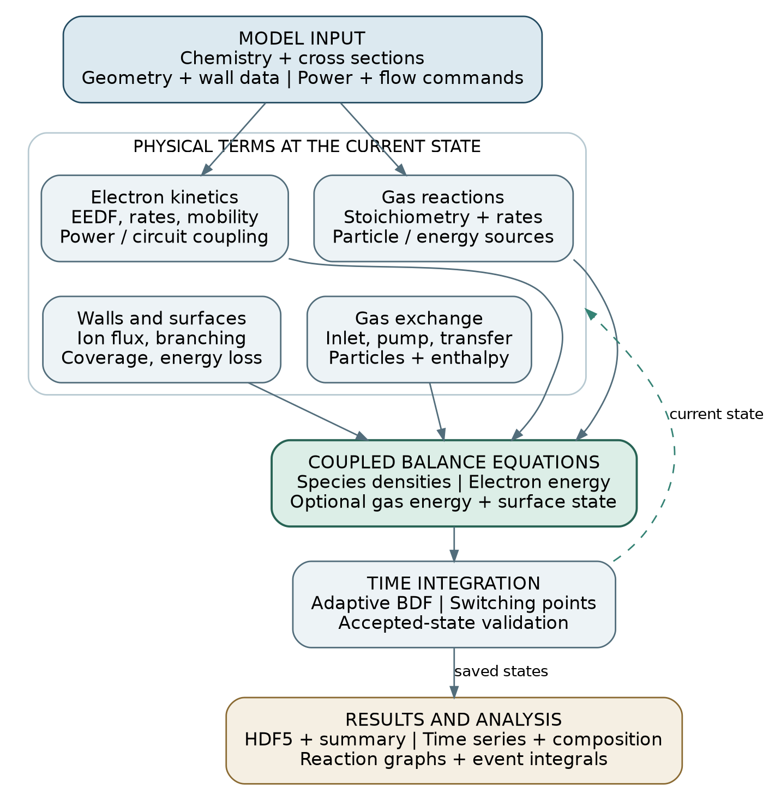

図1. 物理機能と数値・解析機能の関係。中央の収支への入力と、状態から各機能への戻りを区別した。
図中のstateは積分する状態、balance assemblyは各機能の寄与を合算する処理である。

| 機能 | 主な入力 | 計算する量と役割 |
|---|---|---|
| 化学反応 | 化学種、反応式、速度式、電子衝突データ | 反応進行速度、種の生成消滅、指定反応エネルギー |
| 電子状態・衝突係数 | 粒子密度、電子エネルギーまたは換算電場、分布の指定 | 電子密度・平均エネルギー、反応係数、移動度 |
| 電源・回路 | 吸収電力、電圧等の指令、回路定数、電子状態 | 電子・気体への電力、必要な換算電場、電流・電圧 |
| 壁輸送・表面反応 | 面積、壁温、入射束、反応分岐、表面被覆 | 気相の損失と戻り、壁へのエネルギー、被覆率変化 |
| 流入・排気・内部移送 | 粒子流量、排気速度、移送係数 | 粒子、電子エネルギー、重粒子エンタルピーの流出入 |
| 時間積分 | 初期状態、上記の収支、許容差、切替時刻 | 剛性ODEの解、採用ステップでの状態領域の確認 |
| 出力・解析 | 保存状態、選択した派生量・probe・図 | HDF5、収支内訳、CSV、組成・時系列図、反応図 |

### 2.2 積分する状態、代数的に求める量、外部指令

数値的に区別すべき量を表3に示す。電子密度と電子温度を、重粒子密度とは別の独立状態として
無条件に積分する構成ではない。どのエネルギーを解くかに応じて、状態の数が変わる。

| 分類 | 内容 | 本実装での扱い |
|---|---|---|
| 積分状態 | 重粒子種の数密度、電子エネルギー密度 | 電子エネルギーはenergy-balance方式でのみ積分 |
| 任意の積分状態 | 気体内部エネルギー、表面被覆率、指定した蓄積量 | 対応する機能を選んだときだけ追加 |
| 代数量 | 電子密度、電子温度、圧力、空サイト率、反応係数 | 現在の状態と選んだ近似から評価 |
| 外部指令 | 電力・電圧・流量等の時間変化 | 一定値、運転区間、波形・CSV等から評価 |
| 解析量 | 分率、反応頻度、積算反応数、電源量、収支内訳 | 保存状態に対して算出。ODE状態と同義ではない |

表3. 時間積分、物理関係式、入力、解析の責務。積算反応数の出力は保存点からの数値積分である。

重粒子とは、気相の原子・分子・イオンの総称であり、電子は含めない。
電子エネルギー分布（EEDF）は、個々の電子がどのエネルギーに分布するかを表す。
本稿でclosureと呼ぶのは、空間構造や分布など、直接解かない自由度に代わって必要量を決める関係式である。
壁への流束と電子分布の選択が代表例になる。

### 2.3 入力から結果までの計算手順

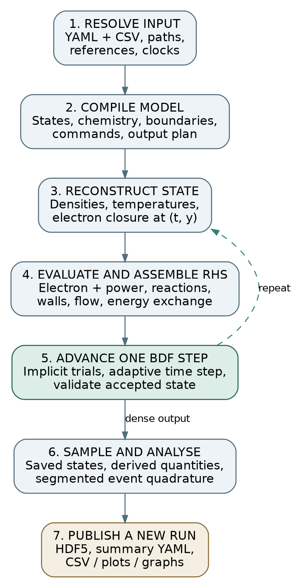

図2. 計算の流れ。反復するのは保存則の右辺評価と陰的時間積分であり、ファイル読込ではない。
保存時刻の選択と反応数の積算は、積分器の適応ステップとは別に扱う。

1. **入力の具体化。** 一つのcase YAMLから化学機構、寸法、運転、モデル、出力要求を読み、
   外部CSVのパス、参照ID、単位、時間原点を確定する。
2. **モデルの組立て。** 反応式と係数、初期状態、境界、電源、状態配置、運転切替、出力系列を準備する。
   電子係数表が必要な構成では、この段階で読み込むか準備する。
3. **現在状態の再構成。** 仮の時刻と状態から密度、温度、電子密度、被覆率等を求める。
   電源・回路と電子係数に相互依存があれば、この評価内で整合する値を求める。
4. **物理項の評価。** 気相反応、壁損失、表面反応、弾性エネルギー交換、流入出を同じ状態で評価し、
   粒子・エネルギー・表面状態の時間微分へまとめる。
5. **時間積分。** 後退差分公式（BDF）が上の評価を繰り返し、時間幅と次数を調整する。
   採用した状態を検査し、指令の不連続点では区間を分けて積分を再開する。
6. **保存と解析。** 指定時刻の状態を保存し、要求された派生量と収支を同じ物理評価から算出する。
   反応イベント数を区間別に積算する。
7. **結果の出力。** 数値結果、実効入力、来歴、要求された表・図を新しいrunへ保存する。

公開APIの`load_case`は入力の読込・検証、`simulate`は参照データの読込・組立て・積分・解析、
`write_result`は結果の保存を担当する。`simulate`だけでは結果ファイルを作らない。
CLIの`run`はこれらを順に実行する入口である。
保存結果から図を描き直す操作では、時間積分を再実行しない。

### 2.4 装置表現と近似の選択

通常は、一つの放電容積と、それに接する壁・基板、電源、流入出から構成する。
本実装では、この容積を`zone`、境界面を`surface`、電源の接続を`power_port`と呼ぶ。
放電部と処理部を分ける必要がある場合に限って容積を増やし、`edge`で移送を指定する。
これらは物理量の接続先を示す入力上の名称であり、電子係数や化学反応とは別の機能分類である。

選択の要点は、電子エネルギーを積分するか、現在の換算電場に従属させるか、
気体温度を既知とするか、内部エネルギーから求めるか、壁と表面のどの過程を残すかにある。
実験で既知の量を入力し、未知量を収支から求める構成にする。
必要な係数とその適用条件が揃わない機能を追加しても、予測の根拠は増えない。

第3-7節は、一つの容積に対する方程式を用い、区画添字を省く。
複数容積の接続は第8節で扱う。第9-11節では電源、数値解法、出力の意味を示し、
第12-14節で数値検証と適用上の解釈をまとめる。
第15節で本コードの到達点を総括し、第16節で検証の拡充と機能開発の順序を示す。

### 2.5 記号と単位

| 記号 | 単位 | 定義 |
|---|---|---|
| $n_s,\ n_e$ | m⁻³ | 重粒子種sと電子の数密度 |
| $V,\ A_b$ | m³, m² | 計算容積と境界面bの面積 |
| $R_r,\ r_r$ | m⁻³ s⁻¹, m⁻² s⁻¹ | 気相・表面反応の進行速度 |
| $k_r,\ \nu_{s,r}$ | 反応次数に依存, 1 | 速度係数と正味化学量論係数 |
| $T_g,\ \theta_e$ | K, eV | 気体温度とエネルギー単位の等価電子温度 |
| $\bar\varepsilon,\ W_e,\ U_g$ | eV, J m⁻³, J m⁻³ | 平均電子エネルギー、電子・気体内部エネルギー密度 |
| $\Gamma,\ C,\ S$ | m⁻² s⁻¹, m³ s⁻¹, m³ s⁻¹ | 粒子束、内部移送係数、排気速度 |
| $e,\ k_B,\ m_e,\ Z_s$ | C, J K⁻¹, kg, 1 | 素電荷の正値、Boltzmann定数、電子質量、電荷数 |

## 3. 連続の式から体積平均方程式へ

### 3.1 保存則と平均操作

種sの局所的な連続の式は、粒子数の時間変化、輸送、反応の釣り合いである。
粒子束をベクトルΓ、反応rの正味化学量論係数をνとする。

$$
\frac{\partial n_s}{\partial t}+\nabla\cdot\boldsymbol{\Gamma}_s=\sum_r\nu_{s,r}R_r. \tag{1}
$$

固定容積Vの平均密度を次で定義する。

$$
\bar n_s=\frac{1}{V}\int_V n_s\,dV. \tag{2}
$$

式(1)を積分し、発散定理を使うと次式を得る。法線は容積の外向きである。

$$
\frac{d\bar n_s}{dt}=\sum_r\nu_{s,r}\overline{R_r}-\frac{1}{V}\oint_{\partial V}\boldsymbol{\Gamma}_s\cdot\hat{\boldsymbol{n}}\,dA. \tag{3}
$$

ここまでの平均操作は厳密である。globalモデルの近似は、平均反応速度と境界流束を
少数の平均量から評価する段階で導入される。二体反応の例では、密度積の平均は次になる。

$$
\overline{n_a n_b}=\bar n_a\bar n_b+\overline{(n_a-\bar n_a)(n_b-\bar n_b)}. \tag{4}
$$

平均密度の積で反応を計算するときは、右辺最後の空間相関を省いている。
温度や電子分布に依存する速度係数にも空間相関があり得る。
したがって、容器平均の密度が合うだけでは平均反応速度の正しさは確定しない。
壁面への輸送と電子分布の関係式を、対象条件に照らして選ぶ必要がある。

### 3.2 各機能が加える生成消滅項

以後、nは平均密度を表す。本実装の重粒子方程式を、機能ごとの寄与で書けば次になる。

$$
\frac{dn_s}{dt}=\sum_r\nu_{s,r}R_r+S_s^{\mathrm{wall}}+S_s^{\mathrm{surf}}+S_s^{\mathrm{flow}}. \tag{5}
$$

右辺の単位はすべてm⁻³ s⁻¹である。
気相反応は容積内の反応速度、壁・表面反応は面反応速度に面積／体積比を掛けた寄与、
流入出は粒子流を体積で割った寄与になる。
この単位の統一が、異なる物理機能を一つの収支へ接続する基準となる。

## 4. 化学反応、保存量、初期状態

### 4.1 反応係数から粒子の生成消滅へ

反応物の係数をα、生成物をβとし、正味係数をν=β−αとする。
質量作用則で表す気相反応の進行速度は次式である。電子は重粒子の積と分けて記す。

$$
R_r=k_r(\mathcal{C})n_e^{\alpha_{e,r}}\prod_s n_s^{\alpha_{s,r}}. \tag{6}
$$

条件集合 $\mathcal{C}$ には電子平均エネルギー、気体温度、換算電場などが入る。
総反応次数をqとすると、kの単位はmの3(q−1)乗毎秒である。
一方、Rの単位は反応次数にかかわらずm⁻³ s⁻¹であり、V倍すると毎秒の反応イベント頻度になる。
特定種の生成速度は、さらにその種の正味係数νを掛けて求める。

例えば電子によるAr電離は、イベント一回でArを一個消費し、Ar⁺と電子を各一個増やす。
励起を電子エネルギー損失だけで表す機構では、励起粒子の密度を独立に追跡しない。
準安定状態の蓄積や段階電離が目的なら、その種と生成・失活反応を反応機構へ含める。

速度式として、一定係数、一次速度、Arrhenius型、一変数表、電子衝突断面積・電子係数表を選べる。
Arrhenius型では、振幅の基準温度を300 Kとする次式を使う。

$$
k(T_g)=A\left(\frac{T_g}{300\,\mathrm{K}}\right)^\beta\exp\left(-\frac{eE_a}{k_BT_g}\right). \tag{7}
$$

活性化エネルギー $E_a$の入力単位はeVである。
係数を移植するときは、この温度規格化、反応次数、単位、第三体や圧力依存の扱いを揃える。
入力表の欠落係数は、0や別の電子モデルで自動補完しない。

### 4.2 元素、電荷、表面サイトの保存

種sに含まれる元素aの原子数をbとする。閉じた気相反応には、元素と電荷の保存条件がある。
電子の正味生成係数を $\nu_{e,r}$と書く。

$$
\sum_s b_{a,s}\nu_{s,r}=0,\qquad \sum_s Z_s\nu_{s,r}-\nu_{e,r}=0. \tag{8}
$$

一つの閉じた容積では、密度を体積倍した粒子数で保存量を評価する。
壁・入口・排気を含む場合には、その交換先まで収支に含める。
特に、壁面での中性化では壁が電荷を受け取るため、気相だけに閉じた電荷収支を要求することはできない。
吸着種を含める場合は、元素数に加えて占有サイト数の収支も設定する。

### 4.3 電子密度と圧力の決定

標準構成では、電子密度を重粒子の正味電荷から準中性条件で求める。
気体圧力は電子を除く全重粒子の理想気体圧力として計算する。

$$
n_e=\sum_s Z_s n_s,\qquad p=k_BT_g\sum_s n_s. \tag{9}
$$

圧力の和にはイオンを含める。初期圧力・温度・モル分率を使う設定では、
全重粒子密度から荷電種の初期密度を引き、残りを中性組成へ配分する。
直接密度を指定する場合は、指定された圧力・温度との整合を確認する。
初期圧力の設定は、その後の圧力を一定にする制御ではない。

電子衝突だけで電離を開始する機構では、電子密度0からはその反応が進まない。
初期の荷電粒子密度を与えるか、外部生成過程を機構に含める。
数値を安定化するための微小密度を、入力にない粒子源として暗黙に足す構成にはしない。

準中性近似は、容器内部の電荷分離を小さいとみなして電子密度を決める関係である。
Poisson方程式を解かないため、シース内の電位・電荷分布は得られない。
容積内部での準中性、壁電流、負イオンの輸送を別々に評価する必要がある。
外部から電子密度の時系列を与える拡張を選ぶ場合は、電子密度と重粒子電荷の差を残差として扱う。

## 5. 電子分布と衝突係数

### 5.1 平均エネルギーと等価電子温度

エネルギーをeVで表し、電子一個を選んだときの確率密度をFとする。
本稿の分布関数は、密度を含む位相空間分布ではなく、次の規格化を満たすエネルギー確率密度である。

$$
\int_0^\infty F(\varepsilon)\,d\varepsilon=1,\qquad \bar\varepsilon=\int_0^\infty\varepsilon F(\varepsilon)\,d\varepsilon. \tag{10}
$$

等価電子温度 $\theta_e$ は、Kelvin温度との関係を $\theta_e=k_BT_e/e$、平均エネルギーとの関係を $\theta_e=2\bar\varepsilon/3$ とする。
非Maxwellian分布に対してもこの平均値を出力するが、分布全体が温度一個で決まることは仮定しない。
Maxwellianのエネルギー確率密度は次式である。

$$
F_M(\varepsilon;\theta_e)=\frac{2\sqrt{\varepsilon}}{\sqrt{\pi}\theta_e^{3/2}}\exp(-\varepsilon/\theta_e). \tag{11}
$$

平均エネルギー3 eVは等価電子温度2 eVに対応する。
一方、気体温度300 Kのエネルギー相当は約0.02585 eVである。
入力`mean_energy_eV`と出力`electron_temperature_eV`は、この換算を区別して読む。

### 5.2 衝突断面積から速度係数を求める

電子の速度と衝突断面積を、エネルギー分布にわたって平均すると速度係数を得る。
重粒子の熱速度を電子速度に対して無視する近似では、次式になる。

$$
k_r=\int_0^\infty\sigma_r(\varepsilon)\sqrt{\frac{2e\varepsilon}{m_e}}F(\varepsilon)\,d\varepsilon. \tag{12}
$$

Maxwellianを代入すれば、積分は次の形に整理できる。

$$
k_r(\theta_e)=\sqrt{\frac{8e}{\pi m_e}}\theta_e^{-3/2}\int\sigma_r(\varepsilon)\varepsilon e^{-\varepsilon/\theta_e}\,d\varepsilon. \tag{13}
$$

本実装は、収録断面積をエネルギーの区分線形関数とみなし、各区間を解析的に積分する。
途中に固定の速度係数表を作らないため、その表の補間誤差は加わらない。
元断面積の誤差、区分線形近似、分布の選択による誤差は残る。

一つの区間でσ=a+bεと書くと、必要な積分は次のモーメントで表せる。

$$
I_q(l,u)=\theta_e^{q+1}\left[\Gamma(q+1,l/\theta_e)-\Gamma(q+1,u/\theta_e)\right]. \tag{14}
$$

区間の寄与は $aI_1+bI_2$となる。Γは上側不完全gamma関数である。
実装では、狭い区間で近い原始関数を差し引く桁落ちを避けるため、
区間始点を移したモーメントと`expm1`を使う。

断面積の収録範囲外を外挿しない。終端エネルギーを $E_{\max}$とし、
Maxwellianのエネルギー重み付き裾比が10⁻⁶以下になることを確認する。
さらに、収録最大断面積を終端より上へ一定延長した仮定上の寄与が、
収録域積分の10⁻³以下であることを要求する。
後者は収録不足を検出するための条件であり、未知の実断面積の誤差限界ではない。

### 5.3 電子係数表と局所電場近似

外部表を用いる場合は、平均エネルギーまたは換算電場E/Nを軸として係数を線形補間する。
Nは中性気相粒子の総密度、換算電場の単位Tdは10⁻²¹ V m²である。
電子係数は、生成時の混合組成、衝突集合、分布の近似に依存する。
LXCatはこれらの基礎データを共有する基盤であり、個々のデータの適用条件は出典に従って判断する。[[3]](#ref-3)

局所電場方式（`local_field`）では、電子エネルギーを独立に積分せず、
現在のE/Nに対応する平均エネルギー・反応係数・移動度を使う。
電子エネルギー緩和が運転条件の変化に対して十分速いとみなす選択であり、
電源切替後の有限な緩和時間をこの方式だけで表すことはできない。

移動度μと換算移動度μNは異なる物理量として扱う。密度への換算は次式による。

$$
\mu(N)=\frac{(\mu N)_{\mathrm{table}}}{N}=\mu_{\mathrm{ref}}\frac{N_{\mathrm{ref}}}{N}. \tag{15}
$$

絶対移動度の表には基準密度を明示する。表範囲外の既定動作はエラーであり、
端値保持を明示しても、その範囲で係数が物理的に妥当だと確認されたことにはならない。
本パッケージの近似EEDF生成は、完全なBoltzmann計算とは異なる経験的な構成である。付録Aに式を示す。

## 6. 電子・気体のエネルギー収支

### 6.1 電子エネルギーを密度として積分する

energy-balance方式では、電子エネルギー密度 $W_e$を状態として積分する。
電子数が変化しても、その時刻の密度から平均エネルギーを求め直せる。

$$
W_e=en_e\bar\varepsilon=\frac{3}{2}en_e\theta_e. \tag{16}
$$

電子吸収電力、反応、壁面損失、弾性衝突、内部移送の寄与を合計する。
反応エネルギー項を $Q_{\mathrm{chem}}$と書く。

$$
\frac{dW_e}{dt}=\frac{P_e}{V}+Q_{\mathrm{chem}}-Q_{e,\mathrm{wall}}-Q_{eg}+S_e^E. \tag{17}
$$

$$
Q_{\mathrm{chem}}=e\sum_r\Delta\varepsilon_{e,r}R_r.
$$

電子へのエネルギー移送を正とする。例えば電離で15.76 eV失う反応には、
その損失に対応する負の移送量を与える。すべての項の単位はW m⁻³であり、
吸収電力 $P_e$の単位Wとは体積の係数だけ異なる。
温度自体を独立に積分しないため、電子数の変化による温度変化を別項として二重に加える必要はない。

### 6.2 電子と中性気体の弾性エネルギー交換

中性種jの運動量移行速度係数を $k_{m,j}$とすると、本実装の交換項は次式である。

$$
Q_{eg}=3en_e\left(\theta_e-\frac{k_BT_g}{e}\right)\sum_j\frac{m_e}{m_j}n_jk_{m,j}. \tag{18}
$$

電子が気体より高温ならQegは正であり、電子から引いた同じ値を気体へ加える。
温度関係が逆になれば符号も反転する。これは電子と気体の内部交換である。
一方、反応に使われたエネルギーがすべて直ちに並進熱へ戻るとは限らないため、
反応・励起・表面からの加熱量は機構の指定に従う。
運動量移行データのない中性種については交換を省略して警告し、別の係数を推定して埋めない。

### 6.3 気体温度固定と内部エネルギー方式

既定の固定気体温度は、外部環境が温度を保つ近似に相当する。
気体の加熱・冷却を解く場合は、各種の定積熱容量 $c_{v,s}$を与え、内部エネルギー密度を積分する。

$$
U_g=T_g\sum_s c_{v,s}n_s,\qquad T_g=\frac{U_g}{\sum_s c_{v,s}n_s}. \tag{19a}
$$

気体へ与える電力、反応・表面からの指定加熱、式(18)、壁熱交換、粒子の流出入を含める。
加熱・熱交換をまとめた体積項を $Q_g$、流れによる項を $S_g^{\mathrm{flow}}$、
壁・表面との粒子交換に伴う項を $S_g^{\mathrm{part}}$ とすると、
内部エネルギーの収支は次になる。

$$
\frac{dU_g}{dt}=Q_g+S_g^{\mathrm{flow}}+S_g^{\mathrm{part}}. \tag{19b}
$$

$$
Q_g=\frac{P_g}{V}+Q_{g,\mathrm{chem}}+Q_{g,\mathrm{surf}}+Q_{eg}+Q_{g,\mathrm{wall}}.
$$

$Q_{g,\mathrm{chem}}$ と $Q_{g,\mathrm{surf}}$ は、各反応から気体へ渡ると指定した熱である。
壁との熱交換は、周波数 $\nu_{\mathrm{th}}$で壁温に対応する内部エネルギーへ緩和する形で与える。

$$
Q_{g,\mathrm{wall}}=-\nu_{\mathrm{th}}\left[U_g-T_w\sum_s c_{v,s}n_s\right]. \tag{20}
$$

開いた固定容積を通る流れには、内部エネルギーに加えて流動仕事がある。
エンタルピー密度 $H_g$と、入口から種sが持ち込むエネルギー流は次になる。

$$
H_g=U_g+p,\qquad \dot E_{\mathrm{in},s}=\dot N_s(c_{v,s}+k_B)T_{\mathrm{in}}. \tag{21}
$$

壁・表面との粒子交換には、現在温度での種の内部エネルギーを対応させる。
熱容量や反応熱を省略した場合に、その値が材料名や種名から自動推定されることはない。
気体加熱が解離率、密度、壁反応を変える条件では、熱収支と化学反応の両方を検討する。

## 7. 壁面輸送と表面化学

### 7.1 平均密度からイオン入射束へ

イオンの壁損失は、放電中の粒子寿命と電子エネルギー損失を結ぶ。
冷イオン近似でのBohm速度と、境界面bへの入射束を次で表す。

$$
u_{B,i}=\sqrt{\frac{Z_ie\theta_e}{m_i}},\qquad \Gamma_{i,b}=h_{i,b}n_i u_{B,i}. \tag{22}
$$

hはシース端密度と容積平均密度の比である。
数値を指定した場合、その値へ別の0.61係数を暗黙に掛けない。
自動指定では、中性密度Nに対する次の近似を使う。

$$
h_i=\operatorname{clip}\left(\frac{0.86}{\sqrt{3+LN\sigma_{in}/2}},h_{\min},h_{\max}\right). \tag{23}
$$

特性長Lを省略した場合、その境界面についてV/Aを使う。
従って面積を変えると、収支のA/Vだけでなく、Lを介してhも変わる。
これは境界輸送の近似であり、装置形状から密度分布を解いた結果ではない。
電気陰性度、多イオン、イオン温度、衝突性が変わる場合には、対応する境界輸送の評価が必要になる。

### 7.2 壁面中性化とシースのエネルギー損失

入射イオン一個あたりの分岐確率を $p_{b,j}$とすると、分岐jの面イベント速度は $p_{b,j}\Gamma_i$である。
各入射種について確率和を1とし、戻る中性粒子などを境界反応式で定義する。
この同じイベントから、入射損失と生成物の戻りを計算する。

標準的な単一一価正イオンの構成では、電子の熱束とイオン電流が浮遊壁で釣り合う条件から、
電子のシース障壁エネルギーを求める。

$$
\Gamma_{e,\mathrm{th}}=n_e\sqrt{\frac{e\theta_e}{2\pi m_e}},\qquad \varepsilon_{\mathrm{sh}}=\theta_e\ln\frac{\Gamma_{e,\mathrm{th}}}{\sum_i Z_i\Gamma_i}. \tag{24}
$$

壁へ向かう電子エネルギーの損失は、実際のイオン入射束を使って評価する。

$$
Q_{e,\mathrm{wall}}=e\sum_b\frac{A_b}{V}\sum_i\Gamma_{i,b}(2Z_i\theta_e+\varepsilon_{\mathrm{sh},b}). \tag{25}
$$

式(24)に非負解がなければ、その条件での評価を失敗とする。
冷イオンBohm近似には、電子温度がイオン温度に対して十分高いという前提がある。
電源停止後に電子が冷えた領域まで同じ式を使う場合、この前提の成立を再確認する。
CCPの平均シース診断と、ここで使う壁エネルギー収支は別の計算である。

### 7.3 吸着、脱離、イオン支援反応

表面化学を解く場合は、表面種の面密度をサイト密度 $N_{\mathrm{site}}$で割った被覆率 $\theta_j$を状態とする。
一粒子の占有サイト数を $a_j$とすると、空サイト率と被覆率の収支は次になる。

$$
\theta_*=1-\sum_j a_j\theta_j,\qquad \frac{d\theta_j}{dt}=\frac{1}{N_{\mathrm{site}}}\sum_r\nu^{\mathrm{surf}}_{j,r}r_r. \tag{26}
$$

面反応速度rの単位はm⁻² s⁻¹であり、気相の密度変化へ接続するときにA/Vを掛ける。
付着確率sを使う中性粒子の吸着は、熱入射束と被覆率因子gを用いて表す。

$$
r_{\mathrm{stick}}=s\frac{n_g}{4}\sqrt{\frac{8k_BT_g}{\pi m_g}}\,g(\boldsymbol{\theta}). \tag{27}
$$

イオン支援反応は、入射束、エネルギー依存収率、被覆率因子の積で表す。

$$
r_{\mathrm{ion}}=\Gamma_iY_0\left(\frac{\varepsilon_i-E_{\mathrm{th}}}{E_{\mathrm{ref}}-E_{\mathrm{th}}}\right)^b g(\boldsymbol{\theta}),\quad \varepsilon_i>E_{\mathrm{th}}. \tag{28a}
$$

閾値以下の収率は0とする。熱脱離とLangmuir-Hinshelwood型の表面反応には次の形を使う。

$$
r_{\mathrm{des}}=\nu_{\mathrm{des}}N_{\mathrm{site}}e^{-eE_a/(k_BT_s)}g(\boldsymbol{\theta}). \tag{28b}
$$

$$
r_{\mathrm{LH}}=A_{\mathrm{LH}}N_{\mathrm{site}}^2e^{-eE_a/(k_BT_s)}g(\boldsymbol{\theta}). \tag{28c}
$$

$T_s$ は表面温度、$\nu_{\mathrm{des}}$ の単位はs⁻¹、$A_{\mathrm{LH}}$ の単位はm² s⁻¹である。
gには反応物被覆率の質量作用因子と、明示した追加の被覆率因子が入る。
本実装のLH型の密度規格化はサイト密度の二乗であり、この定義に合う係数を用意する。
係数、面積、サイト密度、表面温度は使用する機構と装置条件から与える。
空サイトを独立に積分しないため、サイト収支に冗長な状態は加わらない。
膜厚や壁への蓄積は、宣言した反応から積算する拡張として付録Bに示す。

## 8. 原料供給、排気、複数容積の接続

### 8.1 流量と滞留の表現

入口に指定するsccmは、基準状態101325 Pa・273.15 Kでの体積流量である。
装置内の実体積流量とは異なり、粒子流へ換算して収支へ加える。

$$
\dot N_{\mathrm{in},s}=4.477962\times10^{17}Q_s,\qquad S_{\mathrm{in},s}=\frac{\dot N_{\mathrm{in},s}}{V}. \tag{29}
$$

排気速度Sの損失項は $-Sn_s/V$となる。反応・温度変化を無視した目安では、排気の時間尺度はV/Sである。
供給と排気による滞留は、反応生成物が再衝突や表面反応を受ける時間を変える。
運転中の圧力は、これらの収支から得た密度と温度を使って計算する。

### 8.2 放電部と処理部を分ける場合

異なる容積を接続する場合、初めて容積の添字a、bを導入する。
本実装の方向付き移送は、上流aの密度に係数 $C_{ab}$を掛けて粒子流とする。

$$
\left.\frac{dn_{a,s}}{dt}\right|_{ab}=-\frac{C_{ab}}{V_a}n_{a,s},\qquad \left.\frac{dn_{b,s}}{dt}\right|_{ab}=+\frac{C_{ab}}{V_b}n_{a,s}. \tag{30}
$$

移動する粒子数は両側で同じである。電子・気体エネルギーを解く構成では、
対応する電子エネルギー密度と重粒子エンタルピーも移送する。
閉じた内部移送では、各密度を体積倍して足した全粒子数と移送エネルギーが保存される。
容積が異なる場合に密度だけを単純加算すると、この収支を誤る。

式(30)は、密度差・圧力差・距離から流量を解く式ではない。
逆向きの移送には別の接続が必要である。
複数の容積を空間順に並べれば、生成域と反応・処理域を分ける区画モデルを作れる。
連続的な一次元移流拡散の近似として使う場合は、係数と分割の根拠、境界条件、分割収束を使用者が検討する。

## 9. 吸収電力、電源、回路

### 9.1 既知の吸収電力を与える

最も直接的な構成は、測定・推定した吸収電力Pを与え、
電子と気体へ向かう割合 $f_e$、$f_g$を指定する方法である。両者の和を1とする。
電源装置の設定値、整合器を通った電力、プラズマの吸収電力は区別して入力する。
電子収支へ入るのは、電子が実際に受け取る電力である。

### 9.2 直流直列回路と電子伝導

電子移動度から伝導率とプラズマのバルク抵抗を求め、直列抵抗Rbを含む回路を計算する。
Lは電極間の有効長、Aは電流断面積である。

$$
\sigma_p=en_e\mu_e,\qquad R_p=\frac{L}{\sigma_p A},\qquad I=\frac{V_s}{R_b+R_p}. \tag{31}
$$

電圧降下、電子への吸収電力、換算電場は次になる。

$$
V_p=IR_p,\qquad P_e=f_{\mathrm{abs}}I^2R_p,\qquad \frac{E}{N}=\frac{|V_p|}{LN}. \tag{32}
$$

移動度がE/Nに依存する局所電場方式では、回路と電子係数を連立して評価する。
電子密度0は開回路極限となり、電流と吸収電力を0とする。
この近似は電子ドリフトによるバルク伝導を扱い、電極シースの局所的な電流電圧特性は解かない。

外部CSVは、電子電力、総吸収電力、または電圧と電流の時系列を受け付ける。
電圧と電流の列では、それぞれを補間した後で積を取る。
直接の電力列を併記した場合は、その列を優先する。
交流の実効値電圧と実効値電流だけでは位相を含む実電力を特定できないため、入力する列の物理量を確認する。

### 9.3 RF包絡・CCP・ICPの近似

RF包絡モデルは、結合効率と有効抵抗から吸収電力を求める。
周波数が入力されても、電磁場やシース運動をRF一周期ごとに解く構成ではない。
パルス包絡や平均電力との関係を近似する機能として使う。

CCPモデルは、抵抗性バルクと無損失のシース容量を組み合わせた集中定数回路である。

$$
|Z|=\sqrt{R_p^2+X_s^2},\qquad X_s=\frac{1}{\omega C_p}+\frac{1}{\omega C_g},\qquad P_{\mathrm{abs}}=I_{\mathrm{rms}}^2R_p. \tag{33}
$$

電圧と電流の実効値の積は皮相電力VAであり、電子収支に加える実電力とは異なる。
シース厚さ、面積非対称からの自己バイアス、平均イオンエネルギーは簡略化した診断値である。
それらを用いたイオンエネルギー分布や、標準壁収支への自己無撞着な結合は含まれない。

ICPモデルは、密度・圧力・周波数に依存する経験的な結合効率から吸収電力を与える。
E/H指標は滑らかな経験式であり、電磁場からモード遷移を導いた結果ではない。
これらの電源機能はexperimental分類に属し、付録Bの式と対象装置のデータを照合して使う。

## 10. 時間積分と数値上の近似

### 10.1 剛性と状態量の規格化

反応機構には速い衝突と遅い滞留・表面応答が共存する。
そのため、最も速い時間尺度で全期間を刻む陽解法では非効率になることがある。
本実装はSciPyのBDFを用い、陰的反復で次の状態を求める。
可変次数1-5のBDF/NDF法と疎なJacobian構造を使う。[[5]](#ref-5)
NDFを含む手法の背景はShampine・Reicheltに説明されている。[[6]](#ref-6)

単位・桁が異なる状態を同じ許容差で扱うため、成分ごとの固定尺度 $s_j$で規格化する。

$$
\hat y_j=\frac{y_j}{s_j},\qquad \frac{d\hat y_j}{dt}=\frac{f_j(t,\boldsymbol{y})}{s_j}. \tag{34}
$$

既定の相対許容差は10⁻⁶、無次元状態への絶対許容差は10⁻¹⁴である。
後者を、そのまま密度に対する10⁻¹⁴ m⁻³の指定と解釈しない。
許容差が制御するのは局所数値誤差であり、全時刻の誤差や係数・物理近似の誤差を保証しない。

### 10.2 運転切替、状態領域、保存時刻

電源ステップ、パルス、previous補間の切替点で区間を分け、BDFを再開する。
Newton反復の試行点では、境界へ連続化した評価用状態を使う。
これは試行時の物理項評価のための処理であり、積分器の状態を毎回書き換える操作ではない。
採用したすべてのステップで、密度・エネルギーの非負性や表面占有を確認する。

保存時刻は、積分器の適応ステップと独立に選べる。
指定時刻の状態は直前ステップの連続補間から求めるため、
保存点を増やすこととODE解の許容差を厳しくすることは別の操作である。
切替時刻に保存する電力等は切替前の左側値を使い、
反応数の積算では区間ごとに適切な片側値を評価する。

## 11. 出力と解析で比較する物理量

### 11.1 状態、分率、生成消滅、probe

保存状態は、重粒子密度と選択したエネルギー・表面状態である。
重粒子のモル分率と分圧は次で定義する。

$$
x_s=\frac{n_s}{\sum_j n_j},\qquad p_s=n_sk_BT_g. \tag{35}
$$

分率の分母は、電子を除く全重粒子種であり、イオンと図に選ばない種も含む。
選択種だけで100%に再規格化しないため、異なる図の値を同じ基準で比較できる。
`net_production_m3_s`は気相反応だけでなく、式(5)全体の正味生成消滅速度である。

名前付きprobeは、既存の平均密度、表面束、電源量等を選んで名前を付ける機能である。
空間の一点を新しく解く機能ではない。
局所計測、線積分、発光強度、Langmuir probeの電流と比較するときは、
測定が重み付けする領域と応答を別途定義する。

### 11.2 反応頻度と累積イベント数

反応rが容器全体で単位時間に何回進むかは、気相では体積、表面では面積を掛けて求める。

$$
\dot\Xi_r=VR_r\quad(\mathrm{gas}),\qquad \dot\Xi_r=Ar_r\quad(\mathrm{surface}). \tag{36}
$$

累積数は、保存点における反応頻度を区間別に台形積分して求める。

$$
\Xi_r(t_k)\simeq\sum_{j<k}\frac{t_{j+1}-t_j}{2}\left[\dot\Xi_r(t_j)+\dot\Xi_r(t_{j+1})\right]. \tag{37}
$$

ここでΞは決定論的な連続量の推定であり、Monte Carloで発生した整数イベント数ではない。
独立ODEとして積分した状態でもないため、保存間隔に対する収束を確認して使う。
特定種の生成消滅に換算する場合は、各反応の化学量論係数を掛け合わせる。

### 11.3 組成図と反応ネットワーク

時系列・組成図は、異なる単位を別パネルへ分け、運転切替とともに状態変化を示す。
反応図はGraphvizにより化学種と反応を別ノードで描き、
反応物から反応へ、反応から生成物へ有向辺を引く。[[7]](#ref-7)
イベント頻度や積算数を重みにすれば、どの反応が多く進んだかを調べられる。

この図が表すのは化学種と宣言反応の参加関係である。
同じ元素が複数の生成物へ分配される場合の原子追跡や、
入口・排気・内部輸送・壁電荷を含む全装置収支は別に評価する。
密度の波形、生成消滅の内訳、エネルギー収支を併せて読むことで、
反応数の大きさと、関心量を律速する反応の違いを検討できる。

<a id="verification"></a>

## 12. 検証方法と再現条件

### 12.1 検証の階層

ここでいうverificationは、選んだ方程式を実装・積分できているかの確認である。
validationは、対象装置の観測量を所定の精度で予測できるかの確認である。
解析解や別コードとの一致は前者の根拠になるが、後者の代わりにはならない。

Turnerらのプラズマbenchmarkは、物理条件と数値条件を固定し、独立コード間の比較と残存する数値誤差を
明示する構成を採る。[[15]](#ref-15) 本稿でも、解析解、保存参照、より細かい数値解を区別する。
ただし、本稿の保存参照との回帰は、同論文のように複数コードを独立実行して統計的な一致を調べたものではない。
LoKI-GMの解説は、保存式、電子・化学・表面の役割、数値フロー、用途別の計算例を結び付けて説明している。[[16]](#ref-16)
本稿でも機能名だけでなく、既知量・未知量・近似を各検証条件へ対応付ける。両コードのclosureや解法が同一であることは仮定しない。

| 検証 | 比較対象 | 読み取れること |
|---|---|---|
| 断面積積分 | 解析式・独立数値求積 | 積分実装の正確さ |
| 一次反応・2区画移送 | 独立に導いた時間解 | ODE・体積係数・粒子保存 |
| 別コード由来case | 保存済み数値出力 | 限定した条件の回帰一致 |
| 許容差・保存間隔の収束 | より細かい数値解 | 数値設定への依存 |
| 入力感度 | 明示した条件差 | その条件近傍で結果を変える因子 |
| 独立実験 | 観測領域・入力を揃えた測定 | 装置予測の妥当性。今回は未実施 |

### 12.2 実行条件と誤差の定義

19ケースはWSL/Linux x86_64、Python 3.12.3、NumPy 2.5.4、SciPy 1.18.1、h5py 3.16.0、
Pydantic 2.14.1、PyYAML 6.0.3で実行した。図はMatplotlib 3.11.2を使う。
個々のrunはHDF5に実効入力、入力checksum、コードhash、依存version、終了状態を持つ。
数値表の正本は `benchmarks/theory/results.json`、再計算入口は `tools.benchmarks.theory` である。
数値記録は各runの入力YAMLと開始・終端時刻を示し、入力・参照・比較実行器の一覧と集約hash、
Python実装と依存lockのhashを保持する。実行条件は配布するcase YAMLから読み、実行器内では書き換えない。
測定した時間は設定解決後のcompileとsimulateで、図の作成・結果保存は含まない。
同一ホストでの単発測定であり、他のソルバーに対する速度優位性は評価していない。
計算時間はホスト負荷とキャッシュ状態にも左右される参考値である。

スカラーの相対差と、波形全体の規格化最大差を区別する。

$$
\delta_q=\frac{|q-q_{\mathrm{ref}}|}{|q_{\mathrm{ref}}|},\qquad E_q=\frac{\max_t|q(t)-q_{\mathrm{ref}}(t)|}{\max_t|q_{\mathrm{ref}}(t)|}. \tag{38}
$$

Eは各時刻の相対差の最大とは異なる。参照解を細かくしただけの場合、その解自体の誤差がゼロになったと
解釈しない。以下の表は表示桁を丸めるが、再計算用JSONは丸めない。

### 12.3 問題群と検証対象の対応

| 問題群 | 条件数・run数 | 比較対象と確認する内容 |
|---|---|---|
| Maxwellian係数 | 一定断面積16条件、Ar電離7条件。ODEなし | 解析式・独立求積。与えた断面積と分布の積分 |
| 一次反応 | 1 run | 指数減衰解。時間尺度と数値誤差 |
| 2容積移送 | 1 run | 密度の解析解と全粒子数。体積比と交換の保存 |
| CRANEの2反応Ar | 1 run | SIへ換算した保存終端値。固定係数の気相化学 |
| ZDPlaskin由来DC | 1 run | 保存種密度・回路量。係数表と回路の接続 |
| 低圧Ar・許容差 | 3 run | 同一保存時刻でのより厳しい数値解。ODE許容差依存 |
| イベント保存間隔 | 6 run | 1.25 μs保存を参照。反応頻度の事後積分 |
| 電力・圧力・壁面積感度 | 6 run | 基準Arに対する各±10%。条件変更時の応答 |

合計19 runは、同じ物理問題の数値設定変更・感度条件も含む。
19種類の装置や反応ガスを検証したという数ではない。第13節では、この表の順に問題設定と結果を示す。
各runの `case_yaml` と `result_h5` はJSONに記録し、図・表から入力まで戻れるようにしている。

<a id="benchmarks"></a>

## 13. ベンチマークの問題設定と結果

各節では、検証する関係式、取り除いた物理、比較する量を先に定める。
図の実線・記号が本コード、解析解、保存参照のどれを表すかは図ごとに示す。
同じ断面積・同じ保存出力に由来する二つのデータを、独立した物性検証とは数えない。

### 13.1 Maxwellian速度係数: 断面積積分を確認する

**問題設定。** 電子衝突反応の係数は、断面積と電子分布を積分して得る。
まず一定断面積σ₀=2×10⁻²⁰ m²を閾値 $E_0$ から $E_{\max}=200$ eVまで与え、
その外側の断面積を0とする人工的な問題を使う。式(13)を直接積分すると、次の解析式になる。

$$
k=\sigma_0\sqrt{\frac{8e\theta_e}{\pi m_e}}\left[(1+a)e^{-a}-(1+b)e^{-b}\right],\quad a=E_0/\theta_e,\quad b=E_{\max}/\theta_e. \tag{39}
$$

ここで$\theta_e$はeVで表した等価電子温度で、平均エネルギーの2/3である。
閾値0／2 eVと平均エネルギー0.5、1、1.5、2、3、5、8、10 eVの組合せ16条件を比較する。
次に、同梱Ar電離断面積の区分線形曲線をSciPyの `quad` で独立に数値積分し、
平均エネルギー0.5、1、1.5、2、3、5、8 eVの7条件を比較する。断面積の出典はZenodo収録資産である。[[8]](#ref-8)
この試験は係数評価のみで、反応器のODEを時間積分する19ケースには含めない。

**比較方法と結果。** 区間積分の実装値と解析式、または独立数値求積値との相対差δを式(38)で求める。
一定断面積では閉形式との一致、Ar曲線では閾値と断面積の節点を含む積分の一致を確認する。

| 比較 | 条件数 | 最大相対差 |
|---|---:|---:|
| 一定断面積と式(39) | 16 | 1.90×10⁻¹⁶ |
| Ar電離断面積と独立数値求積 | 7 | 1.33×10⁻¹⁵ |

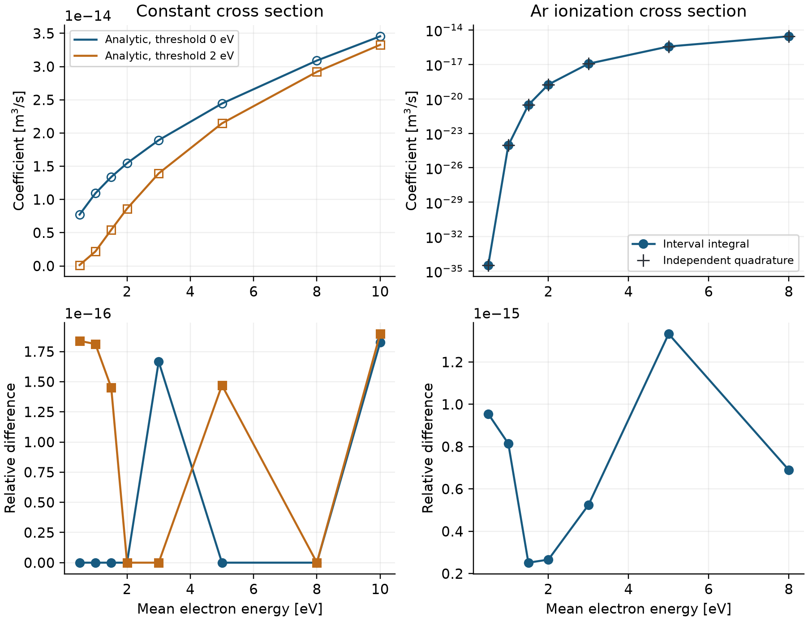

図3. 上段は速度係数、下段は対応する相対差。左列は一定断面積の解析式、右列はAr電離曲線の数値求積との比較。
左上の線は解析値、白抜き記号は実装値で、一致して重なる点も示した。
下段の差は浮動小数点の丸めの程度であり、物性データの不確かさを表さない。

**解釈。** 閾値を持つ断面積では、平均エネルギーが低いときに衝突可能な電子の割合が小さく、
電離係数が急速に減少する。この傾向と積分値を同時に確認できる。
一方、同じMaxwellian分布・同じ断面積曲線を使う比較なので、実放電のEEDFや元断面積の正しさは検証していない。

### 13.2 一次反応: 既知の減衰解を再現する

**問題設定。** `benchmarks/analytic-decay` は、励起種Ar*が一次反応でArへ戻る人工的な系である。
壁、供給、排気、電源を置かず、反応係数をλ=25 s⁻¹に固定する。
初期圧力1 Pa、気体温度300 K、体積0.01 m³とし、荷電seedを除いた中性粒子のモル分率をAr=0.7、Ar*=0.3とする。
Ar⁺のseedは1×10¹² m⁻³で、準中性から電子密度を与える。電子衝突・壁・熱連成の検証を加えた問題ではない。

時定数は1/λ=0.04 sで、0〜0.2 s、すなわち5時定数を計算する。
既定rtol=10⁻⁶、atol=10⁻¹⁴、保存間隔0.002 sで101点を保存する。

**比較方法。** 各保存時刻のAr*密度を $n_*(0)\exp(-\lambda t)$ と比較する。
誤差は各時刻で解析密度を分母にした相対差の最大である。
式(38)の波形最大値で規格化するEとは分母が異なり、終端の低い密度における誤差も評価する。

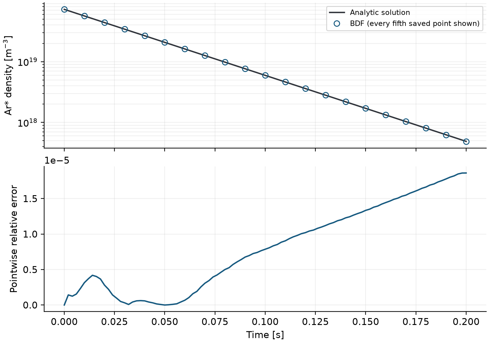

図4. 上段は解析解と計算値、下段は全101保存点の相対誤差。上段の記号だけは読みやすさのため5保存点おきに表示した。
対数縦軸で直線状になる減衰と、減衰に伴って蓄積する数値差を分けて確認する。

| 比較量 | 結果 |
|---|---:|
| 解析解の終端比 $n_*(0.2)/n_*(0)$ | 6.73795×10⁻³ |
| 各保存時刻の最大相対差 | 1.86×10⁻⁵ |
| RHS評価回数／LU分解回数 | 122／14 |

**解釈。** 一次反応の時間尺度と減衰量が既知解に従うことを確認できる。
局所誤差を制御するrtolを10⁻⁶としたことは、全時刻の相対差を10⁻⁶以下に保証する意味ではない。
この例は、実際の反応係数が未知の場合にも正しい減衰が得られるという物性検証にはならない。

### 13.3 異なる体積間の移送: 密度と粒子数を区別する

**問題設定。** `benchmarks/analytic-transport` は、反応・壁・外部への流入出がない2容積の系である。
sourceからtargetへのedgeを一つ置き、上流密度に比例する粒子移送を与える。

| 条件 | source | target |
|---|---:|---:|
| 体積 [m³] | 0.01 | 0.03 |
| 初期圧力 [Pa] | 1.0 | 0.25 |
| 気体温度 [K] | 300 | 300 |
| Ar⁺ seed [m⁻³] | 1×10¹² | 1×10¹² |

残りをArとし、圧力と温度から中性密度を求める。
edge係数C=0.02 m³/s、計算期間0.5 s、保存間隔0.005 s、既定rtol=10⁻⁶、atol=10⁻¹⁴とする。
移送の時定数Vₐ/Cは0.5 sであり、この区間は上流が初期値の約1/eへ減るまでに対応する。

**比較方法。** 式(30)の解析解は次のとおりである。

$$
n_a(t)=n_{a0}e^{-Ct/V_a},\qquad n_b(t)=n_{b0}+\frac{V_a}{V_b}n_{a0}(1-e^{-Ct/V_a}). \tag{40}
$$

各密度の時刻別相対差と、両区画の中性Ar粒子数 $N=V_a n_a+V_b n_b$ の初期値からの相対変化を別々に求める。
下流へ加える粒子数は上流から取る数と同じでも、密度の増減幅は体積比で異なる。

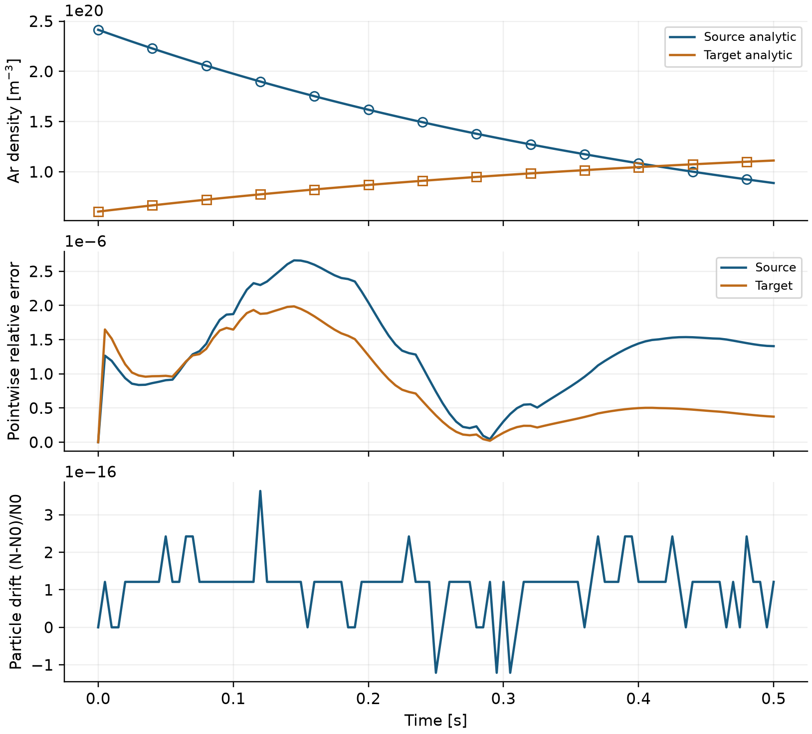

図5. 上段は両区画の密度、中央は式(40)との差、下段は体積積分した粒子数の変化。
上段の線は解析解、記号は8保存点おきの計算値。誤差と保存の評価には全101保存点を用いる。

| 比較量 | 最大誤差 |
|---|---:|
| 上流密度の時刻別相対差 | 2.66×10⁻⁶ |
| 下流密度の時刻別相対差 | 1.99×10⁻⁶ |
| 中性Ar粒子数の相対変化 | 3.64×10⁻¹⁶ |

**解釈。** 各密度には時間積分誤差がある一方、交換される粒子数は丸めの程度で保存する。
密度誤差と保存誤差は異なる性質であり、一方が小さいだけでは他方を確認したことにならない。
このedgeは圧力差流れや拡散を解かないため、1次元輸送方程式の検証としては用いない。

### 13.4 CRANEの2反応Ar: 固定係数の気相化学を比較する

**問題設定。** CRANEはMOOSE上の化学反応ソルバーである。[[9]](#ref-9)
ここでは公開チュートリアルの保存参照を使い、電離と三体再結合だけを比較する。[[10]](#ref-10)
同梱caseは `crane_two_reaction_argon` で、輸送・壁・外部電源を持たない。

| 条件 | 値 |
|---|---:|
| 初期Ar密度 [m⁻³] | 2.5×10²⁵ |
| 初期Ar⁺密度＝電子密度 [m⁻³] | 1×10⁶ |
| 電離係数$k_i$ [m³/s] | 2.1736169000623×10⁻¹⁸ |
| 三体再結合係数$k_r$ [m⁶/s] | 1×10⁻³⁷ |
| 終端時刻／保存点数 | 0.75 μs／200 |
| rtol／atol | 10⁻⁸／10⁻¹⁴ |
| 最大積分step幅 | 1 ns |

準中性 $n_e=n_i$ のとき、イオンの収支は次であり、正の定常解は $n_i=k_i/k_r$ となる。

$$
\frac{dn_i}{dt}=n_{\mathrm{Ar}}n_i(k_i-k_r n_i),\qquad n_{i,\mathrm{eq}}=k_i/k_r. \tag{40a}
$$

**比較方法と結果。** 本コードの終端密度を、cm基準からSIへ換算した保存済みCRANE終端値と比較する。
本リポジトリが比較値として固定しているのは終端の記録であり、CRANEの全時間波形との誤差を評価したわけではない。

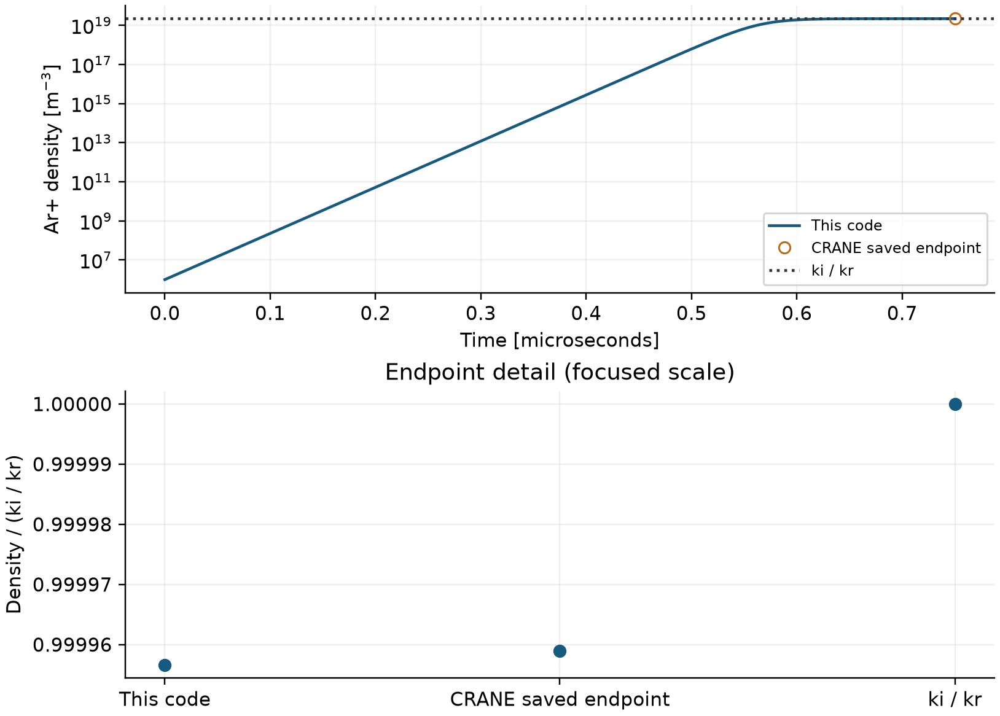

図6. 上段の曲線は本コードの時間発展、丸印はCRANEの保存終端値、点線は式(40a)の定常密度。
下段は終端値を$k_i/k_r$で規格化して拡大した点比較で、縦軸は0始まりではない。
終端値同士の一致と、無限時間の定常値への接近を混同しない。

| 量 | 本コード | 保存済みCRANE出力 |
|---|---:|---:|
| 最終Ar⁺密度 [m⁻³] | 2.17352259×10¹⁹ | 2.17352774×10¹⁹ |
| 相対差 | 2.37×10⁻⁶ | - |

**解釈。** 密度は電離で増加し、再結合と釣り合う約2.17362×10¹⁹ m⁻³へ近づく。
終端の相対差は既存回帰許容差5×10⁻⁴以内で、固定係数の気相化学の接続を確認できた。
参照チュートリアルの室温と本caseの300 Kは同一ではないが、比較する密度と固定係数を揃えている。
温度依存係数、電子エネルギー、低圧の壁損失を検証する条件ではない。

<a id="zdplaskin-benchmark"></a>

### 13.5 ZDPlaskin由来の化学・DC回路: 係数と電源を接続する

**問題設定。** `zdplaskin_example2` は、保存済みexample2を出典とする反応係数CSVと直列回路を使う。[[11]](#ref-11)
Ar、Ar*、Ar⁺、Ar₂⁺の密度を積分し、電子密度は準中性、電子状態はlocal-fieldで決める。
電子エネルギー収支を同時に積分する例ではない。

| 条件 | 本コードで与える値 |
|---|---|
| 圧力・気体温度 | 13332.23684 Pa（約100 Torr）、300 K |
| 体積／壁面積 | 2.010619298×10⁻⁷ m³／2.010619298×10⁻⁴ m² |
| 電極間隔／電極半径 | 0.004 m／0.004 m |
| 電源電圧／直列抵抗 | 1000 V／100 kΩ |
| 壁輸送 | 指定損失頻度3230 s⁻¹ |
| 初期荷電seed | Ar⁺、Ar₂⁺それぞれ1×10¹² m⁻³。従って初期$n_e$は2×10¹² m⁻³ |
| 終端・保存点数 | 0.7520833 ms・151点 |
| rtol／atol、最大step幅 | 3×10⁻⁶／10⁻¹⁴、1 μs |

保存参照の条件欄には初期電子密度1×10¹² m⁻³が記録されており、本caseの準中性から求める初期値とは異なる。
立上りの波形比較にはこの初期条件差も残る。初期状態まで一致させた独立コード比較とは扱わない。
また100 Torrは低圧Ar過渡例とは異なる圧力域であり、両者の近似を一括して検証したことにはならない。

**比較方法。** case、参照summary、参照回路CSVの終端時刻の一致を確認し、
最終種密度、保存点での最大電子密度、最終電圧・電流・E/Nを比較する。
回路波形は保存状態で同じ電源モデルを再評価した値と、元の回路CSVを、それぞれの保存時刻のまま重ねる。
全波形を同一格子へ補間した誤差ノルムは本比較では報告しない。

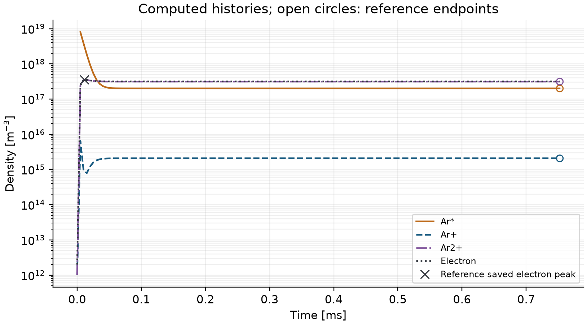

図7. 線は本コードの密度、白抜き丸は保存参照の終端種密度、×は参照の保存点での電子密度最大。
参照の種密度全波形を示してはいない。初期値0のAr*は対数軸上では表示されず、生成後から見える。

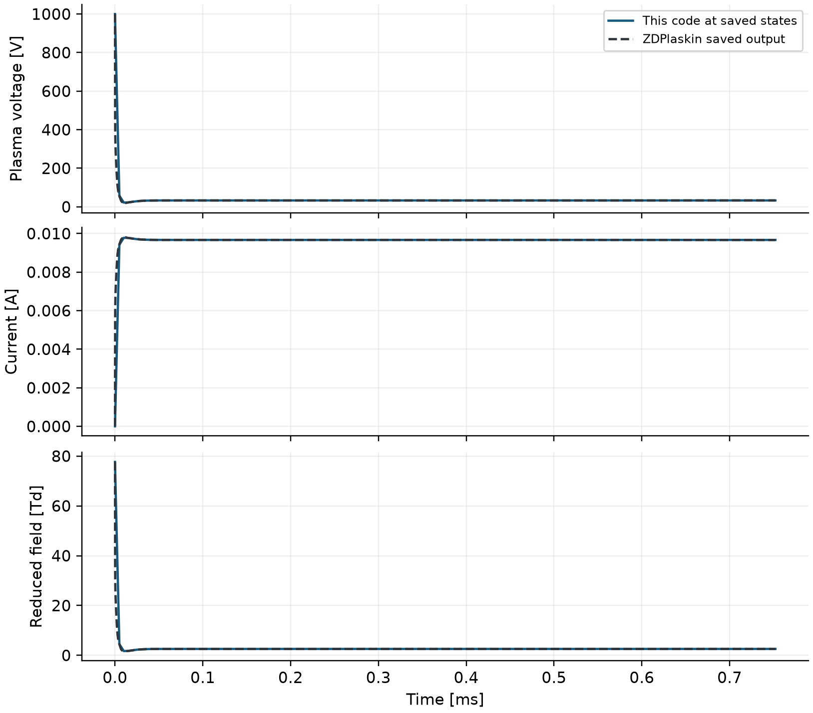

図8. 本コードの保存状態から求めた回路量と、保存済みZDPlaskin回路出力。
実線と破線は異なる保存格子を結んだ表示で、急速な立上りの形やpeakは格子に依存する。
この図の線の重なりだけで終端以外の誤差が許容差以内と判断しない。

| 比較量 | 本コード | 保存参照 | 相対差 [%] |
|---|---:|---:|---:|
| 最終Ar* [m⁻³] | 2.014779×10¹⁷ | 2.014270×10¹⁷ | 0.0253 |
| 最終Ar⁺ [m⁻³] | 2.083214×10¹⁵ | 2.079332×10¹⁵ | 0.1867 |
| 最終Ar₂⁺ [m⁻³] | 3.149623×10¹⁷ | 3.149570×10¹⁷ | 0.00168 |
| 最終電子密度 [m⁻³] | 3.170455×10¹⁷ | 3.170363×10¹⁷ | 0.00290 |
| 保存点での最大電子密度 [m⁻³] | 3.530828×10¹⁷ | 3.571898×10¹⁷ | 1.1498 |
| 最終プラズマ電圧 [V] | 33.00284 | 33.22250 | 0.6612 |
| 最終電流 [A] | 0.00966997 | 0.00966778 | 0.0227 |
| 最終E/N [Td] | 2.563261 | 2.561342 | 0.0749 |

**解釈。** 密度上昇により伝導性が増すと、直列抵抗の電圧降下が増え、プラズマ電圧とE/Nが低下する。
終端は約33.0 V、9.67 mAであり、電源1000 Vがそのまま放電間隙に掛かる状態ではない。
比較した種密度・保存最大は10%、回路量は5%という既存回帰許容差内であった。
ただし係数表には同じ保存出力の反応進行速度列から逆算したデータを含む。
これは係数表・化学・回路の接続を確認する回帰であり、元のFortran／BOLSIG+の独立実行、
電子分布の自己無撞着な再現、実験への予測精度を示す比較ではない。

### 13.6 低圧Ar: 過渡応答とODE許容差を確認する

**問題設定。** `benchmarks/argon-rtol-1e-6` を基準に、
電離・励起による電子エネルギー損失とBohm壁損失を結合した単一容積のAr放電を計算する。

| 条件 | 値・選択 |
|---|---|
| 体積／壁面積 | 0.01 m³／0.1 m² |
| 初期圧力／気体温度 | 0.8283894 Pa／300 K固定 |
| 初期組成 | 中性モル分率Ar=1、Ar⁺ seed 1×10¹⁴ m⁻³ |
| 初期平均電子エネルギー | 3 eV（等価温度2 eV） |
| 電源 | 0〜1 msに電子へ0.1 W、1〜2 msに0 W |
| 壁 | 浮遊Bohm、h-factor自動評価。入口・排気なし |
| 保存 | 10 μs間隔、201点 |

初期Ar密度は圧力から $p/(k_BT_g)-n_{i0}$ として求める。
同梱 `argon_maxwellian` の直接密度指定とは微小に異なるため、入力ファイル名まで含めて条件を特定する。
気相31反応は電離1個と励起によるエネルギー損失30個で、Ar*の蓄積は積分していない。

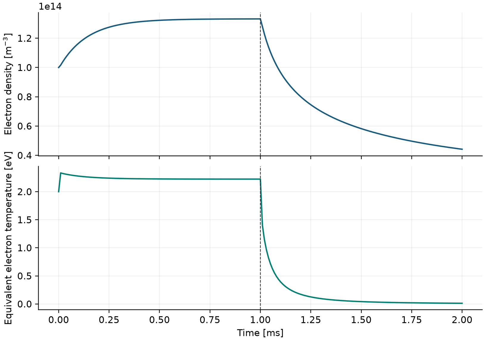

図9. 電子密度と等価電子温度の過渡応答。縦線は1 msの電源切替。
通電中には生成と損失が釣り合う方向へ進み、停止後は電子温度が先に下がって密度が減少する。
2 msの約4.42×10¹³ m⁻³、約0.0125 eVは、この過渡例の終端値である。

**比較方法。** 同じ物理条件・同じ保存時刻で、rtol／atolを10⁻⁶／10⁻¹⁴、10⁻⁷／10⁻¹⁵、10⁻⁸／10⁻¹⁶と変える。
最後を参照に、電子密度と温度の規格化最大差Eを式(38)で計算する。
本試験ではrtolとatolを同時に厳しくしており、片方だけの効果を分離した試験ではない。

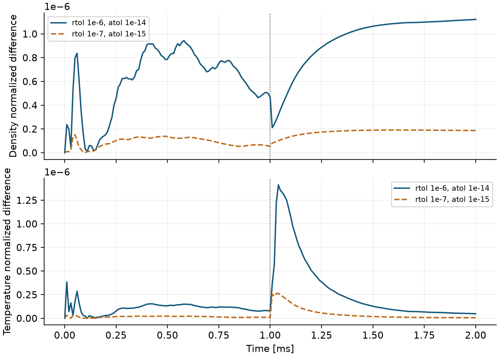

図10. 各時刻の絶対差を参照波形の最大絶対値で割った値。図の最大値が表のEに対応する。
参照はrtol=10⁻⁸の数値解であり、誤差0の厳密解ではない。密度と温度の縦軸は別の尺度である。

| rtol／atol | 密度波形差E | 温度波形差E | RHS評価回数 | 実測時間 [s] |
|---|---:|---:|---:|---:|
| 10⁻⁶／10⁻¹⁴ | 1.12×10⁻⁶ | 1.41×10⁻⁶ | 774 | 1.42 |
| 10⁻⁷／10⁻¹⁵ | 1.91×10⁻⁷ | 2.63×10⁻⁷ | 1116 | 1.68 |
| 10⁻⁸／10⁻¹⁶ | 参照 | 参照 | 1624 | 2.17 |

**解釈。** この条件では厳しい許容差ほど参照との差が減り、追加のRHS評価が必要になった。
運転切替とその前後の緩和を含む波形を比べることで、終端値だけでは見えない数値差を確認できる。
単発の計算時間から速度性能を一般化しない。また低温afterglow末期のBohm近似の適用性は第14.2節で別に検討する。

### 13.7 イベント数: ODEの精度と保存後の積分を分ける

**問題設定。** 前節と同じ物理条件でODE許容差を10⁻⁸／10⁻¹⁶に固定し、
`benchmarks/argon-sampling-40us` から `benchmarks/argon-sampling-1.25us` までの6ケースで保存間隔だけを変える。
比較対象は電離反応と壁面中性化の累積イベント数で、式(37)の区間別台形積分から得る。
全runのRHS評価1624、Jacobian評価6、LU分解107は同じである。

**比較方法と結果。** 最も細かい1.25 μsを参照に、終端イベント数の相対差δを求める。
保存間隔はODEの適応step幅ではなく、保存した反応頻度を積分する際の分解能である。

| 保存間隔 [μs] | 保存点数 | 電離数の相対差 | 壁イベント数の相対差 |
|---|---:|---:|---:|
| 40 | 51 | 3.94×10⁻³ | 2.40×10⁻³ |
| 20 | 101 | 1.74×10⁻³ | 7.08×10⁻⁴ |
| 10 | 201 | 7.61×10⁻⁴ | 1.80×10⁻⁴ |
| 5 | 401 | 4.08×10⁻⁴ | 4.04×10⁻⁵ |
| 2.5 | 801 | 1.71×10⁻⁴ | 8.60×10⁻⁶ |
| 1.25 | 1601 | 参照 | 参照 |

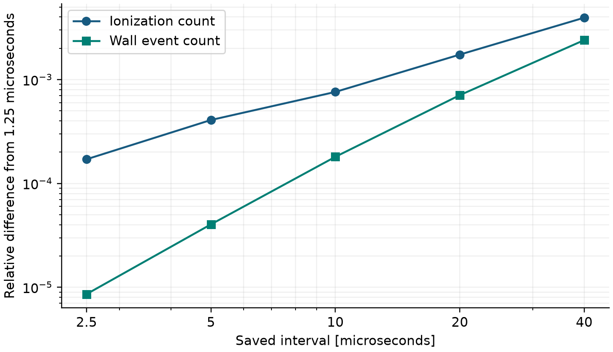

図11. 1.25 μsを参照にしたイベント数の相対差。対数軸のため、自己比較で差0になる参照点自体は図へ置かず表に示す。
粗い保存条件では立上りの速い反応頻度を十分に分解できず、この範囲から理想的な2次収束を主張しない。

最細条件の電離数は7.46775×10¹²、壁イベント数は8.02556×10¹²である。
この単一一価イオンの系では、両者の差がイオン粒子数の変化と整合するかも調べられる。

$$
\epsilon_C=\frac{|V[n_i(t_f)-n_i(0)]-(C_{\mathrm{ion}}-C_{\mathrm{wall}})|}{\max(C_{\mathrm{ion}},C_{\mathrm{wall}})}. \tag{40b}
$$

最細条件にも$\epsilon_C$=7.59×10⁻⁵が残る。イベント数はODE状態に追加して厳密積分した量ではないため、
状態密度の変化からその差を強制補正していない。

**解釈。** 密度波形の許容差収束が良好でも、保存頻度を積分する量には別の誤差が残る。
反応経路の順位だけを比較する場合と、反応数の差から収率・収支を評価する場合とで必要精度を定め、
保存間隔を変えて確認する。図の線幅や多い桁のイベント表示は、その精度を保証しない。

### 13.8 入力感度: 電力・圧力・壁面積の役割を比べる

**問題設定。** 第13.6節の基準run（rtol=10⁻⁶）に対して、
通電電力、初期圧力、壁面積を一つずつ±10%変える。その他の条件と保存時刻は保ち、
2 msの電子密度・温度の変化率を基準runの終端値から求める。
各case名は `benchmarks/argon-` に表の接尾名を付けたものとなる。

| case接尾名 | 変更した値 | 終端電子密度 [%] | 終端電子温度 [%] |
|---|---|---:|---:|
| `power-minus10` | 通電0.09 W | -9.994 | 約0 |
| `power-plus10` | 通電0.11 W | +9.994 | 約0 |
| `pressure-minus10` | 初期0.74555046 Pa | -5.789 | -5.835 |
| `pressure-plus10` | 初期0.91122834 Pa | +5.578 | +5.702 |
| `area-minus10` | 壁0.09 m² | +23.108 | +28.542 |
| `area-plus10` | 壁0.11 m² | -17.239 | -20.426 |

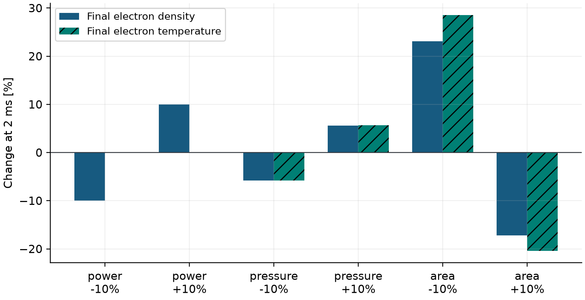

図12. 同じ終端時刻での基準runからの変化率。0は基準と同じ値、正は増加、負は減少。
塗りの棒は密度、斜線の棒は温度を表す。
表は表示桁を丸めており、温度の「約0」は変化が厳密に0という意味ではない。

**解釈。** 通電電力の変更は、この例では主に終端密度を変える。
停止後の十分遅い時刻に比較しているため、この終端温度だけから通電中の温度も電力に依存しないと結論しない。
初期圧力の変更時は中性密度を再計算し、荷電seedは固定する。
壁面積を変えると、A/Vだけでなく自動h-factorに用いる特性長V/Aも変わる。
従って、図の大きな面積感度を単純な面積比例損失だけで説明することはできない。

この6条件では面積の応答が非対称であり、基準点付近でも線形近似が十分かを確認する必要がある。
これは任意幅の局所的な条件比較であり、パラメータの統計分布を仮定した不確かさ伝播や、
95%信頼区間、実機の設計誤差ではない。afterglow末期の適用限界も含めて使う。


<a id="discussion"></a>

## 14. 考察: どこまで有用で、何が未検証か

### 14.1 反応機構の検討と実験設計への使い方

解析積分との比較は電子衝突係数の評価、既知解との比較は時間積分と体積係数、
回帰比較は化学・回路の接続、許容差収束は数値設定への依存をそれぞれ確認している。
これらを組み合わせることで、条件変更時の密度・エネルギー・反応頻度の差を、
実装上の誤差と物理仮定の問題に分けて検討できる。

過渡Arの例では、同じ±10%の変更でも、電力、初期圧力、壁面積に対する応答が異なった。
密度だけでなく、電子エネルギー、壁への流束、生成・消失イベントを合わせて見ると、
追加測定すべき壁条件や、精査すべき反応係数を絞る手掛かりになる。
ただし、afterglow末期の温度は次節で述べる近似の適用条件から外れるため、
この感度値をそのまま実機の設計量には用いない。

エッチングやリモート処理へ展開する場合は、まず関心量を平均密度、基板への粒子束、
または反応生成物の滞留量として定義する。次に、原料からその量へ至る反応と壁・流入出をそろえ、
吸収電力、容積、表面積、気体温度を実験と対応させる。
これが整った段階で、圧力や流量、運転波形を独立に変え、律速過程が維持される範囲を調べる。
この手順は、局所的なシースや微細形状の計算へ渡す境界条件を決める前段としても使える。

### 14.2 afterglow末期とBohm近似

Ar例の終端等価電子温度0.0125 eVは、300 Kのエネルギー相当0.02585 eVより低い。
イオン温度を気体温度程度とみなすなら、冷イオンBohm式が仮定する電子温度優勢は成立しない。
電源停止後の電子分布、イオン温度、準中性の成立、壁電流収支を独立に確認する必要がある。
本稿の波形は実装した方程式の応答として示し、低温afterglowの装置精度の根拠には使わない。

本実装の `standard` は、固定気体温度、準中性・電気的正性、単一一価正イオン、
Maxwellian＋電子エネルギー収支、吸収電力指定、Bohm壁等という機能構成の分類である。
電子・イオン温度比や分布の妥当性を全時刻で認定する指標ではない。

### 14.3 測定との比較を成立させる条件

局所最大、線積分、体積平均は異なる量である。例えば光学計測には、発光種、励起状態、
遷移確率、消光、観測線の積分が必要であり、重粒子密度へprobe名を付けるだけでは発光強度にならない。
Langmuir probeには電流電圧応答と電子分布の仮定が必要である。
装置比較では、実効体積、壁面積、吸収電力、気体温度、観測領域の対応を先に固定する。
校正した圧力・電力条件を、そのまま独立な評価条件とみなさない。

誤差の原因には、数値誤差、入力・測定の不確かさ、反応機構の不足、closureのモデル化誤差がある。
パラメータの確率分布に根拠がある場合には、例えば一次近似の共分散伝播を考えられる。

$$
\operatorname{Cov}(\boldsymbol{q})\simeq J_p\operatorname{Cov}(\boldsymbol{p})J_p^{\mathsf{T}},\qquad (J_p)_{ij}=\frac{\partial q_i}{\partial p_j}. \tag{41}
$$

これは不確かさを評価するための一般的な考え方で、このパッケージに自動推定・校正機能として
実装済みという意味ではない。非線形性や相関が大きければ、分布と観測を明示した別の評価が必要である。

### 14.4 本章の比較が支える範囲

本稿で機能を説明したことと、その機能を独立に定量検証したことを区別する。
目的に応じ、次の範囲から追加の比較を選ぶ。

| 対象 | 第13節で示した根拠 | 次に必要な比較 |
|---|---|---|
| 電子係数 | 同一断面積の積分と独立求積 | 対象の混合組成・EEDF・係数の出典と不確かさ |
| 化学・壁を含む過渡応答 | 簡略Ar系、許容差収束、局所感度 | 対象ガスの反応機構・壁係数・観測量を揃えた装置比較 |
| 容積間移送 | 方向付きedgeの解析解と中性Ar粒子保存 | 実機の流れ・拡散・滞留時間、入口・排気条件の妥当性 |
| 電源・回路 | 保存係数を使うDC回帰 | DC初期条件の整合と独立な係数生成、RF・CCP・ICPの校正・評価 |
| 気体熱・表面・蓄積 | 方程式と入力は説明。ここでは独立した定量benchmarkを提示していない | 熱容量、熱移送、site・反応収率を固定した参照問題 |
| 反応イベント図 | 保存間隔に対する積分結果の収束 | 用途に必要な精度と収支、対象条件の保存間隔収束 |

例えば、図11でイベント積分の数値差を調べても、表面の反応収率まで確認したことにはならない。
DC終端値の一致も、初期密度差を含む立上りの予測やRF周期内の加熱を支える根拠には使わない。
独立した実験比較と不確かさ評価は[次段階の計画](ROADMAP.md)として残す。

<a id="conclusions"></a>

## 15. 結論: 本コードのまとめ

### 15.1 モデリング基盤としての到達点

本コードは、低圧非平衡プラズマの粒子収支とエネルギー収支を組み立て、
組成、電子状態、壁への粒子供給、反応の寄与が運転条件に応じて変化する過程を調べるための基盤である。
化学反応、電子衝突、壁、流入出、電源を同一時刻の状態へ接続し、
必要に応じて気体エネルギー、表面被覆、蓄積状態を加えて、共通の時間積分器で解く。
放電部と処理部を分ける場合には、容積間の移送を粒子数とエネルギーの収支へ加えられる。
各項の役割を保存則に沿って分ける構成は、反応機構や壁条件を変更した際に、
どの入力がどの生成消滅項を介して関心量へ影響したかを追うために有用である。

利用者はcase YAMLを起点に、化学機構、外部CSV、装置条件、運転履歴と出力要求を指定する。
計算結果には状態と選択した派生量・収支に加え、実効入力と来歴が残る。
その保存結果から組成の時系列、反応頻度、累積イベント、反応ネットワークを解析できる。
入力、連成計算、保存、再解析を接続することで、同じ物理量の定義を維持しながら条件を比較し、
必要な機能を段階的に追加できる構成となった。

用途としては、原料と生成物を結ぶ反応機構の検討、連続・パルス運転の過渡応答、
供給・排気・壁条件への感度評価、測定すべき量や次の詳細計算へ渡す条件の選定が挙げられる。
適用範囲は、採用した電子分布、壁輸送、電源結合と空間平均の近似によって定まる。
特に基板束、表面反応、RF電源等へ展開する場合には、対象の係数と観測量を揃えた追加検証を要する。

### 15.2 数値検証から得られた結論

第13節の19 runと係数積分試験は、計算の各段階を異なる比較方法で確認した。
Maxwellian速度係数は解析積分・独立求積と丸め誤差程度で一致し、
一次減衰と異体積間移送は既知解をそれぞれ最大相対誤差約1.86×10⁻⁵、2.66×10⁻⁶で再現した。
移送例では、保存される中性Arの総粒子数の相対変化は3.64×10⁻¹⁶であった。
これらは、係数評価、時間積分、密度と粒子数の換算を確認する根拠となる。

CRANE・ZDPlaskin由来の比較では、反応機構と回路を接続した結果を保存参照と照合した。
ただし、CRANEの比較対象は終端値に限られ、DC例には初期電子密度の差と参照由来係数への依存が残る。
したがって、この一致だけから独立コードによる全過程の再現性や装置の予測精度は判断できない。
Ar過渡問題では、ODE許容差に対する波形の収束と、保存間隔に対するイベント積算の収束を別々に確認した。
この結果は、状態の時間積分が十分に収束していても、保存後に求める反応数には別の誤差が残ることを示す。

以上より、本コードは、明示した近似の下で反応と輸送・エネルギーの寄与を比較する数値的基盤として利用できる。
一方、空間分布、混合組成に依存する非Maxwellian応答、低温afterglow、経験的電源結合の適用性は、
本稿の数値収束から確定しない。利用者は関心量を先に定義し、必要な反応と境界条件を揃え、
数値収束を確認した上で独立な測定・参照計算と比較する。この手順が、次節の開発課題を選ぶ基準となる。

<a id="future-development"></a>

## 16. 今後の開発課題

### 16.1 優先する比較条件の整備と独立検証

次の開発段階では、同じ物理条件と観測量で予測を評価できる参照問題を整備する。
直近では、DC例の元入力における全初期種密度を確定し、本コードの初期電子密度2×10¹² m⁻³と
参照条件欄の1×10¹² m⁻³の差を解消する必要がある。
電子係数も独立に生成し、初期状態・反応機構・係数・比較時刻を揃えた上で、
終端値に加えて立上りと回路応答を比較する。入力の差を残したまま終端値を合わせても、この課題は完了しない。

これと並行して、用途を代表する装置・運転条件と観測量を一つ選び、独立実験との比較を進める。
密度、基板への粒子束、生成物量等のどれを評価するかを決め、
局所値・線積分・体積平均の対応、吸収電力、実効体積・壁面積、気体温度、測定誤差を記録する。
校正に使用する条件と評価用の条件を分け、評価用条件に合わせて係数を調整しない。
その上で、数値誤差、根拠のある入力不確かさ、モデル化誤差を分けて示す。
この段階の完了は、一つの波形が一致することではなく、条件と誤差の定義を公開して独立な評価を再現できることで判断する。

### 16.2 物理モデルと解析機能の開発順序

検証結果から不足が分かった機能を優先し、次の順序で拡充する。
表の内容は開発課題であり、現行版で実装・装置検証済みの仕様を表すものではない。

| 課題と順序 | 開発する内容 | 完了を判断する根拠 |
|---|---|---|
| 第一段階: 電子係数と組成依存 | 独立Boltzmann計算と速度・輸送係数を比較し、初期組成固定の表と近似EEDFの誤差を評価。必要性を確認してから組成方向の補間・更新を設計 | 対象組成と電場・エネルギー範囲、断面積、分布、係数の誤差が明示され、係数と電子エネルギー収支の整合を確認できる |
| 第一段階: 低温afterglowと壁 | 電子・イオン温度が近づく領域の壁輸送、壁電流、エネルギー交換を評価し、適用範囲に応じた関係式を選ぶ | 第14.2節の低温域を含む独立比較で粒子・エネルギー収支を確認し、冷イオンBohm近似の使用範囲を定められる |
| 第二段階: 気体熱・表面・蓄積 | 熱容量、熱移送、表面site、反応収率を固定した単純な参照問題から、対象プロセスの比較へ進む | エネルギー・元素・siteの各収支と、温度・被覆・蓄積量を個別に比較でき、係数の出典と校正範囲が分かる |
| 第二段階: RF・CCP・ICP結合 | 吸収電力、電圧・電流、自己バイアス等の平均量を測定・参照計算と対応させ、経験式の有効範囲を評価 | 校正に使わない圧力・電力条件でも関心量を比較でき、周期平均量と周期内応答の区別が明確である |
| 第二段階: イベントと装置全収支 | 反応に加え、入口・排気・移送・壁の寄与を共通の対象範囲と単位で表示。要求精度に応じて累積量の積分方式を検討 | 元素・電荷・エネルギーの収支を追跡でき、累積量の誤差が保存間隔とODE許容差のどちらに依存するかを説明できる |
| 用途に応じた拡張: 空間方向 | 長さ、断面積、移流・拡散、境界条件を定義し、容積接続から空間離散化へ拡張する必要性を評価 | 既知の移流拡散問題との比較と分割収束を示せる。現行の方向付きedgeによる区画モデルと擬似1次元モデルを区別できる |

第一段階は、現在のAr例と電子係数に直接関わる適用範囲の明確化である。
第二段階は、独立検証で選んだ用途に必要な機能から着手する。
空間方向の拡張は、平均量では評価できない勾配が関心量を左右すると判断した場合に検討する。
すべての用途へ同時に機能を追加する計画とはせず、比較結果を次の開発の判断材料にする。

### 16.3 継続的な改良を支える設計方針

物理機能の拡充と併せ、入力名・単位・値域が式と対応するよう整理する。
現時点では、表面反応係数名から実際の次元を読み取りにくいこと、
反応熱の許容値域がYAMLとCSVで異なること、電源固有probeがoff区間で未定義になる場合が残る。
これらは互換性と移行手順を定め、同じ指定が形式や運転区間によって異なる意味にならないよう改める。

設定の入口はcase YAMLへ集約し、再利用する機構と係数データを参照する構成を維持する。
新しい機能にも、入力、適用条件、保存則への寄与、出力量、最小限の比較問題を対応付ける。
検証は既知解、保存則、独立参照等によって物理・数値の意味を確認するものを中心とし、
同じ条件判定を各層で繰り返す診断や実装を写すだけのテストを増やさない。
数値核と入出力・描画の責務を保ち、共通処理を利用して拡張することで、用途追加による設定や説明の散逸を抑える。

開発上の到達点は、対象用途について、入力条件から支配方程式、出力量、比較根拠までを利用者がたどれる状態である。
具体的な残件と進捗は[開発計画](ROADMAP.md)を正本とし、本節では開発の物理的な目的と完了条件を示した。
現在は数値・入出力基盤と本稿の再現可能な検証説明までを整備しており、
次はDC比較条件の整合確認と、独立検証に用いる観測量・参照条件の確定へ進む。

## 付録A. 近似EEDFは何を計算しているか

`experimental.approximate_two_term` は、完全な電子Boltzmann方程式の角度展開・衝突演算子を
離散化した検証済みtwo-term solverではない。名称だけからBOLSIG+等と同じ方程式を解くと解釈しない。
式(12)へ渡す分布候補を経験的なエネルギー空間形状で作り、電子1個あたりの電力釣り合いで
その形状パラメータを選ぶ探索用closureである。

混合比で重み付けした運動量断面積をσₘ、非弾性損失断面積を
$L_\sigma=\sum_r x_r\Delta\varepsilon_r\sigma_r$ とする。
エネルギーを1 eVで規格化したE、形状パラメータξ、規格化断面積M・損失Lに対して、実装の形状式は次である。

$$
\mathcal{D}_j=\frac{(\xi+0.02)\sqrt{E_j+0.03}}{1+0.35M_j},\qquad \mathcal{B}_j=0.8+0.6M_j+\frac{1.4L_j}{\max(\xi,10^{-8})}. \tag{A1}
$$

$$
d_j=\operatorname{clip}(\mathcal{B}_j\Delta E_j/\max(\mathcal{D}_j,10^{-30}),10^{-10},90),\qquad \widetilde F_j=\frac{\exp(-\sum_{l<j}d_l)}{\sqrt{E_j+0.02}}. \tag{A2}
$$

Mはσₘを格子上の平均で、Lは損失断面積を正の値の平均で規格化する。
ゼロ除算を避ける最小値を使い、台形積分でFを規格化する。
0.02、0.03、0.35、0.8、0.6、1.4等は本近似の数値定数で、普遍的な物理定数ではない。

分布から運動量移行頻度、移動度、平均エネルギー、拡散係数の候補を求める。

$$
\nu_m=N\int\sigma_m vF\,d\varepsilon,\quad \mu=\frac{e}{m_e\nu_m},\quad D_e=\mu\frac{2\bar\varepsilon}{3}. \tag{A3}
$$

最後の式はエネルギーの数値をeVとしたEinstein型関係である。
形状を決める電力釣り合いは次である。各項は電子1個あたりWである。

$$
e\mu E_{\mathrm{field}}^2 =eN\int L_\sigma vF\,d\varepsilon +eN\left(\int\sigma_m vF\,d\varepsilon\right)\varepsilon_{\mathrm{el}}. \tag{A4}
$$

代理弾性損失 $\varepsilon_{\mathrm{el}}$ は既定0.03 eVであり、RHSの電子・気体交換式(18)とは別の近似である。
形状範囲0.02〜220に根が挟まることを要求し、対数残差5×10⁻⁴以下を目標に反復する。
エネルギー格子最終区間の確率質量が1×10⁻³を超える解を拒否する。
電源・係数の外側反復に使う1×10⁻⁶の判定と、分布生成内部の判定を混同しない。

通常計算では初期中性組成ごとに準備した表を用い、反応で組成が変わっても再生成しない。
準備表に追加する電場0 節点は平均エネルギー・速度係数を0とし、移動度は最初の値を使う境界拡張であり、
気体との熱平衡EEDFを求めた解ではない。組成の変化、エネルギー格子、衝突収録範囲、独立Boltzmann解との
比較を行ってから利用範囲を決める必要がある。

## 付録B. 経験的電源と蓄積状態の実装式

### B.1 RF包絡

吸収電力指定では電源側電力を $P_d=P_a/\eta$ とし、$V_{\mathrm{rms}}=\sqrt{P_dR_{\mathrm{eff}}}$。
電圧指定では $P_d=V_{\mathrm{rms}}^2/R_{\mathrm{eff}}$ と $P_a=\eta P_d$ を使う。
矩形包絡をg(t)とすると、換算電場と自己バイアスは次の形である。

$$
(E/N)_{\mathrm{Td}}=a_0g(t)+a_1\sqrt{P_a},\qquad V_{\mathrm{bias}}=-f_b\sqrt{2}V_{\mathrm{rms}}. \tag{B1}
$$

バイアス項はbias役割の電源接続だけに適用する。電位もオフセットと電力平方根で構成する。
これらの係数は校正入力であり、電磁場計算から決まらない。

### B.2 CCPの経験的バルクとシース

バルク抵抗は有効長 $L_{\mathrm{eff}}=V/A_p$、$n_{16}=n_e/10^{16}$、$f_*=f/13.56\,\mathrm{MHz}$ に対し、
数値をSIで与えて次の経験式を用いる。

$$
R_p=5\frac{\max(L_{\mathrm{eff}}/\mathrm{m},10^{-6})} {\sqrt{\max(n_{16},10^{-10})f_*}}\,\Omega. \tag{B2}
$$

シース容量は $C_s=\epsilon_0A_s/d_s$、厚さはDebye長に電圧依存の係数を掛けて推定する。

$$
\lambda_D=\sqrt{\frac{\epsilon_0\max(\theta_e,0.03)}{e\max(n_e,10^6)}}. \tag{B3a}
$$

$$
d_s=\max\left(4\lambda_D\sqrt{1+\frac{\max(V,1)}{\max(\theta_e,0.1)}},5\times10^{-5}\right). \tag{B3b}
$$

ここでnはm⁻³、θはeV、VはV、dはmというSI数値を使う。
最小密度・最小温度・厚さはこの経験式を評価する正則化であり、独立に積分する粒子密度を修正しない。
面積比の1.35乗から自己バイアスを推定し、イオンエネルギーの診断は
$\varepsilon_i\simeq V_{s,p}/(1+N\sigma d_s)$、σ=5×10⁻²⁰ m²とする。
これらはイオンエネルギー分布や無損失回路に含まれないシース実損失を解くものではない。

### B.3 ICPの連続的なモード指標

密度因子d、モード指標m、滑らかなH側の重みhを次で作る。

$$
d=1-e^{-2.2n_e/10^{17}},\qquad m=d\sqrt{P_d/150}. \tag{B4a}
$$

$$
x=\operatorname{clip}((m-0.45)/0.20,0,1),\qquad h=x^2(3-2x). \tag{B4b}
$$

圧力因子aと周波数因子b、積u、結合効率は次である。圧力pは中性密度から計算するPa値である。

$$
a=0.65+0.20\tanh\left(\frac{\max(p/10,10^{-3})-0.3}{0.6}\right). \tag{B5a}
$$

$$
b=0.85+0.08\log_{10}(1+\max(f_*,0.1)). \tag{B5b}
$$

$$
u=dab,\qquad \eta_E=0.18+0.37u,\qquad \eta_H=0.40+0.48u. \tag{B6a}
$$

$$
\eta=\operatorname{clip}(d[\eta_E+h(\eta_H-\eta_E)],0,0.95). \tag{B6b}
$$

`mode_H` はhであり、測定に基づくH-mode認定ではない。
換算電場は、ゼロ電力・ゼロ密度で消える活性係数に
$25+30\sqrt{\theta_e}+0.01P_a$ を掛けた経験値である。
係数中の150はW、密度の基準はm⁻³である。装置ごとの電磁場・整合回路・吸収分布は解いていない。

### B.4 膜厚と壁への蓄積

面イベント速度r、蓄積収率y、膜の層収率ℓ、単層厚さ $d_0$ から、蓄積粒子数Bと厚さδを計算する。

$$
\frac{dB}{dt}=Ayr,\qquad \frac{d\delta}{dt}=d_0\frac{\ell r}{N_{\mathrm{site}}}. \tag{B7}
$$

これは宣言したイベントの積算で、材料の組織、面内均一性、応力、熱伝導を予測する式ではない。
汎用extension状態も宣言した項をODEへ追加する仕組みであり、状態名だけから物理を推定しない。

<a id="reproduce"></a>

## 付録C. 再計算とコードとの対応

ベンチマークはネットワーク接続を使わず、同梱入力と保存参照から再計算できる。
`plasma_global/examples/cases/benchmarks/` の17 YAMLと、同じ `cases/` のCRANE・ZDPlaskin例の
計19ケースを用いる。共有する化学機構・断面積は `chemistry/`、電子係数は `data/` に置く。
入力の所在・選び方・単独実行は[統合マニュアル 第2節](index.md#examples)にまとめた。
各YAMLは通常のcaseであり、インストール後も `init` で必要な入力一式を取り出して実行できる。

解析解・保存参照との比較と図を含む一式は、Python環境に本パッケージとplot依存を入れ、
比較実行器と `benchmarks/references/` を含むリポジトリのルートで実行する。

```bash
python -m pip install ".[plot]"
python -m tools.benchmarks.theory --output runs/theory-001
```

出力先は未作成の場所を使う。`results.json`、`figures/` の10図、19 runのHDF5・summaryを保存する。
JSONの `result_h5` はこの出力先を基準とする生成物のpathであり、版管理済みの結果ファイルを指さない。
JSONの数値と本文の表示桁を比較し、保存HDF5の実効caseで条件を確認する。
図の描画は `tools/benchmarks/_theory_figures.py` にまとめ、計算・比較を行う実行器と役割を分けている。
両ファイルを入力記録の集約hashへ含め、図の再生成条件も識別する。
依存ライブラリやコードが変われば来歴のハッシュと測定時間も変わるため、過去の数値を新環境の検証記録へ付け直さない。

| 理論・方程式 | 主な実装 |
|---|---|
| 式(5)・(6) 粒子と反応 | `core/_runtime_sources.py`, `chemistry/compile.py` |
| 式(9)・(16) 電子状態 | `models/electrons.py` |
| 式(13)・(14) Maxwell積分 | `chemistry/_maxwell.py` |
| 式(17)・(18) 電子エネルギー・弾性移送 | `core/_runtime_sources.py`, `models/elastic.py`, `models/gas_energy.py` |
| 式(19a)〜(21) 気体エネルギー | `models/gas_energy.py`, `core/transport.py` |
| 式(22)〜(25) 壁 | `models/_wall_runtime.py`, `models/walls.py` |
| 式(26)〜(28) 表面 | `models/_surface_runtime.py`, `models/_surface_kernels.py` |
| 式(30) 区画輸送 | `core/transport.py` |
| 式(31)・(32) DC | `models/_power_ports.py` |
| 式(34)・時間積分 | `core/solver.py`, `core/_solver_domain.py` |
| 式(36)・(37) イベント | `_output_channels.py`, `postprocess.py` |
| 付録A・B | `experimental/eedf.py`, `experimental/_power_kernels.py`, `experimental/_ccp_power_kernel.py` |

全パスの先頭には `plasma_global/` を付ける。
実効入力、入力チェックサム、コードハッシュ、依存バージョンは結果HDF5に残り、図から逆算して設定を補完しない。
本文Markdownを原本とし、PDFは同じ原本から生成する。PDF作成・日本語フォント指定は[開発・保守](DEVELOPMENT.md)に記す。

## 参考文献・データ出典

以下の文献はモデルの背景・手法・データ出典を支える。本実装や装置精度が文献で認定されたことを意味しない。
Web資料の確認日は2026年10月26〜27日。式の実装上の定数・境界処理は付録Cのコードを正本とする。

<a id="ref-1"></a> **[1]** Hurlbatt, A. et al. (2017). *Concepts, Capabilities, and Limitations of Global Models: A Review*.
Plasma Processes and Polymers 14, 1600138.
[DOI: 10.1002/ppap.201600138](https://doi.org/10.1002/ppap.201600138).

<a id="ref-2"></a> **[2]** Hagelaar, G. J. M. and Pitchford, L. C. (2005). *Solving the Boltzmann equation to obtain electron
transport coefficients and rate coefficients for fluid models*. Plasma Sources Science and Technology 14, 722-733.
[DOI: 10.1088/0963-0252/14/4/011](https://doi.org/10.1088/0963-0252/14/4/011).

<a id="ref-3"></a> **[3]** Pitchford, L. C. et al. (2017). *LXCat: an Open-Access, Web-Based Platform for Data Needed for
Modeling Low Temperature Plasmas*. Plasma Processes and Polymers 14, 1600098.
[DOI: 10.1002/ppap.201600098](https://doi.org/10.1002/ppap.201600098).

<a id="ref-4"></a> **[4]** Kemaneci, E., Carbone, E., Booth, J.-P., Graef, W., van Dijk, J. and Kroesen, G. (2014).
*Global (volume-averaged) model of inductively coupled chlorine plasma: Influence of Cl wall recombination
and external heating on continuous and pulse-modulated plasmas*. Plasma Sources Science and Technology 23, 045002.
[DOI: 10.1088/0963-0252/23/4/045002](https://doi.org/10.1088/0963-0252/23/4/045002).

<a id="ref-5"></a> **[5]** SciPy developers. *scipy.integrate.BDF*. 本数値実験の利用versionは1.18.1。
[公式API](https://docs.scipy.org/doc/scipy/reference/generated/scipy.integrate.BDF.html).
本文の既定許容差とstate規格化は本packageの設定で、SciPy本体の既定値とは異なる。

<a id="ref-6"></a> **[6]** Shampine, L. F. and Reichelt, M. W. (1997). *The MATLAB ODE Suite*.
SIAM Journal on Scientific Computing 18(1), 1-22.
[DOI: 10.1137/S1064827594276424](https://doi.org/10.1137/S1064827594276424).

<a id="ref-7"></a> **[7]** Graphviz project. *dot: hierarchical or layered drawings of directed graphs*.
[公式layout資料](https://graphviz.org/docs/layouts/dot/).

<a id="ref-8"></a> **[8]** Schmalzried, A. (2023). *Bolsig+ format cross section of e-N2, O2, NO, Ar, O, N*, v1. Zenodo.
[DOI: 10.5281/zenodo.8192503](https://doi.org/10.5281/zenodo.8192503).
本packageのAr機構はこの収録データのAr部分を用いる。

<a id="ref-9"></a> **[9]** Keniley, S. and Curreli, D. (2019). *CRANE: A MOOSE-based Open Source Tool for Plasma Chemistry Applications*.
[arXiv:1905.10004](https://arxiv.org/abs/1905.10004).

<a id="ref-10"></a> **[10]** CRANE developers. *Two-Reaction Argon Plasma*, tutorial and committed output.
[公式tutorial](https://crane-plasma-chemistry.readthedocs.io/en/latest/TwoReactionArgon.html),
[source repository](https://github.com/lcpp-org/crane).
比較値の固定記録は `benchmarks/references/crane_two_reaction_argon_reference.yaml`。

<a id="ref-11"></a> **[11]** *ZDPlaskin example2*, 保存出力を含むsource repository.
[Hemadityamalla/ZDPlaskin](https://github.com/Hemadityamalla/ZDPlaskin).
本稿が使用した資産は `benchmarks/raw/zdplaskin_example2_eovern/` と `benchmarks/references/` に保持する。
このrepository由来の保存結果との比較であり、ZDPlaskinの全版・全機能の検証を表すものではない。

<a id="ref-12"></a> **[12]** Lee, C., Graves, D. B. and Lieberman, M. A. (1996).
*Role of etch products in polysilicon etching in a high-density chlorine discharge*.
Plasma Chemistry and Plasma Processing 16, 99-120.
[DOI: 10.1007/BF01465219](https://doi.org/10.1007/BF01465219).

<a id="ref-13"></a> **[13]** Toneli, D. A., Pessoa, R. S., Roberto, M. and Gudmundsson, J. T. (2015).
*On the formation and annihilation of the singlet molecular metastables in an oxygen discharge*.
Journal of Physics D: Applied Physics 48, 325202.
[DOI: 10.1088/0022-3727/48/32/325202](https://doi.org/10.1088/0022-3727/48/32/325202).

<a id="ref-14"></a> **[14]** Becker, M. M., Kählert, H., Sun, A., Bonitz, M. and Loffhagen, D. (2017).
*Advanced fluid modeling and PIC/MCC simulations of low-pressure ccrf discharges*.
Plasma Sources Science and Technology 26, 044001.
[DOI: 10.1088/1361-6595/aa5cce](https://doi.org/10.1088/1361-6595/aa5cce).

<a id="ref-15"></a> **[15]** Turner, M. M. et al. (2013).
*Simulation benchmarks for low-pressure plasmas: capacitive discharges*. Physics of Plasmas 20, 013507.
[DOI: 10.1063/1.4775084](https://doi.org/10.1063/1.4775084)、[著者公開稿](https://arxiv.org/abs/1211.5246).
検証条件・数値誤差・独立コード比較の報告方法を参照した。論文のPIC/MCC問題を本稿で再計算したものではない。

<a id="ref-16"></a> **[16]** Alves, L. L. et al. (2026).
*LoKI-GM: a global model framework for plasma chemistry studies*.
[arXiv:2607.27234v1](https://arxiv.org/abs/2607.27234v1).
ここでは2026年7月23日付の公開稿を参照する。方程式・数値フロー・適用例の説明構成を参照し、
本コードと同じモデルや精度を持つという比較には用いない。
