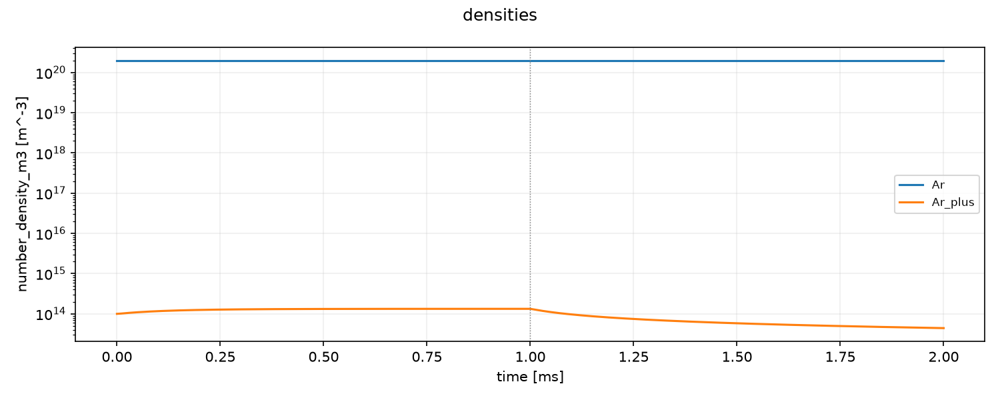
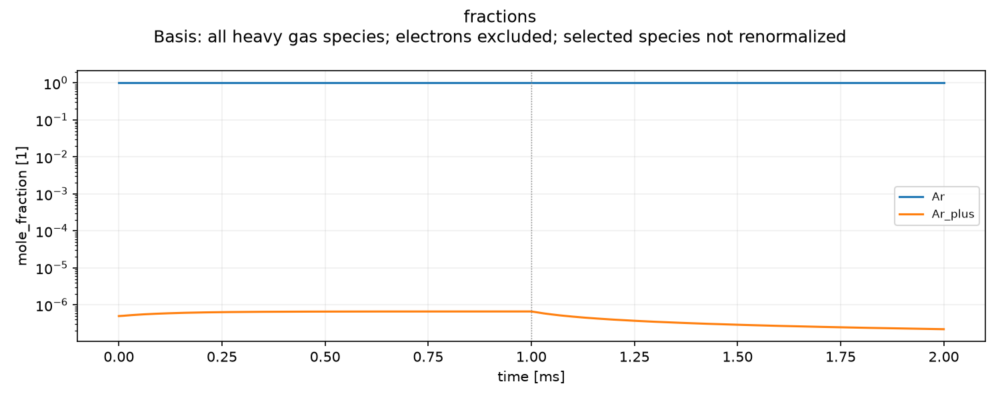
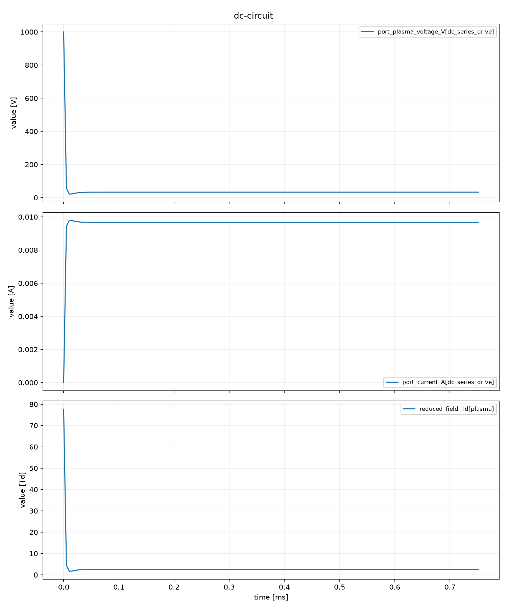
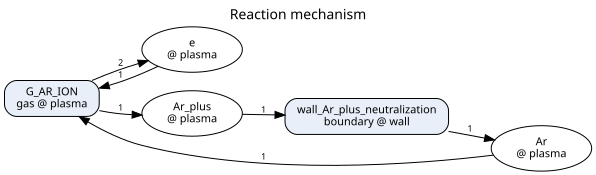

# モデリングマニュアル兼統合仕様書

対象は **Plasma Global Model 0.5.0／入力schema v4／結果HDF5 format v3** です。
本書に利用者向けの仕様と操作をまとめ、実装済みの機能と今後の拡張を区別します。

初回は第2〜4節を順に読み、同梱例の実行、結果の確認、自分の条件への変更まで進めてください。
第5〜14節は設定・出力を調べるためのリファレンスです。すべての変数を設定する必要はなく、
利用する物理機能の表を参照します。第15〜17節では結果の評価、問題への対応、旧版からの移行を扱います。

globalモデルを初めて扱う場合は、[低圧プラズマの体積平均モデル](THEORY.md)で技術的背景、機能構成、保存則からの導出、方程式、近似、
実測したベンチマーク結果を確認できます。本書は操作と設定、理論文書は方程式と検証を担当します。
[完成版PDF](assets/global-model-theory.pdf)をダウンロードして閲覧することもできます。

| 知りたいこと | 読む箇所 |
|---|---|
| 全体構成・計算の流れ・適用対象を把握したい | [1. 目的と適用範囲](#purpose) |
| まず動かして結果を見たい | [2. 初回実行](#quickstart)、[3. 計算例の読み方](#worked-example) |
| 自分の装置と化学機構を設定したい | [4. モデルを作る手順](#workflow)〜[9. 運転条件](#operation) |
| 連続通電・パルス・流通・回路・表面の用途から選びたい | [用途別の作業手順](#task-guides) |
| 条件を変えた計算を比較したい | [条件比較の手順](#compare-cases) |
| 入力変数の意味・単位・省略時の扱いを調べたい | [5. 表の読み方](#variable-reference)、[6. 装置](#reactor)〜[13. 描画設定](#figures) |
| 許容差や保存間隔を設定したい | [10. 数値計算](#numerics) |
| probe・CSV・組成図・反応図を使いたい | [11. 出力](#outputs)〜[13. 図による解析](#figures) |
| 保存結果をPythonで解析したい | [14. 結果ファイルとAPI](#results) |
| HDF5の採用理由・保存項目・具体的なデータを知りたい | [14. 結果の保存と読込](#results)、[実データの例](#result-example) |
| 結果の妥当性を判断したい | [15. 検証と解釈](#validation)、[16. 困ったとき](#troubleshooting) |
| コマンドの引数・終了コードを調べたい | [操作一覧](#commands) |
| 古い入力を移行したい | [17. 互換性と移行](#migration) |

内部構造と保守手順は[開発・保守](DEVELOPMENT.md)、未実装の内容と次の作業は
[計画と残る課題](ROADMAP.md)へ分けます。

<a id="purpose"></a>

## 1. 目的と適用範囲

### モデルが答える問い

本パッケージは、低圧プラズマの粒子・エネルギー収支を時間積分する体積平均モデルです。
電子衝突による生成、体積反応、壁面反応、電力供給、原料供給・排気を結合し、
平均組成と過渡応答を決める過程を調べます。
反応機構の選別、壁条件や吸収電力の感度評価、パルス運転の検討、
空間分解モデルへ渡す代表状態の検討に利用できます。

低圧のICP・CCPやパルス放電は、電子・気体・表面の時間尺度が異なります。
例えば、Cl系エッチングでは原子生成と壁再結合、O₂放電では準安定分子と負イオン反応が
組成を変える要因になります。これらの文献事例、流体・PIC/MCCとの比較、近似の選択は
[理論資料 第1節](THEORY.md#background)に説明しています。
本パッケージの同梱機構と数値検証はArを中心とし、他のガスの機構・装置精度は個別に確認します。

| 調べたいこと | 比較する出力 | 主に準備する入力 |
|---|---|---|
| どの反応が組成を決めるか | 密度、生成消滅速度、反応頻度 | 化学種・反応、衝突データ、境界反応 |
| 通電・停止後に何が残るか | 電子エネルギー、組成の時系列 | 吸収電力・運転波形、初期状態、時間分解能 |
| 容器や壁材を変えるとどうなるか | 壁への粒子束、損失、表面被覆 | 体積・面積、壁輸送、反応分岐、表面係数 |
| 原料や生成物の滞留がどう効くか | 分率、流出入、必要なら処理部の状態 | 流量、排気速度、根拠のある内部移送 |
| 回路と化学反応がどう結び付くか | 電流、電圧、吸収電力、電子状態 | 回路定数、電子係数とその適用条件 |

### 機能の全体構成


各物理機能は、同じ瞬間の密度・エネルギー・表面状態から寄与を評価します。
それを粒子・エネルギー・表面の収支へまとめ、時間積分します。
入力上の区画分割は装置表現の一部であり、反応や電子係数、壁輸送とは別の機能です。

| 機能 | 設定する場所 | 役割・詳しい説明 |
|---|---|---|
| 化学機構と係数 | `chemistry`、外部CSV | 種と反応、速度式、断面積。[第7節](#chemistry) |
| 容積・境界・流入出 | `reactor` | 体積・面積、壁、供給、排気、必要な内部移送。[第6節](#reactor) |
| 電子・気体・表面の近似 | `models` | 積分するエネルギー、電子係数、壁・表面の関係式。[第8節](#physics) |
| 電源と運転履歴 | `reactor.power_ports`、`run` | 吸収電力、回路、切替と波形。[第9節](#operation) |
| 時間積分と保存時刻 | `solver` | 許容差、時間幅、解析する時刻。[第10節](#numerics) |
| 解析・保存・図 | `output` | 派生量、probe、CSV、時系列・組成・反応図。[第11-14節](#outputs) |

### 計算の流れと操作の対応


1. `init`で開始例を取り出し、YAMLと必要なCSVを編集します。
2. `validate`で参照データを含むモデルを組み立て、`outputs`で利用可能な解析系列を確認します。
3. `run`が、現在状態から電子係数・電源・反応・壁・流入出を評価し、収支をBDF法で時間積分します。
4. 指定した保存時刻で派生量と反応数を評価し、結果・入力来歴・図を新しいrunへ保存します。
5. `export`、`plot`、`network`またはPython APIで保存結果を調べます。

電子密度は標準では準中性から求める代数量です。電子エネルギー、気体内部エネルギー、
表面被覆率は、対応する方式を選んだ場合に積分状態へ加わります。
保存点数は積分器の適応ステップ数と独立で、probeや図を増やしても物理的な状態数は増えません。

### 適用範囲

一つの容積を完全混合とする構成を基本とし、必要なら複数容積の収支を接続します。
座標ごとの密度、局所電磁場、シース内分布、ウェハ面内の分布を求めたい場合は、
空間分解流体・粒子・表面形状モデルなどが必要です。
Langmuir probeの電流、発光強度、視線積分や計測器応答も別の観測モデルを要します。
RF・CCP・ICPの電源機能は簡略結合のexperimental構成であり、装置ごとの検証を行って使います。

本書では、重粒子種を電子以外の気相粒子、closureを直接解かない自由度の関係式、
ledgerを一回の物理評価で得る生成消滅・エネルギー収支の内訳と呼びます。
入力名と接続の詳細は[第6節](#reactor)にまとめます。

電子の平均エネルギーは一粒子あたりの平均運動エネルギー、電子温度はその2/3をeVで表した等価温度です。
EEDFは電子のエネルギー分布、E/Nは電場を中性粒子密度で割った換算電場を表します。
MaxwellianはEEDFを熱平衡形で近似する選択で、電子と気体の温度を等しくする指定ではありません。
これらと電源方式の対応は[電子状態の選択](#physics)で説明します。

<a id="quickstart"></a>

## 2. 初回実行

### 環境の準備

Python 3.11以上とpipを使います。以下のコマンドは、ダウンロードまたはcloneした
リポジトリのルートで実行します。システムのPython環境と分ける場合は、先に仮想環境を作ります。

```bash
python -m venv .venv
```

| 利用するshell | 仮想環境の有効化 |
|---|---|
| Windows PowerShell | `.\.venv\Scripts\Activate.ps1` |
| Linux／macOSのbash・zsh | `. .venv/bin/activate` |

有効化後の `python -m pip --version` に、この環境のpathが表示されることを確認します。
PowerShellで有効化が制限されている場合は、実行ポリシーを変えずに
`.\.venv\Scripts\python.exe -m pip install .`、
`.\.venv\Scripts\python.exe -m plasma_global.cli --help` のように環境のPythonを直接指定できます。
以下の `plasma-global` は、同じ環境の `python -m plasma_global.cli` でも実行できます。

### 入力を取り出して計算する

利用する環境へインストールします。
通常利用に開発用依存やリポジトリ内のテストデータは不要です。

```bash
python -m pip install .
plasma-global init argon_maxwellian --output work/argon
plasma-global validate work/argon/case.yaml
plasma-global outputs work/argon/case.yaml
plasma-global run work/argon/case.yaml --output runs/argon-001
```

`init` は必要なcase、反応機構、数値CSVを新しいディレクトリへコピーします。
`validate` は入力とモデルの組み立てを確認し、時間積分はしません。
`outputs` はそのモデルで利用可能な系列名、単位、保存対象かどうかを表示します。
電源固有量の一部は初期状態で評価して列挙するため、停止中などに同じ量が定義できるかは別途確認します。
`run` が計算し、`result.h5` と人が読む `summary.yaml` を保存します。
この基本例は `output.csv: true` なので、解析用 `result.csv` と列名・単位の `series.yaml` も生成します。
出力先は毎回新しい名前にします。既存の結果は上書きしません。

### 最初の計算で確認すること

`validate` の成功に続き、run終了後に `runs/argon-001/summary.yaml` を開きます。
この例では `status.success: true`、`status.code: completed`、`time.end_s: 0.002` を確認します。
201保存時刻のうち、最終電子密度は約4.42×10¹³ m⁻³です。桁と時間変化の見方は[第3節](#worked-example)で説明します。
実行時間やsolverの評価回数は環境に依存し、合否の条件には使いません。

| 生成物 | 最初に確認する内容 |
|---|---|
| `summary.yaml` | 完了したか、どの時刻まで計算したか、構成の警告、指定した最終値 |
| `result.h5` | 全状態・保存した派生量・実効入力・来歴を含む再解析用の正本 |
| `result.csv` | 表計算ソフト等へ渡す数値。各行が1保存時刻 |
| `series.yaml` | CSVの列名と単位。CSVだけでは終了状態と入力来歴を復元できない |

ファイルがあるだけで完了と判断せず、終了状態と終端時刻を確認します。
結果HDF5からの再描画やCSV化ではODEを再計算しません。一方、保存しなかった派生量は
後から任意に復元できるわけではないため、必要な系列は計算前に `outputs` で確認します。

取り出した基本例の構成は次です。通常の編集入口は `case.yaml` だけで、
共有する反応機構や数値表を変える場合に参照先も編集します。

```text
work/argon/
  case.yaml                              装置・初期状態・運転・モデル・出力
  chemistry/argon_lxcat/chemistry.yaml     化学種・反応・断面積の対応
  chemistry/argon_lxcat/cross_sections.csv 数値断面積
```

このディレクトリごと移動しても参照が成立します。リポジトリへの絶対pathや、
利用者が別途ダウンロードする入力はありません。計算結果は指定した `runs/argon-001/` に分けて保存します。

### 図を出力する

図とCSVを含む一通りの解析例は次です。

```bash
python -m pip install ".[plot,graph]"
plasma-global init argon_analysis --output work/analysis
plasma-global run work/analysis/case.yaml --output runs/analysis-001
```

反応図の画像にはPythonの `graphviz` に加えてGraphviz本体の `dot` が必要です。
`dot -V` で起動を確認してください。導入方法は
[Graphviz公式ガイド](https://graphviz.readthedocs.io/en/stable/manual.html#installation)を参照します。
`format: dot` はPython側のgraphvizだけで出力できます。時系列図にはMatplotlibを使います。
CLIは要求された描画依存を積分前に確認します。

上の描画依存を導入した後は、最初の計算の保存結果からも図を作れます。角括弧・コンマを含む系列名は引用符で囲みます。

```bash
plasma-global plot runs/argon-001/result.h5 "electron_density_m3[plasma]" "electron_temperature_eV[plasma]" --output figures/argon-first
```

この操作は保存済みの電子密度・温度を描画します。反応図・組成図や複数系列の詳細は[第13節](#figures)を参照してください。

<a id="examples"></a>

### 同梱例と検証用ケースの選び方

```bash
plasma-global init --list
```

インストール済みの24ケースを、名前と用途の説明で一覧表示します。
入力の正本はリポジトリの `plasma_global/examples/` に一か所だけ置き、同じファイルをwheelに同梱します。
`cases/` にcase YAML、`chemistry/` に共有機構と断面積CSV、`data/` に電子係数CSVがあります。
利用者は `init` で選んだcaseとその依存ファイルだけを取り出します。

| `init` に渡す名前 | 主な用途 | 解釈 |
|---|---|---|
| `argon_maxwellian` | 単一zone、実断面積、吸収電力、afterglow | 標準構成から始める基本例 |
| `argon_analysis` | 上と同じ物理、probe・CSV・組成図・反応図 | 出力設定の具体例 |
| `argon_lxcat` | 2 zone、輸送、近似EEDF、ICP／CCP | experimentalな区画・結合モデルの例 |
| `crane_two_reaction_argon` | 簡単な反応機構と別コード出力の比較 | 化学反応の回帰比較 |
| `zdplaskin_example2` | 電子係数CSV、local-field、DC直列回路 | 別コード由来の回帰比較 |
| `rf_envelope_calibration` | RF簡略モデルの校正設定 | 校正手順の例 |
| `smoke` | 複数の実験的拡張を短時間実行 | 接続確認用。装置の開始例には基本Arを使う |

数値検証用の17ケースは、[第15節の検証ケース](#benchmark-cases)へまとめています。
まず用途別の7例から選び、数値誤差を調べる段階で検証ケースを使ってください。

### リポジトリ内で参照する場所

| 所在 | 用途 |
|---|---|
| `docs/index.md` | このマニュアル。操作と入力・出力仕様の正本 |
| `docs/THEORY.md` | 背景、方程式、近似、数値検証と参考文献 |
| `plasma_global/examples/` | 同梱YAML／CSVの正本。編集用にはinitで取り出す |
| `benchmarks/references/`、`benchmarks/raw/` | 保存参照と係数の再生成元。通常runで別途置く入力ではない |
| `tools/`、`tests/` | 保守・検証用。通常利用の開始点はCLI／公開API |
| `pyproject.toml`、`uv.lock` | パッケージ版・依存の定義と開発用の固定環境 |

<a id="worked-example"></a>

## 3. 計算例の読み方と有用性

`argon_analysis` は体積0.01 m³、壁面積0.1 m²、気体温度300 K、初期Ar密度2.0×10²⁰ m⁻³、
Ar⁺ seed 1.0×10¹⁴ m⁻³、初期平均電子エネルギー3 eVの例です。
0〜1 msは吸収電力0.1 Wを電子へ与え、1〜2 msは0 Wにします。流入と排気はありません。
実断面積からMaxwellian反応係数を求め、準中性、電子エネルギー収支、Bohm壁損失を使います。


図の縦線は1 msの運転切替です。密度、等価電子温度、電力は単位が異なるため別panelに表示します。
初期平均エネルギー3 eVは初期電子温度2 eVに対応します。
この過渡例の2 msでの値は電子密度がおよそ4.42×10¹³ m⁻³、電子温度が0.0125 eVです。
これは低温afterglowの終端値です。高電力の定常値や装置で測った値として使いません。

この図は上の `init argon_analysis` → `run` で生成する `plots/plasma.png` です。
[第13節](#figures)では同じ計算の組成図・反応図と、別のDC回路例を説明します。
本書へ収録した図は0.5.0の実計算出力です。
外観差や計算環境による微小差を許容し、画像の一致を物理的な合否条件にしません。

例えば「停止後のイオン密度を長く維持したい」という問いなら、壁面積・壁輸送・輸送先を
一度に変更せず、それぞれを変更したcaseで比較します。密度と電子温度、壁への束、
電離・消失イベントを同時に見ると、増減の理由を検討できます。
独立実験への一致は、この例からは主張していません。

<a id="workflow"></a>

## 4. 自分のモデルを作る手順

最初に、装置の名称よりも「何を既知の入力とし、何を計算したいか」を決めます。
吸収電力が分かっている計算と、電源電圧から放電電流を求める計算では、必要な電子係数と電源モデルが異なります。

| 用途・既知の条件 | 最初に選ぶ構成 | 主に設定する量 | 開始例と判断の範囲 |
|---|---|---|---|
| 吸収電力から平均組成・電子エネルギーを求める | `energy_balance`、Maxwellian係数、`prescribed_power` | 反応機構、V・A、p・T・組成、電子への電力分配 | `argon_maxwellian`。同梱機構はAr用 |
| 通電・停止・パルスの過渡応答を調べる | 上の構成に `run.steps` または `waveform` を追加 | 通電・停止時間、周期・duty、保存間隔 | `argon_analysis`。低温afterglowでは壁近似の適用条件も確認 |
| 電圧・直列抵抗からDC電流と化学を求める | `local_field`、E/N軸の係数CSV、`dc_series` | 電圧、抵抗、電極間隔・面積、移動度の生成条件 | `zdplaskin_example2`。100 Torrの保存参照との回帰であり、低圧装置全般の実証ではない |
| 放電部から処理部への平均的な移送を調べる | 必要なzoneを方向付きedgeで接続 | 各体積、流量・排気、移送係数、電源接続先 | `argon_lxcat`。区画モデルの例であり、位置ごとの流体解ではない |
| RF・ICP・CCPの簡略結合を調べる | 対応する `experimental.*` 電源モデル | 電力・RMS電圧・周波数、校正係数、CCPの接続面 | `rf_envelope_calibration`、`argon_lxcat`。電磁場・整合回路の詳細は解かない |
| 吸着・脱離・表面反応を組成と結合する | 表面種・反応と `surface_kinetics: {kind: mass_action}` | site密度、占有数、初期被覆率、壁温・入射条件 | `smoke` は接続確認用デモ。対象材料・反応ガスの係数は別途準備する |

Cl系、O₂系、炭化水素系などへ展開する場合は、ガス名だけを置き換えず、化学種・反応・断面積または係数表・
壁での生成物をそろえます。温度を計算する場合は熱容量も必要です。同梱デモの係数を材料の物性値として採用しません。

### すべての用途に共通する作業

1. 比較したい観測量と運転条件を決めます。zone平均か、表面束か、電流かを先に定義します。
2. 最初は1 zoneと必要最小限の化学種・反応で作ります。輸送を調べる必要がある場合にzoneを分けます。
3. 体積、接する壁面積、流量、排気速度、電源の接続先を決めます。同じ容積や面積を重複計上しません。
4. 初期圧力・温度・組成・荷電seedと、電子係数の生成条件・収録範囲を確認します。
5. 電子状態の決め方、壁輸送、必要なら気体エネルギーと表面反応を選びます。
6. 一定条件なら `run.duration_s`、条件を切り替える場合だけ `run.steps` や波形を使います。
7. 欲しいprobe・系列・図を `output` へ指定し、`validate` と `outputs` を実行します。
8. 計算後に終了状態、適用条件、数値収束、保存間隔への依存を確認してから条件を比較します。

反応や境界を選んだ根拠と、対象装置へ対応する量を `case.description`、反応の `metadata`、
係数の `provenance` に記録します。出典の注記は適用条件を検証済みにするflagではありません。

基本となる釣り合いは次です。化学量論係数νは生成が正・消費が負、Rは反応進行速度です。

```text
heavy species:  dn_s/dt = Σ_r ν_rs R_r + 壁・表面の生成消滅 + 流入出・zone間移送
electron:       dW_e/dt = 電子吸収電力/V - 反応損失 - 壁損失 - 弾性移送 + energy輸送
```

密度式はm⁻³ s⁻¹、電子energy式はW m⁻³です。各項を担う反応・境界・輸送を設定することでモデルを作ります。
気体温度固定とlocal-fieldでは、それぞれ対応するenergyの時間積分を行いません。

<a id="task-guides"></a>

### 用途別の作業手順

以下のYAMLは、指定した同梱例を編集するための**置換または追加部分**です。
独立したcaseファイルではありません。同じキーを追記して二重定義せず、指定された階層を編集してください。
新しい物性値を推奨する例ではなく、入力と出力の対応を確認する手順です。

#### A. 一定の吸収電力で組成・電子状態を調べる

`argon_maxwellian` を取り出し、次の2か所を変更します。

```bash
plasma-global init argon_maxwellian --output work/continuous
```

1. `reactor.power_ports.source.model` へ `absorbed_power_W: 0.1` を追加します。
2. 既存の `run` 全体を `run: {duration_s: 0.002}` に置き換えます。元の通電・停止stepは残しません。

```bash
plasma-global validate work/continuous/case.yaml
plasma-global run work/continuous/case.yaml --output runs/continuous-001
```

これで0〜2 msを0.1 Wで連続通電します。`absorbed_power_W[plasma]` が全期間0.1 Wであることを先に確認し、
密度、電子温度、壁損失を評価します。定常状態が目的なら、期間を延ばした結果や終端近傍の変化率を比べます。
積分完了は定常到達の判定ではなく、定常状態を直接求める別のsolverはありません。
壁損失や入射束も残す場合は、計算前に既存の `output.observables` listへ
`wall_energy_loss_W_m3[plasma]`、`incident_flux_m2_s[wall,Ar_plus]` を追加します。

#### B. パルスと停止後の応答を調べる

一度だけ通電して停止する場合は `argon_analysis` をそのまま実行し、
通電・停止それぞれの `duration_s` と電力を変更します。繰返しパルスなら、
`argon_maxwellian` を `work/pulse` へ取り出し、`run` 全体を次で置き換えます。

```yaml
run:
  steps:
    - label: pulse
      duration_s: 0.002
      commands:
        power_ports:
          source:
            absorbed_power_W: 0.1
            waveform:
              kind: square_pulse
              repetition_Hz: 1000.0
              duty_cycle: 0.5
```

`plasma-global run work/pulse/case.yaml --output runs/pulse-001` で実行します。
周期1 ms、通電0.5 ms、停止0.5 msを2周期計算し、通電側0.1 Wに対して周期平均は0.05 Wです。
元の `solver.sample_interval_s: 1.0e-5` は1周期を100分割しますが、
立上り直後の緩和や反応数の精度は、さらに細かい保存間隔と比べて判断します。
まず保存された電力波形を確認し、その後に電子密度・温度、壁への束、反応速度を比較します。
反応速度・累積数を解析する場合は `output.reaction_rates: true` を追加してから実行します。
切替点の出力は左側値です。周期定常を評価する場合は複数周期を計算し、最後の2周期の同位相の値を比較します。

#### C. 供給・排気、または処理部への輸送を調べる

Aの一定通電caseに対し、次の2項目を `reactor` の直下へ追加すると、Arを供給しながら排気する構成になります。

```yaml
gas_inlets:
  feed:
    zone_id: plasma
    temperature_K: 300.0
    flow_sccm: {Ar: 10.0}
pumps:
  exhaust:
    zone_id: plasma
    speed_m3_s: 0.025
```

この例の排気時定数V/Sは0.4 sで、Aの計算期間2 msより長いため、2 msの結果を流通定常状態とは扱いません。
反応がない一定温度・単一種なら、定常密度は供給粒子数毎秒をSで割った値です。
この釣り合いから流量・排気速度・期間の桁を決め、その上で反応と壁による変化を調べます。
`pressure_Pa` は初期値で、流量と排気速度を指定しても圧力制御器は追加されません。
出力に `pressure_Pa[plasma]` を追加し、各種密度とともに圧力の過渡変化を確認します。

放電部と処理部を分ける場合は、`argon_lxcat` の `source`、`process` とedgeを参照します。
変更するのは各体積、接する壁面積、入口・ポンプの接続先、edgeの移送係数です。
同じ種について両区画の `V n_s` の和を調べると、内部移送と外部への損失を区別できます。
電子係数・電源も含むexperimentalな例なので、単に区画を2つにした標準Ar例として置き換えません。

#### D. 外部係数を使ってDC回路と放電を結合する

`zdplaskin_example2` を取り出します。電子係数CSVと化学機構も同時にコピーされるので、
先にそのまま実行し、[DC図](#dc-output)と波形を照合してから対象装置へ変更します。

| 変更するもの | 編集場所と確認 |
|---|---|
| 電圧・直列抵抗・電極寸法 | `reactor.power_ports.dc_series_drive.model` の `source_voltage_V`、`ballast_resistance_ohm`、`gap_m`、`electrode_area_m2` |
| 係数の計算条件 | `models.electrons.coefficients.file` と `provenance`。E/Nの軸、反応係数、移動度、混合比・密度条件をそろえる |
| 解析する量 | `output.observables` へ `port_plasma_voltage_V[dc_series_drive]` と `port_current_A[dc_series_drive]` を追加。E/Nと種密度も比較 |

この表は保存参照から再構成した係数であり、任意の圧力・組成・E/Nへ適用する汎用物性表ではありません。
対象条件の係数を用意する手順は[外部データの準備](#prepare-data)、列と単位は[電子係数表](#electron-table-settings)を参照します。
計算後は、電源電圧とプラズマ電圧を区別し、抵抗の電圧降下・電流・E/Nを同時に確認します。

#### E. 表面、気体温度、RF・ICP・CCPを含める

これらは対象とする物理を追加する用途です。複数の拡張を同時に有効化する前に、必要な機能を一つずつ選びます。

| 目的 | 始め方・設定するもの | 結果で確認するもの |
|---|---|---|
| 吸着・脱離・表面被覆 | `smoke` の表面機構を参照。表面種・反応・site密度・初期被覆率と `models.surface_kinetics` をそろえる。[表面の設定](#wall-settings) | 被覆率、空site、表面反応速度、気相への生成消滅、site占有の整合 |
| 気体加熱 | 既存のenergy-balance caseに `models.gas_energy: {kind: evolved}` を選び、全重粒子の `cv_over_kb`、電力分配・反応熱・壁熱交換を与える | 気体温度、圧力、気体エネルギー収支、流通時のエンタルピー |
| 測定した電源波形を入力 | `external_table` 電源と時刻CSVを用意し、[電源CSV](#power-table-settings)の列・時間原点・補間を指定 | 入力波形と保存電源量の一致、切替時刻、電子への電力分配 |
| 電子密度の測定時系列を入力 | `experimental.prescribed_profile` と時刻・密度CSVを選び、[電子密度設定](#physics)の列・補間・適用領域を指定 | 指定密度の再現、電荷残差。自己無撞着な電子密度予測との違い |
| RFの経験的な結合 | `rf_envelope_calibration` の吸収電力／電圧制御、結合効率・インピーダンスを対象測定に合わせる | 吸収実電力、電流・電圧、電子状態。校正条件とは別の条件で評価 |
| ICPとCCPの結合 | `argon_lxcat` の接続を参照。供給電力、CCPの制御量と接続面、電子係数、周波数を設定 | 供給・吸収・電子加熱の違い、各電源と壁closureの役割、評価条件での波形 |
| 膜厚・壁蓄積の積算 | 反応ごとの収率・初期状態・単位と対応する `experimental` を明示。[拡張状態](#experimental-settings) | 表面イベント数との換算、面積とsite密度、積算量の符号と単位 |

`smoke` の混合ガス反応・断面積には人工的なデモ係数があります。
表面機構の接続を学ぶ資料として用い、エッチング・成膜速度の予測には対象の反応・収率・物性データを準備します。
本パッケージだけで、材料ごとの反応機構や校正済みRF係数を自動生成することはありません。

<a id="prepare-data"></a>

### 外部データを用意する順序

新しいガスや材料を扱う場合は、モデルを動かすためのファイルと、適用条件を説明する情報を一緒に整えます。

| 順序 | 用意する情報 | 接続先・確認する点 |
|---|---|---|
| 1 | 種ID、組成式、電荷、質量、相 | `chemistry.species`。気体温度を解くなら熱容量、表面種なら占有site数も必要 |
| 2 | 反応式、反応次数、エネルギー移送、出典・適用条件 | `chemistry.reactions`、`rate_models`。同じ反応のID・係数の重複を避ける |
| 3 | 電子衝突断面積、または電子反応・輸送係数のCSV | Maxwellianなら[断面積](#chemistry)、local-field等なら[電子係数表](#electron-table-settings)。使用する軸・単位・生成組成を記録 |
| 4 | 壁での中和生成物、輸送・反応係数 | surfaceとboundary／surface反応。体積反応へ壁反応を重ねて数えない |
| 5 | 観測量と比較条件 | `output` と来歴。モデル平均と測定値の対応を決め、係数範囲を運転全体で確認 |

入力数値に単位文字列を付けたり、YAML内で式を計算したりはできません。
例えば体積1 Lは `volume_m3: 0.001`、圧力1 Paは `pressure_Pa: 1.0` と数値で与えます。
密度、反応係数、エネルギーを同じ単位系へ換算してから入力し、CSVの列名を変えただけで単位も変わったと解釈しません。
外部URLからデータを実行時に取得する機能や、任意形式の反応機構・BOLSIG+出力の自動変換機能はありません。
手元のCSVを標準列または `columns` の対応へ整え、必要なYAMLから相対pathで参照します。

<a id="compare-cases"></a>

### 条件を比較し、結果を引き継ぐ

1. 一つの初期化bundle内で `case.yaml` を `case-base.yaml` と `case-changed.yaml` に保存します。
   同じディレクトリなら共有chemistry／CSVの相対pathを維持できます。
2. 比較目的を `case.description` に記し、まず一つの物理条件だけを変更します。
   圧力と密度のように整合が必要な入力は一緒に更新します。
3. 両方をvalidateし、`runs/base-001` と `runs/changed-001` のように別の出力先で実行します。
4. 両runの終了状態、開始・終端時刻、量の単位・領域・定義をそろえてから、波形・最終値・積算量を比較します。
5. 許容差を厳しくする比較と、保存間隔を細かくする比較を分け、物理条件による差より数値誤差が十分小さいか確認します。

保存時刻が異なるデータを行番号で比較しません。共通の `save_at_s` で計算するか、解析側で補間方法と
不連続点の扱いを明示します。百分率の差は基準値が0に近いと不安定なので、絶対差と尺度も併記します。
CLIのplotは一つのHDF5を対象とします。複数runの重ね描きは[Pythonで読み出す例](#results)を基に解析側で行います。

自動parameter sweep、途中状態のcheckpoint再開、前runのHDF5を初期値として指定する入口はありません。
同じ期間を延ばす場合も初期入力から計算し直します。再現用にはcase・参照YAML／CSVのbundle、
使用版のsourceまたはwheel、依存環境を残し、解析用にはHDF5とsummaryを保存します。
計算中に入力資産を編集せず、変更は次のrunへ分けてください。

<a id="input"></a>

## 5. 入力全体の仕様

通常実行で受け付ける入力は `schema_version: 4` です。

<a id="variable-reference"></a>

### 変数区分と表の読み方

本書の変数名は、case YAMLに記入する公開名です。`<zone>`、`<surface>`、`<port>` は利用者が付けるIDを表します。
例えば `reactor.zones.<zone>.volume_m3` は `reactor → zones → plasma → volume_m3` のように階層をたどります。
`[]` はlist、`{}` はmappingの既定値です。「必須」は選んだ構成で必要な値、「未指定」は値を自動推定しない項目です。
表の既定値は推奨物性値ではありません。装置寸法、壁条件、反応係数、電子表の生成条件には、それぞれ根拠を与えます。
狭い画面では表を横方向にスクロールして、変数名と説明を確認できます。

| 区分 | この区分で決めること | 主な出力への影響 | 詳細 |
|---|---|---|---|
| `case` | 計算の識別名と目的 | 記録の識別。物理式は変えない | 本節 |
| `chemistry` | 粒子・反応・速度係数・衝突過程 | 組成、反応速度、エネルギー損失 | [7節](#chemistry) |
| `reactor` | 容積、面積、初期状態、供給・排気・接続 | 粒子数と密度の換算、損失・滞留時間 | [6節](#reactor) |
| `models` | 直接解く状態と、関係式で閉じる状態 | 電子・気体・表面状態の決め方 | [8節](#physics) |
| `run` | 計算期間と運転履歴 | 過渡応答、切替時刻、波形の位相 | [9節](#operation) |
| `solver` | 誤差制御と結果の保存時刻 | 数値誤差、保存点数、イベント積分の精度 | [10節](#numerics) |
| `output` | 保存する派生量・probe・図 | 解析に残す情報。物理状態の次元は変えない | [11〜13節](#outputs) |
| `experimental` | 膜厚・壁蓄積・汎用状態の有効化 | 宣言した追加状態の積算 | [拡張状態](#experimental-settings) |

### case YAMLのルート項目

| ルート項目 | 必須 | 内容 |
|---|---|---|
| `schema_version` | ○ | 整数4 |
| `case` | ○ | `name` と任意の `description` |
| `chemistry` | ○ | 化学機構の直接定義、または `{file: chemistry.yaml}` |
| `reactor` | ○ | zone、surface、edge、入口、ポンプ、電源 |
| `models` | ○ | 電子モデル。その他は必要な場合に選択 |
| `run` | ○ | 開始時刻、一定時間または条件切替 |
| `solver` | 省略可 | 許容差、保存時刻、step幅 |
| `output` | 省略可 | 保存する派生量、probe、CSV、図 |
| `experimental` | 省略可 | film、wall inventory、拡張状態の明示有効化 |

`case` は次の2項目です。

| 変数 | 型・単位 | 必須・既定値 | 意味・使い方 |
|---|---|---|---|
| `case.name` | 文字列 | 必須 | 計算を識別する名前。出力先ディレクトリはCLIまたはAPIで別に指定 |
| `case.description` | 文字列 | `""` | 調べる現象、装置、係数の根拠や仮定を記す。計算条件の代わりにはならない |

基本は1つのcase YAMLです。共有する化学機構だけ別YAML、数値表だけCSVへ分けられます。
`include`、多段継承、別のscenario設定はありません。

| 入出力 | 形式 | 内容・参照方法 |
|---|---|---|
| case | YAML | 装置・モデル・初期状態・運転・solver・出力を1ファイルで指定 |
| 共有化学機構 | YAML | `chemistry: {file: ...}`。小さい機構はcase内へ直接定義も可能 |
| 外部数値表 | CSV | 断面積、電子反応・輸送係数、単一反応の速度表、電源波形。列・単位は各機能で定義 |
| 計算結果 | HDF5＋YAML | `result.h5` に時系列・実効入力・来歴、`summary.yaml` に終了状態等を保存 |
| 解析用の追加出力 | CSV・画像・DOT等 | `output` で要求。詳細は[第11節](#outputs)以降 |

HDF5は結果保存の形式です。現行caseの外部入力表はCSVを直接読みます。
相対pathはそのfile指定を記述したYAMLのディレクトリ基準です。環境変数と `~` は展開しません。
`provenance` 内の `source_artifact` 等は出典の識別情報で、実行前に別途置く入力ファイルではありません。

重複したYAMLキー、未知の設定、数値文字列の暗黙変換、非有限値、未知の参照を拒否します。
booleanには `true`／`false` を使います。`on`／`off` は文字列、`2.0e20` は数値、
`012` は十進12、`1:20` と日付は文字列として扱います。

[JSON Schema](generated/case.schema.json)は構造・型・既定値をコードから生成します。
chemistryや電源指令と実際のモデルの整合等は `validate` が追加で検査します。
[最小YAML](generated/minimal_case.yaml)は構造確認用で、反応や電源を持たない例です。
物理を検討する開始例には `init` の同梱例を使ってください。

<a id="reactor"></a>

## 6. 装置・初期状態・輸送

### 容積・境界・接続の入力名

`zone` は固定体積を持つ1つの完全混合区画です。各zoneに初期組成、圧力、気体温度を設定し、
壁面、電源、入口、ポンプを接続します。電子係数等のモデル選択はcaseで共通です。
条件はzoneごとに異なり、反応の `zones` 指定で活動する場所を限定できます。

`放電部 → 輸送部1 → 輸送部2 → 処理部` のように接続すれば、空間順に並ぶ区画のモデルとして
使えます。ただし、現行edgeは上流密度に比例する方向付き移送です。座標、区間長、断面積から
流れや拡散を自動計算しません。圧力差、逆流、拡散境界条件を解く1次元モデルとしての精度は
確立しておらず、区画数を増やすだけでは空間精度の保証になりません。

| 用語 | 表すもの |
|---|---|
| zone | 体積を持つ計算区画。内部は一様と仮定 |
| surface | 1つのzoneに接する面積を持つ壁・基板 |
| edge | 2つのzone間の方向付き粒子・エネルギー移送 |
| power_port | 1つのzoneへ接続する電源モデル |
| probe | zone平均・表面平均・電源量を選ぶ名前。計算領域は増やさない |

reactor直下の変数は次のとおりです。各IDの中へ入れる変数は、その後の表で説明します。

| reactor直下の変数 | 型・必須性・既定値 | 意味 |
|---|---|---|
| `chamber_id` | 文字列、既定reactor | 装置・容器の識別名 |
| `description` | 文字列、既定空文字列 | 装置・区画分割の根拠等の注記 |
| `zones` | ID→設定、必須 | 少なくとも1つの完全混合区画 |
| `surfaces` | ID→設定、既定`{}` | 壁面・基板 |
| `gas_inlets` | ID→設定、既定`{}` | 流入先・入口温度・流量 |
| `pumps` | ID→設定、既定`{}` | zoneからの排気 |
| `edges` | ID→設定、既定`{}` | zone間の方向付き移送 |
| `power_ports` | ID→設定、既定`{}` | 電源・回路と接続先 |

### 初期状態を与える

設定場所は `reactor.zones.<zone>` です。圧力・温度・組成は `initial` の中に置きます。

| 変数 | 単位・型 | 必須・既定値 | 物理的な意味と設定上の判断 |
|---|---|---|---|
| `volume_m3` | m³、正数 | 必須 | 完全混合とみなす気相の体積。容器全体か有効放電体積かを明示する |
| `description` | 文字列 | `""` | その区画の役割・分割の根拠 |
| `initial.pressure_Pa` | Pa、正数 | 必須 | 初期heavy gas圧力。運転中に一定に保つ制御値ではない |
| `initial.gas_temperature_K` | K、正数 | 必須 | 初期気体温度。固定温度モデルでは以後もこの値を使う |
| `initial.densities_m3` | 種ID→m⁻³ | 未指定 | 電子を除く気相種の初期密度を直接指定。未記入のheavy種は0 |
| `initial.mole_fractions` | 中性種ID→比率 | 未指定 | 初期中性組成。総和1とし、圧力・温度とseed密度から各密度を決める |
| `initial.seed_densities_m3` | 荷電heavy種ID→m⁻³ | `{}` | 分率方式で追加する初期荷電粒子。正イオンseedを明示し、電子は電子密度モデルで決める |
| `initial.mean_energy_eV` | eV、正数 | 電子energy収支では必須 | 電子1個あたりの平均運動エネルギー。等価電子温度の3/2倍。local-fieldでは指定しない |

装置要素はIDをkeyにしたmappingです。同じIDをlist内で再記入しません。
以下は `reactor` のzone設定の例です。

```yaml
reactor:
  zones:
    plasma:
      volume_m3: 0.01
      initial:
        pressure_Pa: 1.0
        gas_temperature_K: 300.0
        mole_fractions: {Ar: 1.0}
        seed_densities_m3: {Ar_plus: 1.0e12}
        mean_energy_eV: 3.0
```

| 初期組成の指定 | 密度の決め方 |
|---|---|
| `mole_fractions` ＋任意の `seed_densities_m3` | 中性比率は総和1。p／kTからheavy seedの分を引き、中性密度を配分 |
| `densities_m3` | heavy gas species密度を直接指定。p・Tとの整合が必要 |

両方式を併用しません。直接密度の指定にseedも併用しません。正イオンや電子のseedを黙って追加しません。
準中性の場合、電子密度は荷電heavy speciesから求めます。
`energy_balance` には初期 `mean_energy_eV` が必要で、`local_field` では指定しません。

初期圧力は運転中の圧力制御ではありません。運転中のheavy gas圧力は
`p = k_B T_g Σ_s n_s` です。和にはイオンを含み電子を含めません。
固定温度でも、反応・流入・排気で粒子数が変われば圧力は変わります。

### 壁面・入口・排気・接続

面の設定場所は `reactor.surfaces.<surface>` です。幾何・温度・siteの定義と、粒子を面へ運ぶ壁輸送の定義を分けます。

| 変数 | 単位・型 | 必須・既定値 | 意味・用途 |
|---|---|---|---|
| `zone_id` | zone ID | 必須 | 面が接する完全混合容積 |
| `area_m2` | m²、正数 | 必須 | そのzoneに露出する有効面積。同じ実面積を複数surfaceへ重複計上しない |
| `temperature_K` | K、正数 | 必須 | 壁・基板温度。表面反応、気体との熱交換に使う |
| `wall_transport` | mapping | 必須 | イオン等の壁輸送方式と係数。[壁の設定表](#wall-settings)を参照 |
| `ion_impact_energy_eV` | eV、非負 | `0` | 正の値はその面のsheath energy指定に使う。0は通常のclosureへ委ねる指定で、衝突energyが常に0になる意味ではない |
| `site_density_m2` | m⁻²、非負 | `0` | 単位面積あたりの表面site数。表面反応・膜厚を使う面では正の値を与える |
| `initial_coverages` | 表面種ID→無次元値 | `{}` | 表面種の面密度をsite密度で割った初期状態。`elements.site` で重み付けした占有率の和を1以下にする。空siteは書かない |

入口は `reactor.gas_inlets.<inlet>`、ポンプは `reactor.pumps.<pump>`、内部接続は `reactor.edges.<edge>` に置きます。

| 区分 | 変数 | 単位・必須性 | 意味 |
|---|---|---|---|
| gas inlet | `zone_id` | ID、必須 | 流入先のzone |
| gas inlet | `temperature_K` | K、必須 | 流入ガス温度。気体energyを解く場合の流入エンタルピーに使う |
| gas inlet | `flow_sccm` | 種ID→sccm、既定`{}` | 各気相種の標準体積流量。空mappingは流入なし |
| pump | `zone_id` | ID、必須 | 排気元のzone |
| pump | `speed_m3_s` | m³/s、非負、必須 | zoneでの有効排気速度。0は排気なし。実装置では配管等を含む有効値を与える |
| edge | `from_zone` | ID、必須 | 粒子を取り出す上流区画 |
| edge | `to_zone` | ID、必須 | 同じ粒子数を受け取る下流区画。上流と異なるIDを使う |
| edge | `conductance_m3_s` | m³/s、非負、必須 | 上流密度に掛けて粒子移送数を求める係数C。圧力差コンダクタンスの式とは区別する |

電源の接続と変数は[9節](#operation)にまとめます。

sccmは基準101325 Pa・273.15 Kに対応する換算値を使い、1 sccmを4.477962×10¹⁷ particles/sとします。
装置内の実体積流量とは異なります。ポンプ速度Sによる密度減少は `dn_s/dt = -(S/V) n_s` です。
edgeの係数Cについて、sourceから毎秒 `C n_source,s` 個を取り、targetへ同数を加えます。

```text
dn_source,s/dt = -(C/V_source) n_source,s
dn_target,s/dt = +(C/V_target) n_source,s
```

これは `C(n_source - n_target)` や圧力差に比例する流れではありません。
逆方向のedgeも明示しなければ逆流しません。内部edgeだけの体積積分粒子数は保存します。
電子energyを積分する場合はその密度、気体energyを積分する場合はエンタルピー `U_g + p` を
流出入させます。固定した体積が自動変形することはありません。

<a id="chemistry"></a>

## 7. 化学種・反応・外部数値表

`chemistry` に直接定義するか、`chemistry: {file: chemistry.yaml}` で共有します。
外部化学機構は `schema_version: 4` です。

| 項目 | 内容 |
|---|---|
| `species` | `id`, `phase`, `charge`, `mass_amu`, `elements` 等を持つlist、またはCSV |
| `file` | caseから共有する化学機構YAMLのpath。直接定義とは併用しない |
| `schema_version` | 化学機構内では省略時4。指定する場合は4 |
| `gas_reactions` | zone内の気相反応のlist、またはCSV |
| `boundary_reactions` | 壁入射イオンの生成物・分岐のlist、またはCSV |
| `surface_reactions` | 被覆率・表面反応のlist、またはCSV |
| `rate_models` | 共用速度式のID mapping。必要な場合だけ別YAML参照 |
| `cross_sections` | 断面積ID・CSV・出典等のlist。必要な場合だけ別YAML参照 |
| `provenance` | 機構の出典・注記 |

`species` と各反応listはCSVのpath文字列にもできます。例えば `species: species.csv` とします。
`rate_models` はmappingまたはそれを持つYAMLのpath、`cross_sections` はlistまたはそれを持つYAMLのpathです。
少数の種・反応は直接YAMLで定義し、複数caseで同じ機構を使う場合に共有ファイルへ分離します。
化学機構内の `schema_version` は省略時4、`experimental` は[拡張状態](#experimental-settings)の宣言です。

### 化学種の変数

設定場所は `chemistry.species[]`、外部機構ならそのYAMLの `species[]` です。
電子もspeciesとして宣言しますが、電子密度を独立なheavy密度として初期化・積分しません。

| 変数 | 単位・型 | 必須・既定値 | 意味・用途 |
|---|---|---|---|
| `id` | 文字列 | 必須 | 反応式・初期条件・出力名で共通に使う種ID。表示名とは区別する |
| `phase` | `gas` / `surface` | `gas` | 気相密度として扱うか、表面状態として扱うか |
| `charge` | 整数、電気素量単位 | `0` | 電荷数。Ar⁺は1、電子は−1 |
| `mass_amu` | u | 必須 | 粒子質量。熱速度・Bohm速度等に使う。site等の表面記号は0を許す |
| `elements` | 元素名→個数 | `{}` | 元素保存を検査する組成。`site` は表面占有数を表す特別な成分 |
| `state_tags` | 文字列list | `[]` | `electron` は電子、`site` は空site、`film_fragment` は膜の構成要素として識別。その他のラベルは注記用途 |
| `surfaces` | surface ID list | `[]` | 表面種の適用面。空listは対象となる全surfaceへ適用 |
| `cv_over_kb` | 無次元、正数 | 未指定 | 粒子1個あたり定容熱容量をkBで割った値。気体energyを解く場合は全heavy gas種に必要 |
| `metadata` | mapping | `{}` | 出典・表示名・注記。物理係数の代わりにはならない |

表面の `site` 種は空siteを表す代数量です。`film_fragment` は通常の独立被覆率から外れ、
対応する膜拡張を選んだ場合に化学量論の増減を膜厚へ換算します。

### 反応の変数

`gas_reactions[]` は体積反応、`boundary_reactions[]` は壁へ到達したイオンの中性化、
`surface_reactions[]` は吸着・脱離等の表面過程です。速度の単位は、それぞれの測度が体積か面積かで異なります。

| 変数 | 型・単位 | 必須・既定値 | 意味・用途 |
|---|---|---|---|
| `id` | 文字列 | 必須 | 反応ID。反応速度・イベント系列と図の反応node名に使う |
| `equation` | 反応式文字列 | 必須 | `e + Ar -> 2 e + Ar_plus` のように化学量論を記す。反応物の係数は通常そのまま反応次数になる |
| `rate` | mappingまたは速度式ID | 気相・表面で必要 | 速度式の直接定義、または `rate_models` の参照。boundaryには記入しない |
| `electron_energy_transfer_eV` | eV/event、符号付き | 条件による | 電子へのエネルギー移送。負が電子冷却、正が電子加熱。table専用の電子反応では0を含め明示 |
| `energy_loss_eV` | eV/event、非負 | 条件による | 電子損失を正で記す別表現。上のsigned値とは併記しない |
| `gas_heating_eV` | eV/event | `0` | 気体への反応熱。正が加熱。気相反応では非負、boundaryでは0。表面YAMLは符号付き値を受け付けるが、反応CSVは非負に制限される |
| `zones` | zone ID list | `[]` | 活動するzoneを限定。空listは該当する全zone |
| `surfaces` | surface ID list | `[]` | boundary・surface反応の適用面を限定。空listは該当する全surface |
| `metadata` | mapping | `{}` | 文献・反応の解釈・適用範囲などの注記 |

boundaryの公開入力は、正イオン1個を唯一の反応物とし、中性気相種を生成物に指定します。
例えば `Ar_plus -> Ar` です。壁への到達頻度はsurfaceの壁輸送モデルが求めます。
現行YAMLは独立な分岐確率変数を持たず、選択された経路を確率1として扱います。
同じ面・入射イオンに複数の競合経路を追加して、任意確率で分岐させる設定にはなっていません。

気相反応は `id`、`equation`、`rate` を中心に定義します。速度式は近くへ直接書き、
共有する場合だけ `rate_models` のIDで参照できます。次は電子係数CSVを使う反応の断片です。

```yaml
gas_reactions:
  - id: ionize
    equation: e + Ar -> 2 e + Ar_plus
    rate: {kind: electron_table, rate_id: ionize}
    electron_energy_transfer_eV: -15.76
```

`electron_energy_transfer_eV` は電子への加熱が正、冷却が負です。
損失を正で書く `energy_loss_eV` も使えますが、両方を併記しません。
table専用反応の移送は0の場合も明示します。`gas_heating_eV` は気体への加熱です。
無作用なenergy指定、未知の種・速度式、元素・電荷・siteの不整合を検査します。
壁との電荷交換を含むboundaryは、気相の閉じた反応とは異なる境界として扱います。

### 速度式

気相のmass actionは `R_r = k_r Π_s n_s^α_rs` です。電子が反応物なら電子密度も掛けます。
気相で反応物総次数qの係数単位は `m^(3(q-1))/s`、反応進行速度Rはm⁻³ s⁻¹です。
表面速度式は入射束やsite密度を使う別の定義なので、気相の係数単位を流用しません。

| `rate.kind` | 中心入力・意味 |
|---|---|
| `electron_impact` | `cross_section`, `branching_yield`。電子衝突断面積に結び付ける |
| `electron_table` | `rate_id`。電子係数CSVの `k:<rate_id>` |
| `constant` | `value`。一定係数 |
| `first_order` | `rate_s_inv`。一次速度 |
| `arrhenius` | `A`, `beta`, `activation_eV`。`A (T_g/300)^beta exp[-E_a/(k_B T_g)]` |
| `tabulated_1d` | `axis`, `file`, `bounds`。状態量に対する1変数の係数表 |
| `sticking` | `value`、任意の `coverage`。中性入射の付着 |
| `ion_assisted` | `yield`, `threshold_eV`, `reference_energy_eV`, `exponent`、任意の `coverage` |
| `desorption` | `frequency_s_inv`, `activation_eV`。脱離 |
| `langmuir_hinshelwood` | `A_m2_s_inv`, `activation_eV`。表面反応 |
| `experimental.electron_temperature_power_law` | `A`, `reference_temperature_K`, `exponent`。電子温度の経験式 |

#### 気相速度式の各係数

表中の「係数単位」は、反応物総次数qに対する `m^(3(q−1))/s` です。二体反応はm³/s、三体反応はm⁶/sです。
`rate` に直接記述する場合も `rate_models.<id>` に共有する場合も同じ変数を使います。

| 適用するkind | 変数 | 単位・必須性 | 意味 |
|---|---|---|---|
| 全速度式 | `kind` | 文字列、必須 | 上表の速度式を選択 |
| electron_impact | `cross_section` | 断面積ID、必須 | 積分する断面積の参照 |
| electron_impact | `branching_yield` | 非負、必須 | 積分係数に掛ける反応収率。壁反応の分岐確率とは別 |
| electron_table | `rate_id` | 文字列、必須 | 電子CSVの `k:<rate_id>` に対応するID |
| electron_table | `branching_yield` | 非負、既定1 | CSV係数に掛ける収率 |
| constant | `value` | 係数単位、必須 | 状態に依存しない速度係数 |
| first_order | `rate_s_inv` | s⁻¹、必須 | 一次の反応頻度 |
| arrhenius | `A` | 係数単位、必須 | `T_g/300` で規格化した前指数係数 |
| arrhenius | `beta` | 無次元、必須 | 気体温度の指数 |
| arrhenius | `activation_eV` | eV、非負、必須 | 気体温度に対する活性化エネルギー |
| tabulated_1d | `axis` | 文字列、必須 | 下記の状態量のうち、表の横軸に使う量 |
| tabulated_1d | `file` | CSV path、必須 | 列 `x,value` の速度係数表 |
| tabulated_1d | `bounds` | `error` / `clip`、必須 | 範囲外で停止するか、端値を継続するか |
| experimental.electron_temperature_power_law | `A` | 係数単位、必須 | 基準電子温度での係数 |
| 同上 | `reference_temperature_K` | K、正数、必須 | 温度べき乗の規格化温度 |
| 同上 | `exponent` | 無次元、必須 | 電子温度の指数 |
| constant / arrhenius / electron_table / tabulated_1d / 電子温度べき乗 | `overall_order` | 非負、省略可 | 宣言した総反応次数の整合検査用。反応式の次数を書き換える係数ではない |

#### 表面速度式と被覆率依存

設定場所は表面反応の `rate` です。温度依存の脱離・表面反応は壁温を使い、stickingの熱入射は気体温度を使います。

| 適用するkind | 変数 | 単位・必須性 | 意味 |
|---|---|---|---|
| sticking | `value` | 0〜1、必須 | 中性粒子の熱入射束に掛ける付着確率 |
| ion_assisted | `yield` | 非負、必須 | 基準エネルギーでの入射イオン1個あたりの反応収率 |
| ion_assisted | `threshold_eV` | eV、非負、必須 | この値以下では反応を0とする閾値 |
| ion_assisted | `reference_energy_eV` | eV、必須 | 収率の基準。thresholdより大きくする |
| ion_assisted | `exponent` | 非負、必須 | `[(E_i−threshold)/(reference−threshold)]` に掛かる指数 |
| desorption | `frequency_s_inv` | s⁻¹、必須 | 熱脱離の前指数頻度 |
| desorption | `activation_eV` | eV、非負、必須 | 壁温に対する脱離の活性化エネルギー |
| langmuir_hinshelwood | `A_m2_s_inv` | m²/s、必須 | site密度の2乗、被覆率の積、Arrhenius因子に掛ける係数。変数名だけから速度の単位を判断しない |
| langmuir_hinshelwood | `activation_eV` | eV、非負、必須 | 壁温に対する活性化エネルギー |
| sticking / ion_assisted | `coverage` | mapping、省略可 | 被覆状態による追加倍率。省略時は倍率1 |
| coverage | `kind` | `constant` / `site_blocking` / `species_power` | 1、空site被覆率のべき乗、指定種被覆率のべき乗を選ぶ |
| coverage: site_blocking | `site_species` | 表面種ID、必須 | 空siteとして用いる種 |
| coverage: species_power | `species` | 表面種ID、必須 | べき乗する被覆率の種 |
| coverage: site_blocking / species_power | `exponent` | 無次元、非負、必須 | 被覆率に掛かる指数 |

`A_m2_s_inv` は現行の変数名です。実装は `r = A N_site² × Arrhenius因子 × 被覆率因子` で、
面反応速度rをm⁻² s⁻¹にするためAの単位はm²/sです。気相二体係数のm³/sや、r自体の単位とは異なります。

`tabulated_1d` のCSVは厳密に `x,value` です。軸は `gas_temperature_K`、`mean_energy_eV`、
`electron_temperature_eV`、`reduced_field_Td`、`pressure_Pa` から選びます。
この速度式の範囲指定は現行の名称が `bounds: error`／`clip` です。
clipは端値保持で、電子・電源CSVの `hold` と同じ名称には統一されていません。

### 断面積

`chemistry.cross_sections[]` の各要素を次で定義します。断面積のkindは、反応のkindとは別です。

| 変数 | 単位・型 | 必須・既定値 | 意味 |
|---|---|---|---|
| `id` | 文字列 | 必須 | electron_impactの `cross_section`、共通CSVのchannelと対応するID |
| `kind` | 文字列 | 必須 | `momentum_transfer`、`attachment`、`dissociation`、`deexcitation`、`excitation`、`ionization` |
| `target` | 気相種ID | 必須 | 衝突相手。運動量移送では弾性エネルギー交換の対象にもなる |
| `threshold_eV` | eV、非負 | 必須 | 電離・励起・解離では反応開始エネルギー。平均電子エネルギーと直接比較して反応を切る値ではない |
| `file` | CSV path | 必須 | 断面積曲線の数値データ |
| `electron_energy_transfer_eV` | eV/event | いずれか一方が必須 | 電子への符号付きエネルギー移送 |
| `energy_loss_eV` | eV/event、非負 | いずれか一方が必須 | 電子損失を正で与える別表現。運動量断面積では0を明示 |
| `metadata` | mapping | `{}` | 測定・計算元、出典、適用範囲等 |

1 curveは `energy_eV,sigma_m2`、複数curveの共通CSVは `channel_id,energy_eV,sigma_m2` です。
channelは断面積IDと対応し、別々のenergy gridを保てます。反応との対応、単位、収録範囲、出典を確認します。

Maxwellian係数は区分線形断面積との積を解析積分します。正のonsetより下を0とし、最終nodeより上へ
外挿しません。未収録energy-weighted tailの条件1×10⁻⁶と、最大収録断面積を上側へ一定延長した
envelopeの寄与比1×10⁻³を検査します。後者は収録不足を見つけるための仮定付き感度指標です。
未知の実断面積がそのenvelope以下と保証するものではなく、物理的な係数誤差の上限や信頼区間にはしません。
この仮定は結果のmetadataにも保存します。

### CSV共通の扱い

化学種・反応をCSVで分離する場合、YAMLの構造をCSVの1セルへそのまま記入しません。

| CSVの種類 | 必須列 | 任意列・複数値の記法 |
|---|---|---|
| species | `id,phase,charge,mass_amu,elements` | `state_tags,surfaces,cv_over_kb,display_name,notes,provenance`。元素は `Ar:1;O:2`、タグ・面IDは `a\|b` 形式 |
| gas / surface反応 | `id,equation,rate_model` | `energy_loss_eV,electron_energy_transfer_eV,gas_heating_eV,zones,surfaces,notes,provenance`。領域IDは `a\|b` 形式 |
| boundary反応 | `id,equation` | `energy_loss_eV,electron_energy_transfer_eV,gas_heating_eV,zones,surfaces,notes,provenance`。エネルギー欄は非ゼロ値を指定しない。rate_model列は置かない |

CSVの `rate_model` はYAMLの共有 `rate_models` のIDです。YAMLでは直接の `rate` 定義を推奨します。
反応CSVの `gas_heating_eV` も非負です。電子の加熱・冷却を表すsigned値とは区別します。
表面反応の負の反応熱を含むYAMLをCSVへ移す場合、現行CSV読込の値域と一致しません。表面の負値は気体への冷却項になります。
電子係数と電源のCSVは、化学種・反応CSVとは別の列仕様を持ちます。[8節](#electron-table-settings)と[9節](#power-table-settings)を参照してください。

電子係数・電源・電子密度profileには、標準列名と外部列名を対応付ける `columns` を使えます。
以下は電子係数ファイルの設定断片です。

```yaml
coefficients:
  file: instrument.csv
  columns:
    mean_energy_eV: MeanEnergy
    reduced_mobility_1_V_m_s: MobilityTimesN
    k:ionize: IonizationRate
```

keyが標準名、valueが外部CSV列名です。指定した場合は選択列だけを数値として読み、未選択の注記列等は
使いません。対応を省略すれば標準列名で読みます。単位換算はせず、SIと指定のeV・Tdへ揃えます。
header重複、行形状、有限値を検査し、sort・欠損補完・外挿は暗黙に行いません。
この `columns` は全種類の化学反応CSVや断面積CSVに適用する汎用変換器ではありません。

<a id="physics"></a>

## 8. 電子・気体エネルギー・壁・表面

### 電子状態の決め方

`models` は「何を直接積分し、何を関係式で決めるか」を選びます。
電源の種類と電子モデルは別の選択です。吸収電力から電子energyを解く場合と、
電場から電子状態を決めるlocal-fieldでは、電子係数表の横軸も変わります。

| 変数 | 選択肢・既定値 | 決める内容 |
|---|---|---|
| `models.electrons.kind` | `energy_balance` / `local_field`、必須 | 電子energy密度を積分するか、E/Nから電子状態を求めるか |
| `models.electrons.coefficients` | energy_balanceではMaxwellianが既定 | 断面積から係数を計算するか、外部CSV・近似EEDFを使うか |
| `models.electron_density.kind` | `quasineutral` が既定 | 電子密度を荷電重粒子から決めるか、外部プロファイルで与えるか |
| `models.gas_energy.kind` | `fixed` が既定、または `evolved` | 気体温度を固定するか、気体内部energyを積分するか |
| `models.surface_kinetics` | 未指定、または `{kind: mass_action}` | 表面被覆率と表面反応を有効化。空mappingで代用しない |

energy_balanceの係数を明示する場合、断面積積分は `coefficients: {kind: maxwellian}` と書きます。
CSVを選ぶ場合は `kind` を足さず、下記の `file` を用います。

| `models.electrons.kind` | 計算するもの | 係数 |
|---|---|---|
| `energy_balance` | 電子energy密度を積分し、平均energyを求める | 既定のMaxwellian、またはmean-energy軸CSV |
| `local_field` | 電源／回路のE/Nから電子状態を代数的に求める | E/N軸CSV、または `experimental.approximate_two_term` |

```yaml
models:
  electrons:
    kind: energy_balance
```

上は `coefficients: {kind: maxwellian}` を省略した標準の書き方です。
表を使う場合は `coefficients: {file: electrons.csv}` とします。
別の場所にelectron closureやlookupを書く必要はありません。
`W_e = n_e e <ε> = (3/2) n_e e T_e`、したがって `T_e[eV] = (2/3) <ε>[eV]` です。
energy収支は吸収電力、反応energy移送、壁損失、弾性移送、輸送で構成します。
電子密度の既定は準中性 `n_e = Σ_s z_s n_s` で、負値をhidden floorで正にしません。

local-fieldは電子energyの緩和時間を解きません。電源・mobility・電子係数の反復は
E/N、mobility、吸収電力の相対残差1×10⁻⁶、最大12回で判定し、非収束を明示エラーにします。
最終の係数と電源量は同じ反復状態に対応させます。

<a id="electron-table-settings"></a>

### 電子係数CSVと適用条件

設定場所は `models.electrons.coefficients` です。CSVは生成時の電子分布・混合組成等の条件を持ちます。

| 変数 | 単位・型 | 必須・既定値 | 意味 |
|---|---|---|---|
| `file` | CSV path | CSV使用時は必須 | 反応係数・移動度・運動量係数を収録する表 |
| `columns` | 標準列名→外部列名 | `{}` | 外部CSVの列名を対応付ける。空mappingなら標準名を直接使う |
| `provenance` | mapping | `{}` | 元データ、混合比、電子分布の解法、生成条件、出典 |
| `bounds` | `error` / `hold` | `error` | 範囲外の参照を停止するか、端値を使うか。holdは物理的な外挿モデルではない |
| `mobility_reference_neutral_density_m3` | m⁻³、正数 | 条件による | 絶対移動度列を生成したときの中性密度。現在密度での移動度へ換算するために使う |


| 標準列 | 意味 |
|---|---|
| `mean_energy_eV` | eV。全電子表で必要な平均電子energy |
| `reduced_field_Td` | Td。local-fieldで必要なE/N。1 Td = 10⁻²¹ V m² |
| `k:<rate_id>` | 反応次数に応じた係数単位。使用する反応に必要な列を要求 |
| `momentum:<species_id>` | m³/s。弾性energy移送に使う中性種の運動量移行係数 |
| `mobility_m2_V_s` | m²/(V·s)。生成時の中性密度に対する絶対mobility μ |
| `reduced_mobility_1_V_m_s` | 1/(V·m·s)。reduced mobility μN |

μとμNを併記しません。絶対μには `coefficients.mobility_reference_neutral_density_m3` を明示し、
初期状態から生成時密度を推測しません。実行中はμNの相似則で現在の中性密度へ換算します。
μNはそのまま保持し、現在の中性密度で割ってμを求めます。表で使わないμ・E/N列は不要ですが、
DC等が必要とする量は必須です。local-fieldのDCは表のμを使い、固定μの二重指定を拒否します。
energy-balanceのDCでは表にμがない場合に固定 `electron_mobility_m2_V_s` を指定できます。

使用する反応係数の欠落を別の反応モデルで補いません。宣言した運動量係数の欠落もエラーです。
運動量データを持たない中性種については弾性energy移送を省略して警告する場合があるため、
計算の成功だけでなくassessmentの警告と、収録する衝突過程も確認します。

軸は有限・一意・厳密昇順、係数は有限・非負で、補間はlinearです。
`coefficients.bounds` は既定 `error`、明示した `hold` だけが端値を保持します。
holdは適用範囲が物理的に拡大したことを意味しません。

電子表は生成時の混合組成に依存します。近似two-termの準備表は初期中性組成比に固定され、
反応に伴う組成変化へ追従して再生成しません。同じ初期組成のzoneでは表を共有します。
既定の準備gridはenergy 10⁻³〜160 eV・360点、E/N 1〜100 Td・48点です。
power-balanceと最終energy binの確率質量1×10⁻³以下を検査しますが、検証済みBoltzmann solverの
代替とは扱いません。大きく組成が変わる場合は別途比較が必要です。

### 近似EEDFの変数

近似EEDFは `local_field` の係数に `kind: experimental.approximate_two_term` を選びます。
以下は `models.electrons.coefficients` 内の変数です。

| 変数 | 単位・既定値 | 意味と変更時の確認 |
|---|---|---|
| `kind` | `experimental.approximate_two_term` | この近似係数生成を明示的に選択 |
| `energy_grid.min_eV` | eV、`1.0e-3` | 電子energy gridの下端。正数 |
| `energy_grid.max_eV` | eV、`160` | 上端。下端より大きくし、分布のtailを収録 |
| `energy_grid.n` | 整数、`360` | energy grid点数。32以上 |
| `reduced_field_grid.min_Td` | Td、`1` | 準備するE/N表の下端。正数 |
| `reduced_field_grid.max_Td` | Td、`100` | E/N表の上端。下端より大きくする |
| `reduced_field_grid.n` | 整数、`48` | E/N点数。2以上。運転中の範囲を覆うようにする |
| `max_shape_iterations` | 正整数、`48` | 分布形状を求める反復回数の上限 |
| `cache.max_entries` | 正整数、`12` | 初期中性組成別の準備表の保持数。組成変化への追従計算を有効にする設定ではない |

### 気体温度と外部指定電子密度

気体温度の既定は固定です。`models.gas_energy: {kind: evolved}` はexperimental構成で、
全heavy gas speciesの `cv_over_kb` が必要です。温度そのものではなく
`U_g = k_B T_g Σ_s (cv_s/k_B) n_s` を積分し、温度を戻します。
気体への電力、反応加熱、弾性移送、壁との熱交換、輸送のエンタルピーを合計します。

| 変数 | 単位・既定値 | 意味 |
|---|---|---|
| `models.gas_energy.kind` | `fixed` / `evolved`、既定fixed | fixedはzoneの初期気体温度を維持。evolvedは重粒子の内部energyを解く |
| `models.gas_energy.wall_energy_relaxation_s_inv_by_zone` | zone ID→s⁻¹、既定`{}` | evolved時の壁温へのエネルギー緩和頻度。未指定zoneはこの交換項なし。装置の熱伝達を評価して与える |

気体温度固定では余剰の熱を温度上昇として追わず、固定温度を支える外部熱浴を暗黙に仮定します。
気体加熱を検討する用途では、この違いを先に選びます。

電子密度を外部指定する場合は `models.electron_density.kind: experimental.prescribed_profile` と
CSVの `file` を使います。補間は `linear`／`previous`、範囲は `bounds: error`／`hold`、
時刻原点はrun開始＋ `time_offset_s` です。必要なら `zone_columns` でzoneと列を対応付けます。
外部密度は自己無撞着な準中性解と同じ意味にはならず、電荷残差も確認します。

設定場所は `models.electron_density` です。quasineutralは `kind` 以外の係数を持ちません。

| 変数 | 単位・必須性・既定値 | 意味 |
|---|---|---|
| `kind` | `quasineutral` / `experimental.prescribed_profile` | 後者は外部CSVで電子密度を規定 |
| `file` | CSV path、profile時必須 | 時刻と電子密度の表。標準列は `time_s,electron_density_m3` |
| `columns` | 標準名→外部名、`{}` | 時刻等の列名の対応付け |
| `zone_columns` | zone ID→密度列名、`{}` | zone別の密度列を使うときの対応付け |
| `interpolation` | `linear` / `previous`、既定linear | 線形補間か、次のnodeまで前の値を保持するか |
| `bounds` | `error` / `hold`、既定error | 時間範囲外で停止するか、端値を保持するか |
| `time_offset_s` | s、既定0 | CSV時刻に加える時間移動。run開始時刻も加えた時刻で評価 |

<a id="wall-settings"></a>

### 壁輸送と表面反応

設定場所は `reactor.surfaces.<surface>.wall_transport` です。壁への輸送と、到達後の表面化学を分けて選びます。

| 適用するkind | 変数 | 単位・必須性・既定値 | 意味 |
|---|---|---|---|
| 全方式 | `kind` | 下表の4方式から選択、必須 | その面への壁輸送の近似 |
| bohm | `h_factor` | 0より大きく1以下、またはauto。既定1 | 端密度／体積平均密度の比。autoは衝突性から毎回評価 |
| bohm | `characteristic_length_m` | m、省略時V/A | auto hの特性長。数値hを直接指定した場合は使わない |
| bohm | `ion_neutral_cross_section_m2` | m²、既定`1.0e-18` | auto hに使うイオン・中性衝突断面積 |
| bohm | `min_h_factor` | 0より大きく1以下、既定0.02 | auto hの下限 |
| bohm | `max_h_factor` | 0より大きく1以下、既定1 | auto hの上限。下限以上にする |
| prescribed_frequency | `frequency_s_inv` | s⁻¹、非負、必須 | その面による体積密度の損失頻度。表面束との換算にはV/Aを使う |
| ambipolar | `diffusion_coefficient_m2_s` | m²/s、正数、必須 | 壁拡散損失に使う両極性拡散係数 |
| ambipolar | `diffusion_length_m` | m、正数、省略可 | 拡散長。省略時はその面のV/A。損失頻度はD/Λ² |
| off | 追加変数なし | — | その面の壁輸送を0にする。表面反応モデルの有効・無効とは別 |

| `wall_transport.kind` | 意味 |
|---|---|
| `bohm` | 正イオンのBohm入射束 |
| `prescribed_frequency` | 指定した損失周波数 |
| `ambipolar` | 指定した拡散係数と拡散長による壁輸送 |
| `off` | その面の壁輸送を無効化 |

Bohm入射束は `Γ_i = h_i n_i sqrt(e T_e/m_i)`、zoneでの損失は `Γ_i A/V` です。
数値 `h_factor` はedge／bulk密度比を直接表し、隠れた0.61係数は掛けません。
`auto` は `0.86/sqrt(3 + L n_neutral σ_in/2)` をmin／max内へ収め、各物理評価で更新します。
特性長Lを省略した場合はそのsurfaceのV/Aを使います。

同じイオン束を壁への粒子損失、boundary生成物の分岐、表面反応、電子壁損失へ渡します。
活動する入射イオンごとに[boundary反応](#chemistry)を明示し、生成物を元素名から推測しません。
明示sheath energyがなければ、Bohm入射束と電子熱束の電流収支からfloating sheathを求めます。
この標準域は単一一価正イオンです。多価イオンや成立しない電流収支を黙って0 eVへ置換しません。
sheath energyは `T_e ln[Γ_e,thermal / Σ_i(z_i Γ_i)]`、電子熱束は
`Γ_e,thermal = n_e sqrt(e T_e/(2πm_e))` です。電子壁損失は入射イオン1個あたり
`2 z_i T_e + sheath_energy` eVを使い、物理的なsheath形状を解く代わりの関係式です。

表面反応を使う場合は `models.surface_kinetics: {kind: mass_action}` を明示し、speciesのsurface所属、
site密度、必要な `initial_coverages` を設定します。被覆率は占有種だけを積分し、free siteは代数量です。
モデルを無効のまま初期被覆率を指定するとエラーになります。機構に表面反応を含めても
モデルを選ばなければ積分されず、警告を出します。

film・wall inventory・汎用拡張状態は `experimental` で明示的に有効化します。
反応イベントの収率から計算する蓄積量で、宣言のない膜成長や蓄積を自動推定しません。

<a id="experimental-settings"></a>

### 膜厚・壁蓄積・汎用状態の変数

case直下の `experimental` で使う拡張だけを有効化します。これらは宣言した反応の積算や補助状態で、
入力名から未知の成膜機構・材料物性・新しい気相反応を推定する機能ではありません。

| 区分 | 変数 | 単位・既定値 | 意味 |
|---|---|---|---|
| experimental | `film` | 未指定 | mappingを置くと膜厚状態を有効化。surface kineticsと膜種の化学量論変化が必要 |
| film | `monolayer_thickness_m` | m、正数、既定`3.0e-10` | 反応由来の層数を膜厚へ換算する単層厚さ |
| experimental | `wall_inventory` | 未指定 | mappingを置くとsurfaceごとの蓄積粒子数を積分 |
| wall_inventory | `initial_by_surface` | surface ID→蓄積名→粒子数、既定`{}` | 少なくとも1つの初期蓄積名を宣言する。粒子数は0でもよい |
| wall_inventory | `events` | list、既定`[]` | 蓄積に対応付ける表面反応イベント |
| events[] | `reaction_id` | 反応ID、必須 | 蓄積変化の原因となる表面反応 |
| events[] | `surface_id` | surface ID、必須 | その反応を計上する面 |
| events[] | `inventory_particles_per_event` | 蓄積名→粒子数/event、必須 | 反応1回あたりの増減。正が蓄積、負が消費。ゼロ収率は書かない |
| experimental | `extensions` | 未指定、または`{}` | 化学機構の汎用補助状態・過程を有効化 |

汎用状態の定義場所は `chemistry.experimental` です。物理量の単位は状態ごとに定め、`output.units` にも記録します。

| 区分 | 変数 | 単位・既定値 | 意味 |
|---|---|---|---|
| chemistry.experimental | `state_variables` | 状態ID→設定 | 宣言する補助状態 |
| state_variables.<id> | `scope` | `global` / `zone` / `surface`、必須 | 状態を全体で1つ持つか、zone・surfaceごとに持つか |
| 同上 | `initial` | 状態の単位、既定0 | 初期値 |
| 同上 | `lower_bound` | 状態の単位、既定0 | 許容下限。制限なしはnull |
| 同上 | `upper_bound` | 状態の単位、既定null | 許容上限。下限以上にする |
| 同上 | `zones` | ID list、省略可 | zone scopeの対象。省略時は全zone |
| 同上 | `surfaces` | ID list、省略可 | surface scopeの対象。省略時は全surface |
| chemistry.experimental | `processes` | 過程ID→設定 | 状態の時間変化を与える項 |
| processes.<id> | `kind` | `source` / `relaxation` / `ion_flux_source` | 一定源、平衡値への緩和、イオン束比例源 |
| 同上 | `target` | 状態ID、必須 | 時間変化を加える補助状態 |
| 同上 | `zones` | ID list、省略可 | 過程を適用するzone。targetのscopeと一致させる |
| 同上 | `surfaces` | ID list、省略可 | 過程を適用するsurface。targetのscopeと一致させる |
| source | `value` | 状態単位/s、必須 | 一定の時間微分 |
| relaxation | `equilibrium` | 状態単位、既定0 | 緩和先の値 |
| relaxation | `tau_s` | s、正数、必須 | 緩和時定数。微分は `(equilibrium−state)/tau_s` |
| ion_flux_source | `coefficient` | 状態単位·m²、必須 | 表面イオン束に掛ける係数。targetはsurface scopeを使う |

global scopeは領域listを指定しません。補助状態の出力名は `状態ID[owner]` で、全体のownerは `global` です。

<a id="operation"></a>

## 9. 電源・回路・時間変化

電源は `reactor.power_ports.<id>.model` で宣言し、一定値もここへ置けます。

port自体の変数は次の3項目です。装置に固定した回路係数と、時間で変える指令値を分けます。

| 変数（power_ports.<port>以下） | 既定・必須性 | 意味 |
|---|---|---|
| `zone_id` | 必須 | 電力を与えるzone。発電機の設置位置ではなく、収支へ加える容積を指定 |
| `coupling_target` | 空文字列 | experimental CCPの接続surface ID。指定する場合は同じzoneの面。その他のモデルでは指定しない |
| `model` | 必須 | 以下のkindごとの電源・回路設定 |

| `model.kind` | 中心設定 |
|---|---|
| `prescribed_power` | `absorbed_power_W` と `electron_fraction`／`gas_fraction`（合計1） |
| `dc_series` | `source_voltage_V`, `ballast_resistance_ohm`, `gap_m`, `electrode_area_m2` |
| `external_table` | `file`, 任意の `columns`, 補間・範囲・scale |
| `experimental.rf_envelope` | control、周波数、吸収電力またはRMS電圧、校正係数 |
| `experimental.ccp` | control、周波数、吸収電力またはRMS電圧、同じzoneのsurfaceへの `coupling_target` |
| `experimental.icp` | `delivered_power_W` と周波数 |

### 吸収電力指定とDC直列回路の変数

設定場所は `reactor.power_ports.<port>.model` です。「未指定」の指令値は、各run stepで与えることもできます。

| model.kind | 変数 | 単位・必須性・既定値 | 意味 |
|---|---|---|---|
| 全モデル | `kind` | 必須 | 上の電源モデルを選択 |
| prescribed_power | `electron_fraction` | 0〜1、必須 | 総吸収電力のうち電子へ与える比率 |
| prescribed_power | `gas_fraction` | 0〜1、必須 | 気体へ与える比率。electron_fractionとの和を1にする |
| prescribed_power | `absorbed_power_W` | W、非負、未指定 | 電子＋気体への総吸収電力の一定値。発電機の表示電力とは区別する |
| dc_series | `source_voltage_V` | V、未指定 | 電源端の直流電圧。プラズマに掛かる電圧は抵抗降下を差し引いて計算 |
| dc_series | `ballast_resistance_ohm` | Ω、正数、必須 | 電源とプラズマの直列抵抗 |
| dc_series | `gap_m` | m、正数、必須 | 電場を求める電極間隔 |
| dc_series | `electrode_area_m2` | m²、正数、必須 | 電流と電子伝導度の換算に用いる断面積。壁損失面積とは別 |
| dc_series | `power_absorption_fraction` | 0〜1、既定1 | プラズマ電力のうち電子加熱へ与える比率 |
| dc_series | `electron_mobility_m2_V_s` | m²/(V·s)、非負、未指定 | 固定移動度を用いる場合の値。表が必要なlocal-fieldでは表の移動度を使い、重複指定しない |

DCでは、初期密度・電子移動度から電流が変わり、プラズマ電圧とE/Nが変わって反応係数へ戻ります。
電源電圧を、そのままプラズマ電圧や換算電場として入力し直す必要はありません。

### RF簡略モデル・CCP・ICPの変数

いずれもexperimental構成です。電力の定義を揃え、対象装置で係数と適用条件を確認して使います。

| model.kind | 変数 | 単位・既定値 | 意味 |
|---|---|---|---|
| rf_envelope | `role` | source / bias、既定source | 主加熱源かバイアス源か。biasで経験式による自己バイアスを評価 |
| rf_envelope | `frequency_Hz` | Hz、正数、既定13.56e6 | RF周波数を記録する。周波数だけから装置固有の整合・電力吸収を求めるモデルではない |
| rf_envelope / ccp | `control` | absorbed_power / voltage、既定absorbed_power | 吸収実電力とRMS電圧のどちらを既知量にするか |
| rf_envelope / ccp | `absorbed_power_W` | W、非負、未指定 | controlがabsorbed_powerの一定指令値 |
| rf_envelope / ccp | `voltage_rms_V` | V、非負、未指定 | controlがvoltageの一定指令値。ピーク値や直流電圧とは別 |
| rf_envelope | `effective_impedance_ohm` | Ω、正数、既定50 | 供給電力とRMS電圧を対応付ける有効抵抗係数 |
| rf_envelope | `coupling_efficiency` | 0〜1、既定1 | 供給側電力から吸収電力への比率 |
| rf_envelope | `base_reduced_field_Td` | Td、非負、既定0 | 通電中のE/Nの基礎値 |
| rf_envelope | `reduced_field_per_sqrt_W_Td` | Td/√W、非負、既定0 | √吸収電力に比例するE/Nの係数 |
| rf_envelope | `self_bias_fraction` | 無次元、非負、既定0.35 | bias時の `−fraction × √2 × V_rms` の係数 |
| rf_envelope | `plasma_potential_offset_V` | V、既定0 | プラズマ電位の基礎値。実行時には非負の値を使う |
| rf_envelope | `plasma_potential_per_sqrt_W` | V/√W、非負、既定0 | √吸収電力に対するプラズマ電位の係数 |
| ccp | `frequency_Hz` | Hz、正数、既定2.0e6 | 簡略bulk・sheath等価回路の駆動周波数 |
| icp | `frequency_Hz` | Hz、正数、既定13.56e6 | 経験的結合式で使う周波数 |
| icp | `delivered_power_W` | W、非負、未指定 | 結合前の供給側電力。電子への吸収量は結合式で決める |

表のrf_envelope、ccp、icpは、それぞれkind名の `experimental.` を省略した表示です。
RF envelopeの電場・電位係数は校正量で、周波数と装置寸法だけから自動的に決まる物性値ではありません。

### runと各stepの変数

| 変数 | 型・単位・既定値 | 意味 |
|---|---|---|
| `run.start_time_s` | s、非負、既定0 | 計算の絶対開始時刻 |
| `run.duration_s` | s、正数 | 一定条件で計算する期間。stepsとどちらか一方を指定 |
| `run.steps` | 非空list | 条件を切り替えるときの順序付き運転条件 |
| `run.steps[].label` | 文字列、省略可 | 区間の説明名。物理指令を決めるIDではなく、重複してもよい |
| `run.steps[].duration_s` | s、正数、必須 | その区間の継続時間。絶対終了時刻ではない |
| `run.steps[].commands` | mapping、既定`{}` | このstepで装置の一定値を上書きする指令 |
| `commands.power_ports.<port>` | mapping | 既存portへの指令。kindは接続先から決まり、指令には記入しない |
| `commands.gas_inlets.<inlet>.flow_sccm` | 種ID→sccm | このstepの種別流量。mappingを与えたstepではその内容に置き換える |
| `commands.surfaces.<surface>.temperature_K` | K、正数 | このstepでの面温度。被覆率や面積を初期化し直す設定ではない |

| 電源指令内の変数 | 適用先・単位 | 意味・省略時の扱い |
|---|---|---|
| `absorbed_power_W` | prescribed_power / RF / CCP、W | そのstepの吸収電力。省略時はportの一定値 |
| `source_voltage_V` | DC、V | そのstepの電源電圧。省略時はportの一定値 |
| `off_voltage_V` | DC、V、既定0 | square pulseの停止側電圧 |
| `voltage_rms_V` | RF / CCP、V | voltage control時のRMS電圧。省略時はportの一定値 |
| `delivered_power_W` | ICP、W | そのstepの供給側電力。省略時はportの一定値 |
| `waveform` | CSV以外の電源指令 | 省略時continuous。square pulseの変数は次表 |

| waveformの変数 | 単位・必須性・既定値 | 意味 |
|---|---|---|
| `kind` | continuous / square_pulse、既定continuous | 一定指令か矩形パルスか |
| `duty_cycle` | 0〜1、pulse時必須 | 1周期に占める通電時間の割合 |
| `repetition_Hz` | Hz、正数、pulse時必須 | 繰返し周波数。周期はその逆数 |
| `phase_s` | s、非負、既定0 | 基準時刻から通電開始を遅らせる位相オフセット。位相は `(t−基準時刻−phase_s)×周波数` の小数部分 |
| `time_reference` | run_start / step_start、既定run_start | パルス位相をrun開始に合わせるか、各step開始で合わせ直すか |

prescribed_powerの矩形パルスでは、指定電力は通電側の値です。停止側0で1周期を平均した電力はduty倍になります。
連続通電の電力を、そのまま平均電力とみなしてdutyを重ねて変更しないようにします。

入力電力、吸収電力、電子への電力、皮相電力を区別します。RF／CCPの `absorbed_power_W` は
プラズマへ吸収された実電力です。lossless sheathを含むCCPの `V_rms I_rms` は皮相電力VAで、
電子加熱へそのまま加算しません。controlで使わない電圧・電力指定は拒否します。
RF側の推定イオンenergyと、壁closureが表面反応へ渡すsheath energyは別の量です。

一定条件では、電源modelに一定値を設定して `run: {duration_s: 0.002}` とします。
変更がある場合だけstepを使います。以下はsourceがprescribed_powerの場合です。

```yaml
run:
  steps:
    - label: powered
      duration_s: 0.001
      commands:
        power_ports:
          source: {absorbed_power_W: 0.1}
    - label: afterglow
      duration_s: 0.001
      commands:
        power_ports:
          source: {absorbed_power_W: 0.0}
```

labelは任意の説明で繰り返せます。必須step IDやrecipeファイルはありません。
指令のkindは参照先から決まり、指令側に書きません。毎step「装置の一定値＋そのstepのoverride」で
解決し、前stepの値を持ち越しません。一定値も指令もない必須量はエラーです。
入口流量とsurface温度もcommandsで変更できます。

square pulseは電源指令の `waveform` に `kind: square_pulse`、`duty_cycle`、`repetition_Hz`、
任意の `phase_s` を設定します。`time_reference` は既定 `run_start`、明示した `step_start` だけが
stepごとに位相を始めます。`run.start_time_s` の既定は0で、`duration_s` と `steps` は併用しません。

<a id="power-table-settings"></a>

### 電源CSV

設定場所は `reactor.power_ports.<port>.model`、kindは `external_table` です。

| 変数 | 単位・必須性・既定値 | 意味 |
|---|---|---|
| `file` | CSV path、必須 | 時刻と電力・電圧・電流等の系列 |
| `columns` | 標準列名→外部列名、既定`{}` | 外部データの列名の対応付け |
| `interpolation` | linear / previous、既定linear | 列ごとに線形補間するか、前の値を保持するか |
| `bounds` | error / hold、既定error | 運転時刻が表の外に出た場合の処理 |
| `time_reference` | run_start / step_start、既定run_start | CSVの時刻0をどこに合わせるか |
| `power_scale` | 非負、既定1 | 電力列に掛ける倍率。任意の単位名を解釈する機能ではない |
| `voltage_scale` | 非負、既定1 | 電圧列に掛ける倍率 |
| `current_scale` | 非負、既定1 | 電流列に掛ける倍率 |
| `gap_m` | m、正数、省略可 | 電圧から電場・E/Nを求める場合の距離 |
| `total_density_m3` | m⁻³、正数、省略可 | 電圧からE/Nへ換算する場合の密度。装置の初期圧力設定とは別 |
| `plasma_potential_V` | V、既定0 | 外部電源モデルで与えるプラズマ電位 |

CSV電源のstep指令では `file`、`columns`、補間・範囲・scale、gap・密度・電位を上書きできます。
加えて `time_offset_s`（s、既定0）で時刻を移動できます。省略した項目はport設定から解決し、
前stepで指定した値を引き継ぎません。`waveform` をCSVに重ねる設定は使いません。

時刻列は `time_s` で、次の形を受け付けます。

| 電力を与える列 | 解釈 |
|---|---|
| `electron_power_W` | 電子分。gas_power_Wは別に加える |
| `absorbed_power_W` | 電子＋気体の総吸収量。gas分を引いた量が電子分 |
| `voltage_V` ＋ `current_A` | 各列を補間・scale適用して積を取り、gas分を引く |

直接power列があればそれを使い、併記V／Iから電力を再定義しません。
`reduced_field_Td` があれば電子状態の入力として使えます。時刻は既定でrun開始＋ `time_offset_s`、
必要なら `time_reference: step_start` を選べます。補間は `linear`／`previous`、範囲は `error`／`hold`。
errorでは運転期間を表が覆う必要があります。holdは端値を継続します。

<a id="numerics"></a>

## 10. 数値計算・時間と保存間隔

`solver` は方程式の物理係数ではなく、時間積分と保存の精度を制御します。

| 変数 | 単位・既定値 | 意味・選び方 |
|---|---|---|
| `method` | BDF | 現行の積分法。他の文字列へ変更してソルバーを切り替える設定ではない |
| `rtol` | 無次元、`1.0e-6` | 相対許容差。重要な観測量の波形を厳しい設定と比較して選ぶ |
| `atol` | 無次元、`1.0e-14` | 状態scaleで無次元化した後の絶対許容差。密度のm⁻³単位へ直接指定する誤差幅ではない |
| `first_step_s` | s、正数、省略可 | 各積分区間で試す最初のstep幅。省略時は積分器が選択 |
| `max_step_s` | s、正数、省略可 | 適応step幅の上限。first_step以上にする。保存間隔とは独立 |
| `sample_interval_s` | s、正数、省略可 | 結果を保存する規則的な間隔。反応イベント積分の分解能にも影響 |
| `save_at_s` | sの厳密昇順list、省略可 | 特定の絶対時刻の保存。sample_intervalと併用しない |

積分器はSciPyの公開[BDF](https://docs.scipy.org/doc/scipy/reference/generated/scipy.integrate.BDF.html)
です。本パッケージの既定許容差は `rtol: 1.0e-6`、`atol: 1.0e-14` です。
atolは密度のSI値へ直接適用する値ではなく、初期状態から固定したscaleで無次元化した状態へ適用します。

```yaml
solver:
  rtol: 1.0e-6
  atol: 1.0e-14
  sample_interval_s: 1.0e-5
```

`first_step_s` と `max_step_s` は任意です。`sample_interval_s` は保存間隔で、積分step幅ではありません。
特定の時刻が必要なら、これと排他的に `save_at_s` の昇順listを指定します。
時刻指定はsimulationの絶対時刻です。未指定なら採用された積分点を保存します。
run始終端と全forcing切替点を追加し、保存点は最大100,000点です。

運転step、pulse、previous補間の不連続点でBDFを再開します。
状態は連続ですが、切替時刻に保存するforcing依存量は**切替前の左側値**です。
例えば1 msで電力を切る例では、1 msの保存電力は通電側、次の保存時刻は停止側になります。
累積イベントは区間ごとの片側rateを使い、このジャンプをまたいで平均しません。

Newtonの試行点は物理領域へ連続化したviewで評価しますが、採用された全stepで密度・energy・被覆率等の
領域を検査します。保存間隔を粗くしても途中の大きな違反は失敗します。
許容幅内の丸めだけを結果の境界へ揃え、大きな負密度や過充填を成功値へ射影しません。

数値収束はrtol／atolを厳しくした比較で、イベント積分の収束は保存間隔を細かくした比較で確認します。
保存点を増やすだけで積分解そのものの許容誤差は厳しくなりません。

<a id="outputs"></a>

## 11. 出力設定と物理量

出力には、時間積分した**状態量**と、その状態から求める**派生量**があります。
電子密度や等価電子温度は通常派生量、重粒子密度と有効にしたenergy・被覆状態は状態量です。
図の表示対象を変えても、同じ物理設定ならODEの状態数は変わりません。

| 変数（output以下） | 型・既定値 | 意味・用途 |
|---|---|---|
| `quantities` | 量名list、`[]` | 下表のzone共通量を簡潔に選択。完全な系列名は書かない |
| `zones` | zone ID list、`[]` | quantitiesの対象。空listは全zone。単独指定はしない |
| `observables` | 系列名list、`[]` | 反応・壁・電源を含む派生量を完全名で選ぶ。quantitiesとは併用しない |
| `summary_series` | 系列名list、`[]` | summaryへ最終値を載せる系列。必要な派生量も保存対象へ加える |
| `reaction_rates` | bool、false | 活動する全気相・boundary・surface反応の速度、イベント頻度、累積数を保存 |
| `probes` | 名前→設定、`{}` | 名前付きの観測対象と量。[12節](#probes) |
| `plots` | 名前→設定、`{}` | 時系列・組成図。[13節](#figures) |
| `networks` | 名前→設定、`{}` | Graphvizの反応図。[13節](#figures) |
| `csv` | bool、false | HDF5・summaryに加え、数値CSVとseries.yamlを出す。HDF5を停止する指定ではない |
| `units` | 拡張系列名→単位文字列、`{}` | 単位を持たない汎用拡張状態の単位を宣言。既知量の単位換算には使わない |

以下の `<zone>`、`<surface>`、`<species>`、`<reaction>`、`<port>` は実際のIDへ置き換えます。
`plasma`、`wall`、`Ar_plus` は同梱例のIDで、パッケージに固定された名称ではありません。

### 自動保存される状態量

| 系列名 | 単位 | 保存される条件と意味 |
|---|---|---|
| `n[<zone>,<species>]` | m⁻³ | 全heavy gas種の数密度。電子はこの状態列に含めない |
| `electron_energy[<zone>]` | J/m³ | energy_balanceの電子energy密度。電子1個あたりのeV値とは別 |
| `gas_internal_energy[<zone>]` | J/m³ | gas_energyがevolvedのときの重粒子内部energy密度 |
| `coverage[<surface>,<species>]` | 1 | surface kinetics有効時の独立な吸着種の状態。空siteは派生量 |
| `film[<surface>]` | m | film拡張が有効な面の膜厚 |
| `inventory[<surface>,<name>]` | 粒子数、1 | wall_inventory拡張の蓄積数。面積あたりではない |
| `<state_id>[<owner>]` | output.unitsで宣言 | 汎用拡張状態。ownerはglobal、zoneまたはsurfaceのID |

### zoneの派生量

quantitiesで選べるのは、次表のうちspeciesを引数に取らない10量です。
種別の分率・分圧・正味生成速度はobservablesまたはprobeで選びます。

| 量名・系列の形 | 単位 | 意味と解釈 |
|---|---|---|
| `electron_density_m3[<zone>]` | m⁻³ | 選択した電子密度モデルによる電子密度 |
| `electron_temperature_eV[<zone>]` | eV | 平均電子energyの2/3の等価温度。非Maxwellianの場合も分布全体をこの温度で置き換える意味ではない |
| `mean_energy_eV[<zone>]` | eV | 電子1個あたりの平均energy |
| `gas_temperature_K[<zone>]` | K | 固定値または内部energyから戻した気体温度 |
| `pressure_Pa[<zone>]` | Pa | 全heavy gas密度和×kB×気体温度。電子圧力を除く |
| `neutral_density_m3[<zone>]` | m⁻³ | 電荷0の気相種の密度和 |
| `heavy_density_m3[<zone>]` | m⁻³ | 電子以外の気相種の密度和。イオンも含む |
| `absorbed_power_W[<zone>]` | W | そのzoneに加える電子電力と直接気体電力の合計。反応加熱や内部移送まで含む総収支ではない |
| `reduced_field_Td[<zone>]` | Td | E/N。1 Td＝10⁻²¹ V·m²。電場を与える電源・電子モデルがある場合に利用可能 |
| `charge_residual_m3[<zone>]` | m⁻³ | `Σ_heavy z_s n_s − n_e`。外部電子密度指定時の電荷整合確認に使う。電荷密度C/m³へは電気素量を掛ける |
| `mole_fraction[<zone>,<species>]` | 1 | 種密度／全heavy gas密度。電子を除き、選択外の種も分母に含む |
| `partial_pressure_Pa[<zone>,<species>]` | Pa | その種の `n_s kB T_g` |
| `net_production_m3_s[<zone>,<species>]` | m⁻³ s⁻¹ | 反応・壁・表面・流入出・輸送を合計した密度の時間微分。正が正味生成、負が正味消費 |

### エネルギー収支の内訳

系列名は以下の量名に `[<zone>]` を付けた形です。単位はすべてW/m³です。
電子・気体・輸送の項を区別し、同じ交換量を両方の加熱として重複加算しないようにします。

| 量名 | 意味・符号 |
|---|---|
| `electron_power_W_m3` | 電源から電子へ与える直接加熱 |
| `gas_power_W_m3` | 電源から気体へ与える直接加熱 |
| `reaction_energy_loss_W_m3` | 電子の反応エネルギー損失。正が損失、負が反応による電子加熱 |
| `wall_energy_loss_W_m3` | 電子の壁損失。電子energy式では差し引く |
| `elastic_heating_W_m3` | 電子から気体への弾性移送。正なら電子冷却・気体加熱、負なら逆向き |
| `gas_reaction_heating_W_m3` | 気相反応が気体へ渡す熱 |
| `surface_reaction_heating_W_m3` | 表面反応由来の気体への熱。面積／体積で換算。正が加熱、負が冷却 |
| `transport_electron_power_W_m3` | 粒子移送・排気に伴う電子energyの正味流入。正が流入 |
| `transport_heavy_power_W_m3` | 移送・排気に伴う重粒子エンタルピーの正味流入 |
| `inlet_heavy_power_W_m3` | 入口温度と流量に対応する流入エンタルピー |
| `wall_heavy_power_W_m3` | 壁と気体との熱交換。正が気体への加熱 |

これらの項だけを足して電子・気体の保存則を確認する場合は、有効にしたclosureと流入出の定義を先に確認します。
固定気体温度モデルでは、気体の内部energyは時間積分していません。

### 壁・表面・反応イベント

| 系列名 | 単位 | 意味 |
|---|---|---|
| `incident_flux_m2_s[<surface>,<ion>]` | m⁻² s⁻¹ | 正イオンの面平均入射束。反応の生成物数とは別 |
| `wall_sheath_energy_eV[<surface>]` | eV | 壁closureが反応へ渡すsheath energy。RF電源の推定イオンenergyとは区別 |
| `surface_temperature_K[<surface>]` | K | surface kineticsで用いる面温度。運転指令による変更を含む |
| `coverage[<surface>,<species>]` | 1 | 表面種の面密度／site密度。空siteは占有数を考慮した代数的な残量 |
| `gas_reaction_rate_m3_s[<zone>,<reaction>]` | m⁻³ s⁻¹ | 気相の単位体積あたり反応進行速度R |
| `boundary_reaction_rate_m2_s[<surface>,<reaction>]` | m⁻² s⁻¹ | 入射イオンに対するboundary反応の面積規格化速度 |
| `surface_reaction_rate_m2_s[<surface>,<reaction>]` | m⁻² s⁻¹ | 表面反応の単位面積あたり進行速度r |
| `gas_event_rate_s_inv[<zone>,<reaction>]` | s⁻¹ | R×zone体積。zone全体で1秒に進む反応回数 |
| `boundary_event_rate_s_inv[<surface>,<reaction>]` | s⁻¹ | boundary速度×面積 |
| `surface_event_rate_s_inv[<surface>,<reaction>]` | s⁻¹ | r×surface面積 |
| `gas_event_count[<zone>,<reaction>]` | 1 | run開始からの気相イベント頻度の時間積分推定 |
| `boundary_event_count[<surface>,<reaction>]` | 1 | run開始からのboundaryイベント数の推定 |
| `surface_event_count[<surface>,<reaction>]` | 1 | run開始からの表面イベント数の推定 |

反応1回で2個生成する種の生成数は、イベント数の2倍です。消費・生成の正味寄与は化学量論係数を掛けて考えます。

### 電源・回路の出力量

系列名は `port_<量名>[<port>]` です。共通の電子・気体電力以外はモデルが実際に返す量だけを選べます。
モデルの診断名を列挙した表であり、全電源で全項目が存在するわけではありません。`outputs` で利用可能な系列を確認します。

| 量名 | 単位 | 意味 |
|---|---|---|
| `electron_power_W` | W | そのportが電子へ与える電力 |
| `gas_power_W` | W | そのportが気体へ直接与える電力 |
| `absorbed_power_W` | W | その電源モデルで定義したプラズマ吸収実電力 |
| `source_voltage_V` | V | DC等の電源端電圧 |
| `plasma_voltage_V` | V | プラズマ部分の電圧降下 |
| `voltage_rms_V` | V | RF等のRMS電圧 |
| `current_A` | A | DCまたは外部表で与えた電流 |
| `current_rms_A` | A | 電源モデルが返すRMS電流 |
| `dc_self_bias_V` | V | モデルが返す直流自己バイアス |
| `delivered_power_W` | W | 結合前の供給側電力 |
| `source_power_W` | W | モデルが供給側電力として返す量 |
| `commanded_power_W` | W | モデルが入力指令として返す電力 |
| `apparent_power_VA` | VA | RMS電圧×RMS電流の皮相電力。吸収実電力とは別 |
| `reduced_field_Td` | Td | そのportが与えるE/N |
| `ion_energy_eV` | eV | 電源モデルによるイオンenergyの推定値 |
| `plasma_potential_V` | V | 電源モデルによるプラズマ電位 |
| `self_bias_V` | V | RF・CCP等の自己バイアス推定 |
| `frequency_Hz` | Hz | RF等の駆動周波数 |
| `rf_voltage_rms_V` | V | CCP等のRF電圧 |
| `rf_current_rms_A` | A | CCP等のRF電流 |
| `coil_voltage_rms_V` | V | ICP簡略モデルのコイル電圧 |
| `coil_current_rms_A` | A | ICP簡略モデルのコイル電流 |
| `downstream_power_W` | W | モデルが下流側への分配として返す電力 |
| `reflected_power_W` | W | 反射電力のモデル値 |
| `coupling_efficiency` | 1 | 結合効率のモデル値。測定済み効率を意味しない |
| `bulk_resistance_ohm` | Ω | bulkの有効抵抗 |
| `sheath_reactance_ohm` | Ω | sheathのリアクタンス |
| `powered_sheath_thickness_m` | m | powered側sheath厚さの近似値 |
| `grounded_sheath_thickness_m` | m | 接地側sheath厚さの近似値 |
| `powered_ion_energy_eV` | eV | powered側のイオンenergy推定 |
| `grounded_ion_energy_eV` | eV | 接地側のイオンenergy推定 |

例えば `port_plasma_voltage_V[dc_series_drive]` は電源IDを引数に取ります。
zone名を角括弧に入れた `reduced_field_Td[plasma]` と引数の意味を混同しないようにします。

### 保存量を選ぶ例
全ODE状態は選択に関係なく保存します。heavy species密度、選択したclosureのenergy、独立被覆率、
選択した拡張状態が対象です。代数量は必要なものを選びます。

```yaml
output:
  quantities: [electron_density_m3, electron_temperature_eV, pressure_Pa]
  zones: [plasma]
  csv: true
```

quantitiesは電子密度・温度・平均energy、気体温度、吸収電力、E/N、電荷残差、圧力、中性密度、
heavy密度を選べます。zonesを省略すると全zoneです。zonesだけの無作用な指定は拒否します。
精密な選択には `observables` に完全名を指定しますが、quantitiesとは併用しません。
`summary_series` で終端の要約へ載せる系列も指定できます。未知名や重複を拒否し、未計算量を0で埋めません。

`reaction_rates: true` で活動する全気相・表面・boundary反応の速度、頻度、累積数を保存します。
反応頻度はspeciesの正味生成速度ではなく、粒子の生成消費数には化学量論係数が掛かります。
boundary頻度には実際の分岐確率を含みます。

図やprobeが必要とする派生量は自動保存します。多数の反応・保存点を選ぶとメモリと容量が増えます。
任意の拡張状態には `output.units` で単位を明示できます。既知量の単位変更や単位換算は行いません。
旧結果が明示的に `unspecified` とした単位は、現在のカタログから推定し直しません。

<a id="probes"></a>

## 12. 名前付きprobe

probeは新しい方程式や計測器を追加する設定ではなく、既存の物理量へ観測名を付ける設定です。
設定場所は `output.probes.<name>` です。同じ対象を複数名で参照しても、独立した測定点にはなりません。

| 変数 | 型・既定値 | 意味 |
|---|---|---|
| `zone` | zone ID、未指定 | 体積平均量の対象。surface・power_portといずれか1つだけ指定 |
| `surface` | surface ID、未指定 | 面平均入射束、被覆率、壁温等の対象 |
| `power_port` | port ID、未指定 | 回路・電源量の対象 |
| `quantities` | 量名list、`[]` | zoneならelectron_density等、surfaceならincident_flux等、電源ならelectron_power等を選ぶ。空listは下記の対象別既定量 |
| `species` | 種ID listまたはall、既定all | 種別量の選択。電子温度など種を取らない量だけのprobeでは指定しない |

同じoutput内の `probes` へ、観測対象を1つずつ指定します。
以下はzoneがplasma、壁がwall、電源がsourceの場合です。

```yaml
output:
  probes:
    bulk:
      zone: plasma
      species: [Ar, Ar_plus]
      quantities: [number_density_m3, mole_fraction, electron_temperature_eV]
    wafer:
      surface: wall
      species: [Ar_plus]
      quantities: [incident_flux_m2_s, wall_sheath_energy_eV]
    supply:
      power_port: source
```

zone、surface、power_portのいずれか1つを選びます。
probe／plot／networkの名前は英数字で始め、続きには英数字・`_`・`-`・`.` を使えます。
ファイルpathを名前には使いません。

| 対象 | 代表的な量・意味 |
|---|---|
| zone | species密度・分率・分圧・正味生成、電子状態、気体状態、energy ledger。体積平均 |
| surface | 正イオンの面平均入射束、wall closureのsheath energy、被覆率・温度 |
| power_port | 実際に電源modelが返す電力、DCの電流・電圧、選択したRF等の量 |

zoneの既定量は電子密度・温度・全heavy species密度、surfaceは入射束、power_portは電子電力・気体電力です。
speciesは既定で対象量に対応する全種を選びます。被覆率とsurface温度はsurface kineticsが有効な場合に選べます。
対象に無関係な量や、種を使わない量だけへのspecies指定は拒否します。

保存名は `probe[bulk,number_density_m3,Ar]` 等です。元系列、単位、対象の解釈をHDF5・series.yaml・summaryへ
記録します。probeは実測器を模擬する機能ではなく、同じzone内の2座標を別値として計算できません。

電源固有量のカタログは初期評価から取得します。運転途中でその量が未定義になる場合はエラーです。
全停止のoff指令等で値が未定義になる組合せを、黙って0埋めしません。
必要なら継続して定義される共通の電力量を選びます。

<a id="figures"></a>

## 13. 組成・時系列・反応図による解析

### 組成と比較図

設定場所は `output.plots.<name>` です。`<name>` が出力図のファイル名になります。

| 変数 | 単位・既定値 | 意味・適用先 |
|---|---|---|
| `kind` | series / composition、既定series | 任意系列の比較か、同じzoneの組成変化か |
| `series` | 系列名list、既定`[]` | series図では必須。完全名または `*` による選択 |
| `zone` | zone ID、省略可 | composition図では必須。series図には指定しない |
| `species` | 種ID listまたはall、既定all | composition図の対象。選択外の種も分率の分母に残る |
| `quantity` | number_density_m3 / mole_fraction | composition図の縦軸。既定number_density_m3 |
| `yscale` | linear / log / symlog、既定linear | 縦軸の尺度。正負の生成速度等を比較する場合はlinearまたはsymlog |
| `time_unit` | s / ms / us / ns、既定s | 図の横軸表示単位。保存データの時刻は常に秒 |
| `time_range_s` | `[開始, 終了]`、省略可 | 図に表示する絶対時刻範囲。秒で指定し、開始を終了より小さくする |
| `title` | 文字列、既定空文字列 | 図の題名 |
| `format` | png / svg / pdf、既定png | 図のファイル形式 |
| `dpi` | 正整数、既定150 | raster画像の解像度。保存点を増やす設定ではない |

`output.plots` に図をまとめます。以下は上のbulk probeと組み合わせる断片です。

```yaml
plots:
  fractions:
    kind: composition
    zone: plasma
    species: [Ar, Ar_plus]
    quantity: mole_fraction
    yscale: log
    time_unit: ms
  plasma:
    series: ["probe[bulk,*]", "absorbed_power_W[plasma]"]
    time_unit: ms
    format: png
```

compositionは `number_density_m3`（既定）または `mole_fraction` です。
分率の分母には選択外のheavy gas speciesとイオンを含み、電子を含めません。
選択種だけで再正規化しません。真空状態の分率は未定義として拒否します。

seriesには完全名または `*` を使えます。`[` と `]` は系列名の文字で、文字集合の検索構文にはしません。
混在する単位は別panelへ分けます。縦軸は `linear`／`log`／`symlog`、時間単位は `s`／`ms`／`us`／`ns`、
形式は `png`／`svg`／`pdf`、dpiは正の整数です。`time_range_s: [0.001, 0.002]` で絶対時刻の範囲を選べます。
logの0はマスクして件数を図に表示し、負値は拒否します。小さな正値への置換は行いません。

```bash
plasma-global plot runs/analysis-001/result.h5 --output figures/recreated
plasma-global plot runs/analysis-001/result.h5 --output figures/pdf --format pdf
plasma-global plot runs/analysis-001/result.h5 "n[plasma,Ar_plus]" --output figures/ion
```

系列を省略すれば保存設定を使い、明示したformat／dpiがその項目を上書きします。
系列を直接渡す場合は各系列を1図ずつ描きます。

#### 実際の組成図を読む

次の2図は `argon_analysis` の `plots/densities.png` と `plots/fractions.png` です。
反応機構にはArの電離と励起損失が含まれますが、この例では励起状態の密度を独立に積分しません。
励起Arの寿命や組成を調べる場合は、例えば `Ar_star` をspeciesとして定義し、生成・消滅反応も追加します。



数密度図では、中性Arが約2×10²⁰ m⁻³、Ar⁺が約10¹⁴ m⁻³という桁の違いを確認できます。
線の上下だけで反応の重要度を判断せず、Ar⁺の増減、電子状態、壁損失も併せて見ます。
1 msの縦線は通電停止の境界で、保存された電力の境界値は左側値です。



分率図は `n_s / Σ_heavy n_s` を表示します。この例のAr⁺比率は数×10⁻⁷で、Arの線はほぼ1です。
電子を含む全粒子に対する電離度とは分母が異なります。speciesをAr⁺だけへ絞っても、分率は1へ再規格化されません。

<a id="dc-output"></a>

#### DC回路の出力を読む

次図は `zdplaskin_example2` の物理条件に、以下のplotを追加して計算したものです。
この断片はcaseの `output` 内へ置きます。図が必要とするport系列は自動保存されます。

```yaml
plots:
  dc-circuit:
    series:
      - "port_plasma_voltage_V[dc_series_drive]"
      - "port_current_A[dc_series_drive]"
      - "reduced_field_Td[plasma]"
    time_unit: ms
```



3つのpanelは上から電圧V、電流A、換算電場Tdです。単位を混ぜて1本の縦軸へ載せません。
電源端は1000 Vでも、最終プラズマ電圧は約33.0028 Vです。残りの電圧は直列抵抗で降下します。
最終電流は約0.00966997 A、E/Nは約2.56326 Td、比較終端は0.7520833 msです。
保存間隔で取りこぼした速い過渡やpeakを、この図の保存点だけから厳密に決めることはできません。

### Graphvizの反応機構・イベント図

`output.networks` に設定します。

```yaml
networks:
  mechanism:
    mode: mechanism
    domains: [gas, boundary]
    format: svg
  ions:
    mode: events
    species: [Ar_plus]
    measure: cumulative
    min_fraction: 0.05
    format: svg
```

| 変数（networks.<name>以下） | 選択肢・既定値 | 意味 |
|---|---|---|
| `mode` | mechanism / events、既定mechanism | 反応参加関係の構造図か、保存反応量で重み付けした図か |
| `measure` | rate / cumulative、既定cumulative | events図の重み。選択時刻の頻度s⁻¹、またはrun開始からの積分回数 |
| `time_s` | s、省略時は最終保存時刻 | events図の絶対時刻。保存点に一致させる |
| `domains` | gas / boundary / surfaceのlist | 反応の種類。既定は3種類すべて |
| `zones` | zone ID list、既定`[]` | 対象zoneの限定。空listは限定なし |
| `surfaces` | surface ID list、既定`[]` | 対象面の限定。指定すると気相反応を除く |
| `species` | 種ID list、既定`[]` | 指定種が反応物・生成物に含まれる反応を選ぶ |
| `min_fraction` | 0〜1、既定0 | 選択範囲内の最大イベント量に対するしきい値 |
| `format` | svg / png / pdf / dot、既定svg | 画像またはDOTの形式 |

領域・種のlistは省略時に限定なし、modeはmechanism、measureはcumulativeが既定です。
species指定は「その種が参加する反応」を抽出し、他の参加種nodeは残します。
surfacesを指定した選択ではその面のboundary・surface反応を対象とし、気相反応は含めません。



構造図の長方形は反応、楕円は種と所属領域、線の数値は化学量論係数です。
同じAr⁺について、生成する電離経路と、壁でArへ戻る経路を区別できます。
線が存在することは、その運転条件で反応が支配的に進むことを意味しません。


イベント図は保存した速度から積分した反応回数を反応nodeと線幅へ反映します。
この例では電離数と壁中性化数を比較できます。初期イオン数もあるため、累積電離数だけから最終密度は決まりません。
例えば最終時刻の粒子収支を調べる場合は `V[n_i(t)−n_i(0)]` と、電離数−壁中性化数を比較します。
離散保存点からの積分なので、両者の差が保存間隔でどう変わるかも調べます。

time、measure、thresholdはイベント図で使います。構造図で無作用な指定は拒否します。
指定時刻は近傍点へ暗黙に移しません。計算前に `save_at_s` 等で必要な点を保存します。
画像とともにDOT・JSONを保存し、選択条件、時刻、単位、数値、除外反応IDを残します。

**イベント数は保存点をforcing区間ごとに台形積分した連続量の推定です。**
確率的な個別イベントの実測・実現数や、ODEへ追加して厳密積分した状態ではありません。
保存間隔に依存するため、これを細かくして収束を確認します。

反応図は「化学種 → 反応 → 生成物」の参加関係で、原子の移動先を一意に割り当てる図ではありません。
入口・ポンプ・zone間輸送、宣言されていない壁吸収、壁との電荷交換、準中性closureによる電子数変化は
追加していません。全粒子・電荷収支の図として解釈せず、正味生成速度・壁束・輸送条件と合わせて考察します。

```bash
plasma-global network runs/analysis-001/result.h5 --output diagrams/recreated
plasma-global network runs/analysis-001/result.h5 --output diagrams/ions --mode events --species Ar_plus
```

mode等を省略すると保存設定を使います。formatだけの指定は保存設定の形式を変更します。
意味を選ぶ引数を渡す場合はその指定から新しい設定を作るため、必要なdomainや閾値も明示します。
未保存のイベント系列を要求するとエラーです。元caseを再実行して既存結果へ継ぎ足しません。

<a id="results"></a>

## 14. 結果ファイル・再現性・Python API

### HDF5を使う理由と利用者が扱うファイル

本パッケージでは、1回の計算結果を `result.h5` にまとめます。時刻と密度だけでなく、状態列の単位、
電子・気体・壁・電源の派生量、終了状態、実効入力、反応図の構造、probeの対応を同時に保存するためです。
解析者は同じファイルから数値とその意味を読み、元caseや外部CSVが手元になくても、保存した系列を再描画できます。
再計算には入力資産と対応するコードが必要です。checksumだけから外部数値表を復元することはできません。

| HDF5を採用する理由 | 本コードでの扱い | 利用上の限界 |
|---|---|---|
| 数値とメタデータの一体保存 | 時系列、単位、反応構造、終了状態等を1ファイルへ保存 | 保存していない派生量を後から補う機能ではない |
| 配列の型・形状の保持 | float64配列、文字列、boolをそれぞれの型で格納 | 型が正しいだけでは物理的な妥当性は保証されない |
| 圧縮 | 要素数が2以上の数値配列にgzipとshuffleを適用 | 小さな計算では管理情報の分だけCSVより大きい場合もある |
| ツール間の受け渡し | h5py等で独立して読み、CSVへ取り出せる | テキストエディタでそのまま内容を確認する形式ではない |
| 配列の一部を読む機能 | h5pyではdatasetのsliceを指定できる | 本パッケージのread_result_h5は全保存量を読み込む。大容量データの遅延読込APIではない |

形式の構造と配列操作は[h5pyの公式入門](https://docs.h5py.org/en/stable/quick.html)、
圧縮・部分読込は[Datasetの公式説明](https://docs.h5py.org/en/stable/high/dataset.html)を参照できます。
数値精度は保存形式だけでは決まりません。CSVも十分な桁数で保存すれば元のfloat64値を復元できます。
本コードでHDF5を使う主な理由は、計算結果と解釈に必要な情報を一緒に保持することです。

HDF5とsummaryは毎回保存します。CSV・図はoutputの要求に応じた追加出力です。

| 出力 | 内容 |
|---|---|
| `result.h5` | 全状態、時刻、選択派生量、終了状態、単位、完全なmetadata |
| `summary.yaml` | 終了状態、機能分類、solver統計、指定系列とprobeの終端値 |
| `result.csv` | `output.csv: true` の場合の数値表 |
| `series.yaml` | run内CSVの列・単位・probeの元系列・平均の範囲・積分法 |
| `plots/` | 設定した時系列・組成図 |
| `networks/` | 設定した反応図、DOT、JSON |

### HDF5の項目・型・配列の並び

`N_t` は保存時刻数、`N_s` はODE状態列数です。状態配列は **`[時刻, 状態成分]`** のtime-majorです。
種や量の並びを固定値で仮定せず、labelsと単位属性で確認します。文字列datasetはUTF-8です。

| HDF5 path・属性 | 型・shape | 意味と具体例 |
|---|---|---|
| root属性 `format` | 文字列 | `plasma_global_result`。この結果形式の識別名 |
| root属性 `format_version` | 整数 | 現行は3。case YAMLのschema_version=4とは別の版番号 |
| root属性 `state_layout` | 文字列 | `time-major` |
| `/time_s` | float64、`(N_t,)` | 絶対保存時刻。単位属性 `unit: s` |
| `/state/values` | float64、`(N_t,N_s)` | 全ODE状態。Ar解析例は `(201,3)` |
| `/state/labels` | 文字列、`(N_s,)` | 各列の意味。例：`n[plasma,Ar_plus]` |
| `/state/values` の `column_units` 属性 | 文字列配列、`(N_s,)` | 状態列ごとの単位。密度m⁻³とenergy J/m³を同じ単位として扱わない |
| `/observables/<series>` | float64、`(N_t,)` またはscalar | 選択した派生量・probe・反応系列。例：`electron_temperature_eV[plasma]` |
| 各observableの `unit` 属性 | 文字列 | そのdatasetの単位。例：`eV` |
| `/metadata/values_yaml` | scalar文字列 | 下表の全メタデータを格納するYAML本文 |
| `/solver/success` | scalar bool（shape=()）、または空dataspace（shape=None） | trueは積分完了、falseは失敗。終了状態が不明な結果では値なし |
| `/solver/status_code` | scalar文字列 | 終了状態の識別コード。正常完了例は `completed` |
| `/solver/status_message` | scalar文字列 | 終了理由の説明 |
| `/solver/statistics_yaml` | scalar文字列 | nfev等のソルバー統計を格納するYAML |

`nfev` はRHS評価回数、`njev` はJacobian評価回数、`nlu` はLU分解回数、
`segments_completed` は積分を完了したforcing区間数です。保存点数や反応イベント数とは別です。

### メタデータの各項目

次表は `/metadata/values_yaml` をYAMLとして読んだmappingの項目です。
モデル固有の詳細は選択した構成によって変わります。Ar解析例では次の19項目を保存しています。

| key | 内容・解析での用途 |
|---|---|
| `effective_case_yaml` | 具体化済みの公開case YAML。採用した条件を確認する。元のコメント・記述順序まで保存するものではない |
| `model_ids` | 電子・電源・壁・気体・表面等で使ったモデルの識別名 |
| `assessment` | standard / experimentalの構成分類と、適用条件・データ不足等の指摘 |
| `provenance` | 読み込んだ入力ファイルのchecksum、package source・依存lockのhash、依存version、係数出典 |
| `series_units` | 状態・派生量・probeの単位対応 |
| `model_geometry` | zone体積、surface面積、種のphase等。粒子数への換算や反応図に使う |
| `reaction_network` | 反応のdomain、領域、反応物・生成物、対応する速度・頻度・累積系列名 |
| `probes` | probe名、元系列、対象領域、平均の解釈、単位 |
| `output_requests` | 保存した出力要求。再描画時の図・反応図設定にも使う |
| `summary_series` | summaryへ終端値を載せる系列 |
| `composition_basis` | 分率の分母に含める種と空間平均の定義 |
| `event_integration` | イベント積分の方式・領域測度・forcing区間の扱い |
| `observable_time_convention` | 切替時刻のforcing依存量を左側値として記録する規約 |
| `run_step_boundaries_s` | 運転step境界の絶対時刻。パルスの全切替時刻数とは別 |
| `sampling_mode` | 保存時刻の選び方。適応積分step幅と区別する |
| `solver_settings` | 許容差・step制約等の数値設定 |
| `state_scale` | 状態を無次元化するために用いたscale |
| `domain_atol` | 物理領域の判定に使う許容幅。solver.atolとは役割が異なる |
| `maxwellian_integration` | 断面積積分・tail評価の方式と設定。Maxwellian係数を使う構成で確認 |

### summary.yamlとseries.yamlの項目

summaryは結果の入口として人が読み、series.yamlはCSVの列を解釈するときに使います。
詳細な来歴の正本はHDF5内のmetadataです。

| ファイル・項目 | 意味 |
|---|---|
| summary: `format`, `format_version` | 保存形式と版番号 |
| summary: `status.success`, `status.code`, `status.message` | 積分の終了状態と理由。定常到達や実験一致を意味しない |
| summary: `time.count`, `time.start_s`, `time.end_s` | 保存点数と保存区間。失敗時は要求終端まで到達したかも確認 |
| summary: `model_ids` | 使用したモデル群 |
| summary: `final` | summary_seriesに指定した系列の最後の保存値 |
| summary: `assessment` | 機能構成の分類と指摘 |
| summary: `solver` | nfev、njev、nlu、完了区間数等 |
| summary: `probes` | 各probeの終端値・単位・元系列・観測対象。probe使用時に存在 |
| series: `columns` | CSV列名、元系列名、単位、probe定義の対応 |
| series: `composition_basis` | 分率の定義 |
| series: `event_integration` | イベント数の積分規約 |
| series: `observable_time_convention` | 切替時刻の値の定義 |
| series: `model_geometry` | 面積・体積・種の所属 |

Ar解析例のsummaryから、終了状態・時間・終端値を抜粋すると次の形になります。
全項目を表示したものではありません。

```yaml
format: plasma_global_result
format_version: 3
status:
  success: true
  code: completed
  message: All recipe segments completed
time:
  count: 201
  start_s: 0.0
  end_s: 0.002
final:
  electron_density_m3[plasma]: 44157699141019.65
  electron_temperature_eV[plasma]: 0.012507085588331865
solver:
  nfev: 774
  njev: 5
  nlu: 61
  segments_completed: 2
```

反応イベント数の約10¹²と、solverのnfev=774は別の量です。前者は物理的な反応頻度の積算推定、
後者は積分器が右辺を呼び出した計算回数です。

metadataには実効case、入力checksum、package sourceの内容hash、project lock hash、依存version、係数出典、
zone体積・surface面積、反応topology、probe対応、単位、出力要求、切替時刻の解釈を保存します。
hashから元ファイルを復元できません。再実行には対応する入力資産とsource／wheelも残します。

全出力が完成してから新しいrunディレクトリへ公開します。図の生成に失敗したrunを半端に公開せず、
既存のrun・CSV・図ディレクトリを上書きしません。数値だけを先に保存するPython利用には
`write_result_h5` もあります。

### APIで計算して読む

```python
from plasma_global import load_case, simulate, write_result
from plasma_global.output import read_result_h5

case = load_case("work/argon/case.yaml")
result = simulate(case)
paths = write_result(result, "runs/argon-python-001")

saved = read_result_h5(paths.result_h5)
if saved.status.success is not True:
    raise RuntimeError(saved.status.message)

time_s = saved.time_s
ion_index = saved.state_labels.index("n[plasma,Ar_plus]")
ion_density_m3 = saved.state[:, ion_index]
electron_temperature_eV = saved.observables["electron_temperature_eV[plasma]"]
```

root APIは `load_case`、`simulate`、`write_result` の3操作です。
simulateは参照CSV等を読み、組み立てと計算を行いますが、結果ファイルは作成しません。
保存結果の解析・描画では元caseを再コンパイルせず、現在の環境で来歴を付け直しません。

#### 保存済みHDF5を読む

第2節で実行した `argon_analysis` の結果を、元caseの再計算なしで読みます。

```python
import numpy as np
from plasma_global.output import read_result_h5

saved = read_result_h5("runs/analysis-001/result.h5")
print(saved.status.success, saved.status.code)
print(saved.state.shape, saved.state_labels)

time_ms = saved.time_s * 1e3
ion_density = saved.series("n[plasma,Ar_plus]")
electron_temperature = saved.series("electron_temperature_eV[plasma]")
print(saved.metadata["series_units"]["electron_temperature_eV[plasma]"])

# 保存点での最大値。連続時間での真のpeakとは区別する。
peak = int(np.argmax(ion_density))
print(time_ms[peak], ion_density[peak])
print(saved.metadata["effective_case_yaml"])
```

`series()` は状態列と派生量を同じ名前で参照します。存在しない量はエラーになり、0で補いません。
全結果の読込・単位検査が不要で、特定のdatasetだけを調べる場合はh5pyを直接使えます。

```python
import h5py
import yaml

with h5py.File("runs/analysis-001/result.h5", "r") as h5:
    print(dict(h5.attrs))
    labels = h5["state/labels"].asstr()[:].tolist()
    units = h5["state/values"].attrs["column_units"]
    print(list(zip(labels, units)))

    # 先頭5時刻だけを読む。配列全体を読み込んでから切り出す操作とは異なる。
    time_s = h5["time_s"][:5]
    temperature_eV = h5["observables/electron_temperature_eV[plasma]"][:5]
    metadata = yaml.safe_load(h5["metadata/values_yaml"].asstr()[()])
    print(time_s, temperature_eV, metadata["sampling_mode"])
```

dataset名の角括弧・カンマは名前の一部です。状態の列番号を推定する代わりに、
例えば `labels.index("n[plasma,Ar_plus]")` で列を求めます。単位も同じ列番号で取り出します。

<a id="result-example"></a>

### 実データの内容と読み方

`argon_analysis` の保存結果は201時刻、状態配列 `(201,3)`、派生量112系列です。
状態の3列は順に `n[plasma,Ar]`、`n[plasma,Ar_plus]`、`electron_energy[plasma]` です。
この列数はこのcaseの値です。反応種・closure・表面状態を変えれば変わります。

以下はHDF5から必要な系列だけを抜き、表示桁を丸めた値です。ファイル自体をこの桁数に丸めて保存していません。

| 絶対時刻 [ms] | Ar⁺密度 [m⁻³] | 等価電子温度 [eV] | 吸収電力 [W] | 壁へのAr⁺束 [m⁻² s⁻¹] | 累積電離数 |
|---|---:|---:|---:|---:|---:|
| 0 | 1.00000×10¹⁴ | 2.00000 | 0.1 | 5.24234×10¹⁶ | 0 |
| 0.5 | 1.32248×10¹⁴ | 2.22699 | 0.1 | 7.31575×10¹⁶ | 3.75033×10¹² |
| 1.0 | 1.33202×10¹⁴ | 2.22416 | 0.1 | 7.36381×10¹⁶ | 7.43566×10¹² |
| 1.01 | 1.28007×10¹⁴ | 1.40541 | 0 | 5.62528×10¹⁶ | 7.47293×10¹² |
| 2.0 | 4.41577×10¹³ | 0.0125071 | 0 | 1.83060×10¹⁵ | 7.47343×10¹² |

累積電離は `gas_event_count[plasma,G_AR_ION]`、壁束は `probe[wall,incident_flux_m2_s,Ar_plus]` を参照しました。
1.0 msの電力が0.1 Wなのは切替前の左側値を保存する規約によります。1.01 msでは停止側の0 Wです。
累積電離数は増え続けても、壁損失が上回ればイオン密度は下がります。密度と累積回数は異なる物理量です。

[第3節の時系列図](#worked-example)は、この表の密度・温度・電力を同じ保存結果から描いています。
通電停止後には電子温度が先に下がり、イオン密度が減少します。最終温度約0.0125 eVは300 Kの熱energy相当より低く、
冷イオンBohm近似の前提が弱くなる領域です。計算が完了したことと、その終端状態が実装置で妥当なことを分けて判断します。

#### 図とデータ例を再生成する

リポジトリ内では、描画依存とGraphviz本体を導入して次を実行できます。

```bash
python -m pip install ".[plot,graph]"
python -m tools.render_manual_examples --output runs/manual-001
```

このツールは同梱2ケースの入力を指定先へ取り出し、DC例には上記の出力選択だけを追加して再計算します。
HDF5を再読込して状態・派生量が計算値と一致することを確認し、6図を `docs/assets/` へ更新します。
指定先の `values.json` に表の保存値とHDF5のdataset構成を記録します。利用者が自分のモデルを計算する際に、この文書用ツールは不要です。

### CSVと終了状態

CSVの列名は数値の所属も区別します。系列名にカンマを含む列は引用されるため、CSV用の読込機能を使います。

| 列名の形 | 内容・例 |
|---|---|
| `time_s` | 絶対時刻、秒 |
| `state:<系列名>` | ODE状態。例：`state:n[plasma,Ar_plus]` |
| `observable:<系列名>` | 時刻ごとの派生量。例：`observable:electron_temperature_eV[plasma]` |
| `observable_scalar:<系列名>` | 時刻によらないscalar派生量。CSV上は各行へ繰り返すが、再読込時にscalarへ戻す |

runでCSVを要求した場合はseries.yamlを添えます。単独exportは数値CSVだけです。

```bash
plasma-global export runs/argon-001/result.h5 --csv runs/argon-export-001/result.csv
```

`status.success` は成功 `True`、失敗 `False`、不明 `None` の3値です。
単独CSVの再読込では計算終了状態・来歴は復元できず不明です。有限な数値が並ぶことを成功へ読み替えません。
CSVを交換用、HDF5を完全な記録として使います。CLIはrun成功時に0、失敗結果は1、入力・実行例外は2を返します。

<a id="commands"></a>

### 操作一覧と実行時の扱い

`plasma-global --help` と `plasma-global <command> --help` で、使用中の版の引数を確認できます。
表の `CASE` はcase YAML、`RESULT` はresult.h5、`DIR` は新しい出力先です。
CLIの引数で指定する相対pathは現在の作業ディレクトリ基準です。YAML内のfile参照は記述元YAML基準になります。

| コマンド | 動作・引数の使い方 | 時間積分 |
|---|---|---|
| `init [EXAMPLE] --output DIR` | 例題と参照データを取り出す。EXAMPLE省略時はargon_maxwellian。`init --list` は一覧のみ | なし |
| `models [--json]` | 受け付けるモデルIDの一覧。物理的な適用範囲は本書の機能説明で確認 | なし |
| `validate CASE` | 入力・外部データ・参照・モデルの組み立てを確認 | なし |
| `outputs CASE [--json]` | 初期モデルで利用できる系列、単位、保存対象を列挙 | なし |
| `run CASE --output DIR` | 計算し、HDF5・summary・設定したCSV／図を保存 | あり |
| `audit CASE` | 計算した終了状態・構成評価・来歴をYAMLで標準出力へ報告。run一式は保存しない | あり |
| `export RESULT --csv FILE` | 保存HDF5から数値CSVのみを出力。series.yamlは単独exportでは生成しない | なし |
| `plot RESULT [SERIES ...] [--output DIR]` | 保存系列を描画。`--format`、`--dpi` を指定可。出力先省略時は結果の隣のplots | なし |
| `network RESULT --output DIR` | 保存された反応構造・イベントを描画。`--mode`、`--measure`、`--time-s`、`--domains`、`--zones`、`--surfaces`、`--species`、`--min-fraction`、`--format` は[反応図設定](#figures)に対応 | なし |
| `migrate-v3 SOURCE --output DIR` | 旧v3入力を新しいv4 bundleへ変換。[移行](#migration)を参照 | なし |

plotの系列を省略すると、保存された描画設定があればそれを使い、なければ描画対象を自動選択します。
networkの選択を省略した場合の設定再利用と既定値は[第13節](#figures)を参照してください。
再描画でも出力先を上書きしません。run時にplotsを出した場合は、別の `--output` を指定します。

| 終了コード | 読み方 |
|---|---|
| `0` | 指定操作が完了。runでは積分成功、auditではその報告の合格 |
| `1` | runの積分失敗、またはauditの不合格。保存された場合はsummaryの理由と到達時刻を確認 |
| `2` | 引数・入力・読込・実行例外。標準エラー出力の `ERROR:` 等を確認。結果の公開まで完了したとは扱わない |

Python APIではCLI終了コードの代わりに `result.status` と例外を扱います。
利用者による中断やOSによる停止の途中状態をcheckpointとして保存する機能はありません。

<a id="validation"></a>

## 15. 妥当性を判断するための仕様

| 確認 | 意味 | 意味しないこと |
|---|---|---|
| `validate` 成功 | 入力・参照・組み立てが成立 | 時間積分成功、実験一致 |
| `status.success: true` | 要求した積分区間を完了 | 定常到達、装置予測精度 |
| `classification: standard` | 標準機能構成に該当 | 全装置・条件での認定 |
| `classification: experimental` | 標準範囲外の構成 | 必ず計算できない、必ず誤る |
| 収束試験に合格 | 指定量の数値誤差・保存間隔依存が小さい | 反応機構や物理仮定の正しさ |

standardは固定気体温度、準中性、負イオンのない単一一価正イオン、実断面積Maxwellian＋電子energy収支、
prescribed absorbed power、floating Bohm壁またはwall off、決定論的boundary分岐の構成です。
表面反応・拡張状態等を含めるとexperimentalになります。入口・排気・zone間移送は標準範囲でも使えます。
分類は通常runとauditで共通です。

```bash
plasma-global audit work/argon/case.yaml
```

auditは実際に時間積分し、構成、来歴、終了状態を報告します。軽い静的検査ではありません。
独立した参照のない自明なゼロ残差を大量に再計算して精度認定する機能は設けていません。

単位・元素／電荷／site、内部輸送の体積積分保存、解析解、独立quadrature、不連続forcing、
HDF5再読込等で実装を検査しています。別コードとの比較は次の範囲に限定します。

| 参照例 | 比較範囲と回帰許容差 |
|---|---|
| CRANE 2反応Ar | 同じ終端0.75 μsの最終Ar⁺密度、相対差5×10⁻⁴以下 |
| ZDPlaskin由来例 | 同じ終端0.7520833 msの種密度と回路量。最終種密度・保存点peak電子密度10%、最終電圧・電流・E/N 5%以下 |

独立実験の装置検証ではなく、元コードの実行全体の同一性も意味しません。
終端時刻は参照summary・回路CSVと一致することを検査します。peakは各データの保存点での最大で、
保存格子の違いと係数の由来を含む比較上の制約は[理論資料のZDPlaskin比較](THEORY.md#zdplaskin-benchmark)で説明します。
本書のAr図は再現可能な過渡例です。独立実験との比較、不確かさの定量化は[次の計画](ROADMAP.md)に残っています。

自分のcaseでは観測量、領域、吸収電力の定義を揃えます。許容差と保存間隔を別々に変え、壁面積・輸送・
速度係数の感度を調べます。校正条件と評価条件を分け、測定誤差や根拠のある入力分布から不確かさを評価します。
任意の±10%感度は信頼区間ではありません。afterglowの終端値を定常値、局所peakを体積平均、
発電機の表示電力を吸収電力へ読み替えません。

<a id="benchmark-cases"></a>

### 同梱検証ケースを使って数値誤差を調べる

同梱する17の数値検証ケースは `cases/benchmarks/` にあり、設定値を直接読める完全なcase YAMLです。
共通設定を別のscenarioファイルへ継承する仕組みは使いません。

| `init` に渡す名前 | 数 | 確認する内容 |
|---|---:|---|
| `benchmarks/analytic-decay` | 1 | 一次反応の指数減衰 |
| `benchmarks/analytic-transport` | 1 | 異なる体積間の移送と粒子保存 |
| `benchmarks/argon-rtol-1e-6`、`benchmarks/argon-rtol-1e-7`、`benchmarks/argon-rtol-1e-8` | 3 | ODE許容差に対する波形の収束 |
| `benchmarks/argon-power-minus10`、`benchmarks/argon-power-plus10` | 2 | 通電電力の±10%感度 |
| `benchmarks/argon-pressure-minus10`、`benchmarks/argon-pressure-plus10` | 2 | 初期圧力の±10%感度 |
| `benchmarks/argon-area-minus10`、`benchmarks/argon-area-plus10` | 2 | 壁面積の±10%感度 |
| `benchmarks/argon-sampling-40us`、`benchmarks/argon-sampling-20us`、`benchmarks/argon-sampling-10us`、`benchmarks/argon-sampling-5us`、`benchmarks/argon-sampling-2.5us`、`benchmarks/argon-sampling-1.25us` | 6 | 保存間隔に対する反応イベント積分の収束 |

例えば解析解と比べられる反応ケースは次で動かせます。

```bash
plasma-global init benchmarks/analytic-decay --output work/decay
plasma-global validate work/decay/case.yaml
plasma-global run work/decay/case.yaml --output runs/decay-001
```

この実行は時系列とCSVを生成します。解析解との比較・誤差集計・図を含む19ケース一式は、
この17ケースとCRANE・ZDPlaskinの2ケースを使います。比較用の保存参照と実行ツールを含む
リポジトリのルートで、次を実行します。

```bash
python -m pip install ".[plot]"
python -m tools.benchmarks.theory --output runs/theory-001
```

`results.json`、`figures/` の10図、`runs/` 配下の19計算結果を作ります。
JSONの `case_yaml` はリポジトリからの入力path、`result_h5` は今回指定した出力先からの相対pathです。
版管理した数値記録 `benchmarks/theory/results.json` に、生成結果ファイルそのものは同梱しません。
保存参照は `benchmarks/references/`、係数の再生成元は `benchmarks/raw/` にあり、
外部ネットワーク、別コードの実行環境、未公開ファイルは不要です。
個別ケースの計算はインストール済みパッケージだけで実行でき、`argon_analysis` の図には前述の描画依存を使います。
各問題の設定、比較する量、グラフと数値の解釈は[Theoryのベンチマーク節](THEORY.md#benchmarks)を参照してください。

<a id="troubleshooting"></a>

## 16. 困ったとき

まず、環境・読込、モデルの組み立て、時間積分、保存・描画のどこで止まったかを確認します。
`validate` まで通るか、runの終了コードは何か、summaryがある場合はどの時刻まで完了したかを順に調べます。

| 症状 | 確認と対応 |
|---|---|
| plasma-globalが見つからない | インストールした仮想環境を使い、`python -m plasma_global.cli --help` で確認。pipと実行Pythonを同じ環境にそろえる |
| numpy・h5py等をimportできない | 使用Pythonとインストール先、エラーのライブラリ名を確認。社内端末の実行制限は管理者の導入手順に従い、別環境へ無差別に再インストールしない |
| fileが見つからない | YAML内参照は記述元YAML基準、CLI引数は作業ディレクトリ基準。initしたbundleをディレクトリごと保つ |
| unknown field・重複キーで止まる | 公開変数名と階層を確認。断片例を追記する場合は既存キーを置換し、旧schemaの入力はmigrate-v3を使う |
| 出力先が既に存在する | 新しいrun名・図名を選ぶ |
| pressureとdensityが合わない | p＝heavy密度和×kT。mole fraction指定ならseedの扱いも確認 |
| 電子係数が範囲外になる | 軸・単位・混合比・生成条件を確認し、必要範囲の表を用意する |
| Maxwellianのtail検査で止まる | 断面積の収録energy範囲と到達平均energyを確認する |
| local-fieldの結合が収束しない | 表のμ、回路寸法、電圧、E/Nの整合を確認する |
| 壁branchが足りない | 活動するイオンとsurfaceについて生成物・分岐を明示する |
| 表面反応が効かない | surface kinetics、site、適用surfaceと警告を確認する |
| 図で必要な系列がない | outputsで候補を調べ、outputへ指定して新しく計算する |
| networkの時刻が選べない | 保存点との一致を確認し、必要ならsave_at_sで計算する |
| dotやMatplotlibが見つからない | 描画依存とGraphviz本体のPATHを確認する |
| result.h5だけでCSV・図がない | CSV・図は追加要求。`output` の選択を確認。保存系列があればexport／plotで再解析できる |
| 通電が続くはずなのに止まる、流量が戻る | 同梱例のrun.stepsと各stepの指令を確認。一定値＋そのstepの上書きで決まり、前stepの上書きは継承されない |
| successだが値が変わり続ける | successは期間完了。定常状態・周期定常が目的なら期間と終端の変化、同位相の周期差を評価 |
| 負密度・過充填・非有限値になる | 反応・初期状態・境界条件・係数単位と数値収束を確認する |

問題を報告する場合は、パッケージ版・Python版・OS、実行コマンド、最初のエラー全文、
実行に必要なcaseと参照YAML／CSV、summaryがあればその終了状態をそろえると再現条件が伝わります。
機密を含む装置値は共有範囲を確認し、現象を保つ最小の入力へ整理してください。

<a id="migration"></a>

## 17. 互換性と移行

入力schema v4と結果HDF5 format v3は別のversionです。通常runは入力v4だけを受け付け、
保存済み結果HDF5 v2／v3の読込は維持します。古い結果の新しい派生量を自動補完しません。

```bash
plasma-global migrate-v3 old/case.yaml --output work/converted
plasma-global validate work/converted/case.yaml
plasma-global run work/converted/case.yaml --output runs/converted-001
```

v3移行は新しいbundleへ一方向変換し、case、必要なchemistry／CSV、`migration.yaml` を作ります。
旧includeを宣言元path基準で展開し、旧電子HDF5をCSVへ変換します。通常runtimeへ旧読込分岐は戻しません。

| 旧指定 | 現行指定 |
|---|---|
| `chemistry.manifest` | `chemistry.file` または直接定義 |
| list内のzone等のID | mappingのkey |
| zone直下の圧力・初期組成 | `zone.initial` |
| 電子モデル・closure・lookupの個別選択 | `electrons.kind` と `coefficients` |
| 電子HDF5 | 直接入力のCSV |
| `default_absorbed_power_W` 等 | portの `absorbed_power_W` 等 |
| recipe／stepの必須ID | `run`、任意のlabel |

旧pulseはstep開始基準を明示して保持し、CSVのoffsetも具体化します。
生成時密度が不明な絶対μは、旧計算で採用した密度を明示し、未確認であることを移行記録へ残します。
旧DCで表のμに隠れて使われなかった固定μは除去し、理由を記録します。
変換後は初期状態、電源・流量、時間原点、係数単位・生成条件を確認してください。
v2の旧runtime・移行入口は削除済みです。v2資産は対応する旧版でv3へ変換してから移行します。
