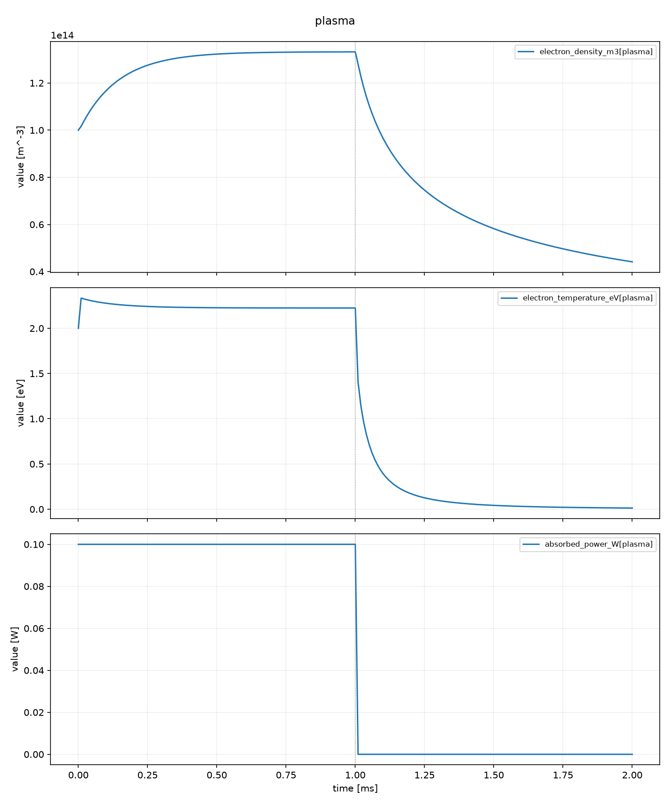
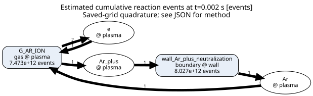

# モデリングマニュアル兼統合仕様書

対象は **Plasma Global Model 0.5.0／入力schema v4／結果HDF5 format v3** です。
本書に利用者向けの仕様と操作をまとめ、実装済みの機能と今後の拡張を区別します。

globalモデルを初めて扱う場合は、[理論と数値検証](THEORY.md)で保存則からの導出、方程式、近似、
実測したベンチマーク結果を確認できます。本書は操作と設定、理論文書は方程式と検証を担当します。
[完成版PDF](assets/global-model-theory.pdf)をダウンロードして閲覧することもできます。

| 知りたいこと | 読む箇所 |
|---|---|
| 自分の目的に適しているか | [1. 目的と適用範囲](#purpose) |
| まず動かして結果を見たい | [2. 初回実行](#quickstart)、[3. 計算例の読み方](#worked-example) |
| 自分の装置と化学機構を設定したい | [4. モデルを作る手順](#workflow)〜[9. 運転条件](#operation) |
| 許容差や保存間隔を設定したい | [10. 数値計算](#numerics) |
| probe・CSV・組成図・反応図を使いたい | [11. 出力](#outputs)〜[13. 図による解析](#figures) |
| 保存結果をPythonで解析したい | [14. 結果ファイルとAPI](#results) |
| 結果の妥当性を判断したい | [15. 検証と解釈](#validation)、[16. 困ったとき](#troubleshooting) |
| 古い入力を移行したい | [17. 互換性と移行](#migration) |

内部構造と保守手順は[開発・保守](DEVELOPMENT.md)、未実装の内容と次の作業は
[計画と残る課題](ROADMAP.md)へ分けます。

<a id="purpose"></a>

## 1. 目的と適用範囲

本パッケージは、低圧プラズマの各区画を完全混合と仮定し、化学種の数密度と選択した
エネルギー収支を時間積分するglobal modelです。反応・壁面損失・電力・流入出の釣り合いを
比較し、組成、過渡応答、反応の寄与、装置条件への感度を調べるために使います。

| 目的 | 調べられること | 必要な中心入力 |
|---|---|---|
| 単一放電容器 | 平均密度、電子状態、生成消滅、反応頻度 | 反応機構、体積・壁面積、吸収電力 |
| パルス放電・afterglow | 通電中と停止後の時間変化、反応の切替 | 波形と時間原点、十分な計算期間 |
| 放電部から処理部への輸送 | zoneごとの平均状態、移送・滞留の影響 | 区画体積と方向付き移送係数 |
| DC回路との結合 | 直列抵抗を含む電流・電圧・電力 | 回路寸法、抵抗、適切な電子係数 |
| 壁面・表面反応 | イオン入射束、反応分岐、被覆率 | 壁輸送、分岐、site密度、表面速度式 |
| RF・CCP・ICPの傾向評価 | 簡略結合モデルによる応答 | 校正・独立検証。これらはexperimental構成 |

zone内の座標ごとの密度、流速、局所電磁場、sheathの空間構造、表面の面内分布は解きません。
Langmuir probeのI–V、発光強度、視線積分、計測器応答も自動では求まりません。
これらが目的なら、空間計算や計測モデルと平均量を結び付ける定義が必要です。

### zoneと擬似1次元の意味

`zone` は固定体積を持つ1つの完全混合区画です。各zoneに初期組成、圧力、気体温度を設定し、
壁面、電源、入口、ポンプを接続します。電子係数等のモデル選択はcaseで共通です。
条件はzoneごとに異なり、反応の `zones` 指定で活動する場所を限定できます。

`放電部 → 輸送部1 → 輸送部2 → 処理部` のように接続すれば、空間順に並ぶ区画のモデルとして
使えます。ただし、現行edgeは上流密度に比例する方向付き移送です。座標、区間長、断面積から
流れや拡散を自動計算しません。圧力差、逆流、拡散境界条件を解く1次元モデルとしての精度は
確立しておらず、区画数を増やすだけでは空間精度の保証になりません。

| 用語 | 表すもの |
|---|---|
| zone | 体積を持つ計算区画。内部は一様と仮定 |
| surface | 1つのzoneに接する面積を持つ壁・基板 |
| edge | 2つのzone間の方向付き粒子・エネルギー移送 |
| power_port | 1つのzoneへ接続する電源モデル |
| probe | zone平均・表面平均・電源量を選ぶ名前。計算領域は増やさない |

本書で使うheavy speciesは電子を除く気相の原子・分子・イオン、EEDFは電子エネルギー分布です。
closureは空間等を解かない代わりに平均量から必要な物理量を求める関係式、forcingは電源・流量等の
外部指令、ledgerは1回の物理評価で得る生成消滅・energy収支の内訳を指します。
siteは表面で吸着種が占有する位置です。これらは追加の設定ファイルの名前ではありません。

<a id="quickstart"></a>

## 2. 初回実行

リポジトリのルートで、Python 3.11以上の環境へインストールします。
通常利用に開発用依存やリポジトリ内のテストデータは不要です。

```bash
python -m pip install .
plasma-global init argon_maxwellian --output work/argon
plasma-global validate work/argon/case.yaml
plasma-global outputs work/argon/case.yaml
plasma-global run work/argon/case.yaml --output runs/argon-001
```

`init` は必要なcase、反応機構、数値CSVを新しいディレクトリへコピーします。
`validate` は入力とモデルの組み立てを確認し、時間積分はしません。
`outputs` はそのモデルで利用可能な系列名、単位、保存対象かどうかを表示します。
`run` が計算し、`result.h5` と人が読む `summary.yaml` を保存します。
出力先は毎回新しい名前にします。既存の結果は上書きしません。

図とCSVを含む一通りの解析例は次です。

```bash
python -m pip install ".[plot,graph]"
plasma-global init argon_analysis --output work/analysis
plasma-global run work/analysis/case.yaml --output runs/analysis-001
```

反応図の画像にはPythonの `graphviz` に加えてGraphviz本体の `dot` が必要です。
`dot -V` で起動を確認してください。導入方法は
[Graphviz公式ガイド](https://graphviz.readthedocs.io/en/stable/manual.html#installation)を参照します。
`format: dot` はPython側のgraphvizだけで出力できます。時系列図にはMatplotlibを使います。
CLIは要求された描画依存を積分前に確認します。

### 同梱例の選び方

| `init` に渡す名前 | 主な用途 | 解釈 |
|---|---|---|
| `argon_maxwellian` | 単一zone、実断面積、吸収電力、afterglow | 標準構成から始める基本例 |
| `argon_analysis` | 上と同じ物理、probe・CSV・組成図・反応図 | 出力設定の具体例 |
| `argon_lxcat` | 2 zone、輸送、近似EEDF、ICP／CCP | experimentalな区画・結合モデルの例 |
| `crane_two_reaction_argon` | 簡単な反応機構と別コード出力の比較 | 化学反応の回帰比較 |
| `zdplaskin_example2` | 電子係数CSV、local-field、DC直列回路 | 別コード由来の回帰比較 |
| `rf_envelope_calibration` | RF簡略モデルの校正設定 | 校正手順の例 |
| `smoke` | 複数の実験的拡張を短時間実行 | 接続確認用。装置の開始例には基本Arを使う |

<a id="worked-example"></a>

## 3. 計算例の読み方と有用性

`argon_analysis` は体積0.01 m³、壁面積0.1 m²、気体温度300 K、初期Ar密度2.0×10²⁰ m⁻³、
Ar⁺ seed 1.0×10¹⁴ m⁻³、初期平均電子エネルギー3 eVの例です。
0〜1 msは吸収電力0.1 Wを電子へ与え、1〜2 msは0 Wにします。流入と排気はありません。
実断面積からMaxwellian反応係数を求め、準中性、電子エネルギー収支、Bohm壁損失を使います。



図の縦線は1 msの運転切替です。密度、等価電子温度、電力は単位が異なるため別panelに表示します。
初期平均エネルギー3 eVは初期電子温度2 eVに対応します。
この過渡例の2 msでの値は電子密度がおよそ4.42×10¹³ m⁻³、電子温度が0.0125 eVです。
これは低温afterglowの終端値です。高電力の定常値や装置で測った値として使いません。



反応図は `Ar_plus` の生成・消費に関係する反応を抽出したものです。化学種から反応node、
反応nodeから生成物へ線を引きます。重みは保存点から積分したイベント数の推定です。
この図では電離と壁面中性化の関係を読み取れます。反応頻度と化学量論係数を合わせて
生成消滅を考察し、密度だけでは判別しにくい反応の寄与を調べます。

両図は上の `init argon_analysis` → `run` で生成する `plots/plasma.png` と
`networks/events.svg` です。本書へ収録した図は0.5.0の実計算出力です。
外観差や計算環境による微小差を許容し、画像の一致を物理的な合否条件にしません。

例えば「停止後のイオン密度を長く維持したい」という問いなら、壁面積・壁輸送・輸送先を
一度に変更せず、それぞれを変更したcaseで比較します。密度と電子温度、壁への束、
電離・消失イベントを同時に見ると、増減の理由を検討できます。
独立実験への一致は、この例からは主張していません。

<a id="workflow"></a>

## 4. 自分のモデルを作る手順

1. 比較したい観測量と運転条件を決めます。zone平均か、表面束か、電流かを先に定義します。
2. 最初は1 zoneと必要最小限の化学種・反応で作ります。輸送を調べる必要がある場合にzoneを分けます。
3. 体積、接する壁面積、流量、排気速度、電源の接続先を決めます。同じ容積や面積を重複計上しません。
4. 初期圧力・温度・組成・荷電seedと、電子係数の生成条件・収録範囲を確認します。
5. 電子状態の決め方、壁輸送、必要なら気体エネルギーと表面反応を選びます。
6. 一定条件なら `run.duration_s`、条件を切り替える場合だけ `run.steps` や波形を使います。
7. 欲しいprobe・系列・図を `output` へ指定し、`validate` と `outputs` を実行します。
8. 計算後に終了状態、適用条件、数値収束、保存間隔への依存を確認してから条件を比較します。

反応や境界を選んだ根拠と、対象装置へ対応する量を `case.description`、反応の `metadata`、
係数の `provenance` に記録します。出典の注記は適用条件を検証済みにするflagではありません。

基本となる釣り合いは次です。化学量論係数νは生成が正・消費が負、Rは反応進行速度です。

```text
heavy species:  dn_s/dt = Σ_r ν_rs R_r + 壁・表面の生成消滅 + 流入出・zone間移送
electron:       dW_e/dt = 電子吸収電力/V - 反応損失 - 壁損失 - 弾性移送 + energy輸送
```

密度式はm⁻³ s⁻¹、電子energy式はW m⁻³です。各項を担う反応・境界・輸送を設定することでモデルを作ります。
気体温度固定とlocal-fieldでは、それぞれ対応するenergyの時間積分を行いません。

<a id="input"></a>

## 5. 入力全体の仕様

通常実行で受け付ける入力は `schema_version: 4` です。

| ルート項目 | 必須 | 内容 |
|---|---|---|
| `schema_version` | ○ | 整数4 |
| `case` | ○ | `name` と任意の `description` |
| `chemistry` | ○ | 化学機構の直接定義、または `{file: chemistry.yaml}` |
| `reactor` | ○ | zone、surface、edge、入口、ポンプ、電源 |
| `models` | ○ | 電子モデル。その他は必要な場合に選択 |
| `run` | ○ | 開始時刻、一定時間または条件切替 |
| `solver` | 省略可 | 許容差、保存時刻、step幅 |
| `output` | 省略可 | 保存する派生量、probe、CSV、図 |
| `experimental` | 省略可 | film、wall inventory、拡張状態の明示有効化 |

基本は1つのYAMLです。共有する化学機構だけ別YAML、数値表だけCSVへ分けられます。
`include`、多段継承、別のscenario設定はありません。HDF5への入力表の事前変換も不要です。
相対pathはそのfile指定を記述したYAMLのディレクトリ基準です。環境変数と `~` は展開しません。

重複したYAMLキー、未知の設定、数値文字列の暗黙変換、非有限値、未知の参照を拒否します。
booleanには `true`／`false` を使います。`on`／`off` は文字列、`2.0e20` は数値、
`012` は十進12、`1:20` と日付は文字列として扱います。

[JSON Schema](generated/case.schema.json)は構造・型・既定値をコードから生成します。
chemistryや電源指令と実際のモデルの整合等は `validate` が追加で検査します。
[最小YAML](generated/minimal_case.yaml)は構造確認用で、反応や電源を持たない例です。
物理を検討する開始例には `init` の同梱例を使ってください。

<a id="reactor"></a>

## 6. 装置・初期状態・輸送

### zoneと初期状態

装置要素はIDをkeyにしたmappingです。同じIDをlist内で再記入しません。
以下は `reactor` のzone設定の例です。

```yaml
reactor:
  zones:
    plasma:
      volume_m3: 0.01
      initial:
        pressure_Pa: 1.0
        gas_temperature_K: 300.0
        mole_fractions: {Ar: 1.0}
        seed_densities_m3: {Ar_plus: 1.0e12}
        mean_energy_eV: 3.0
```

| 初期組成の指定 | 密度の決め方 |
|---|---|
| `mole_fractions` ＋任意の `seed_densities_m3` | 中性比率は総和1。p／kTからheavy seedの分を引き、中性密度を配分 |
| `densities_m3` | heavy gas species密度を直接指定。p・Tとの整合が必要 |

両方式を併用しません。直接密度の指定にseedも併用しません。正イオンや電子のseedを黙って追加しません。
準中性の場合、電子密度は荷電heavy speciesから求めます。
`energy_balance` には初期 `mean_energy_eV` が必要で、`local_field` では指定しません。

初期圧力は運転中の圧力制御ではありません。運転中のheavy gas圧力は
`p = k_B T_g Σ_s n_s` です。和にはイオンを含み電子を含めません。
固定温度でも、反応・流入・排気で粒子数が変われば圧力は変わります。

### 壁面・入口・排気・接続

| 要素 | 中心設定 | 物理的な意味 |
|---|---|---|
| `surfaces.<id>` | `zone_id`, `area_m2`, `temperature_K`, `wall_transport` | 接するzoneと面積・壁温・壁損失 |
| `gas_inlets.<id>` | `zone_id`, `temperature_K`, `flow_sccm` | species別の流入粒子数と入口温度 |
| `pumps.<id>` | `zone_id`, `speed_m3_s` | 現在密度に比例する排気 |
| `edges.<id>` | `from_zone`, `to_zone`, `conductance_m3_s` | 上流から下流への移送 |
| `power_ports.<id>` | `zone_id`, `model` | 接続する電源・回路 |

sccmは基準101325 Pa・273.15 Kに対応する換算値を使い、1 sccmを4.477962×10¹⁷ particles/sとします。
装置内の実体積流量とは異なります。ポンプ速度Sによる密度減少は `dn_s/dt = -(S/V) n_s` です。
edgeの係数Cについて、sourceから毎秒 `C n_source,s` 個を取り、targetへ同数を加えます。

```text
dn_source,s/dt = -(C/V_source) n_source,s
dn_target,s/dt = +(C/V_target) n_source,s
```

これは `C(n_source - n_target)` や圧力差に比例する流れではありません。
逆方向のedgeも明示しなければ逆流しません。内部edgeだけの体積積分粒子数は保存します。
電子energyを積分する場合はその密度、気体energyを積分する場合はエンタルピー `U_g + p` を
流出入させます。固定した体積が自動変形することはありません。

<a id="chemistry"></a>

## 7. 化学種・反応・外部数値表

`chemistry` に直接定義するか、`chemistry: {file: chemistry.yaml}` で共有します。
外部化学機構は `schema_version: 4` です。

| 項目 | 内容 |
|---|---|
| `species` | `id`, `phase`, `charge`, `mass_amu`, `elements` 等を持つlist、またはCSV |
| `gas_reactions` | zone内の気相反応のlist、またはCSV |
| `boundary_reactions` | 壁入射イオンの生成物・分岐のlist、またはCSV |
| `surface_reactions` | 被覆率・表面反応のlist、またはCSV |
| `rate_models` | 共用速度式のID mapping。必要な場合だけ別YAML参照 |
| `cross_sections` | 断面積ID・CSV・出典等のlist。必要な場合だけ別YAML参照 |
| `provenance` | 機構の出典・注記 |

気相反応は `id`、`equation`、`rate` を中心に定義します。速度式は近くへ直接書き、
共有する場合だけ `rate_models` のIDで参照できます。次は電子係数CSVを使う反応の断片です。

```yaml
gas_reactions:
  - id: ionize
    equation: e + Ar -> 2 e + Ar_plus
    rate: {kind: electron_table, rate_id: ionize}
    electron_energy_transfer_eV: -15.76
```

`electron_energy_transfer_eV` は電子への加熱が正、冷却が負です。
損失を正で書く `energy_loss_eV` も使えますが、両方を併記しません。
table専用反応の移送は0の場合も明示します。`gas_heating_eV` は気体への加熱です。
無作用なenergy指定、未知の種・速度式、元素・電荷・siteの不整合を検査します。
壁との電荷交換を含むboundaryは、気相の閉じた反応とは異なる境界として扱います。

### 速度式

気相のmass actionは `R_r = k_r Π_s n_s^α_rs` です。電子が反応物なら電子密度も掛けます。
気相で反応物総次数qの係数単位は `m^(3(q-1))/s`、反応進行速度Rはm⁻³ s⁻¹です。
表面速度式は入射束やsite密度を使う別の定義なので、気相の係数単位を流用しません。

| `rate.kind` | 中心入力・意味 |
|---|---|
| `electron_impact` | `cross_section`, `branching_yield`。電子衝突断面積に結び付ける |
| `electron_table` | `rate_id`。電子係数CSVの `k:<rate_id>` |
| `constant` | `value`。一定係数 |
| `first_order` | `rate_s_inv`。一次速度 |
| `arrhenius` | `A`, `beta`, `activation_eV`。`A (T_g/300)^beta exp[-E_a/(k_B T_g)]` |
| `tabulated_1d` | `axis`, `file`, `bounds`。状態量に対する1変数の係数表 |
| `sticking` | `value`、任意の `coverage`。中性入射の付着 |
| `ion_assisted` | `yield`, `threshold_eV`, `reference_energy_eV`, `exponent`、任意の `coverage` |
| `desorption` | `frequency_s_inv`, `activation_eV`。脱離 |
| `langmuir_hinshelwood` | `A_m2_s_inv`, `activation_eV`。表面反応 |
| `experimental.electron_temperature_power_law` | `A`, `reference_temperature_K`, `exponent`。電子温度の経験式 |

`tabulated_1d` のCSVは厳密に `x,value` です。軸は `gas_temperature_K`、`mean_energy_eV`、
`electron_temperature_eV`、`reduced_field_Td`、`pressure_Pa` から選びます。
この速度式の範囲指定は現行の名称が `bounds: error`／`clip` です。
clipは端値保持で、電子・電源CSVの `hold` と同じ名称には統一されていません。

### 断面積

1 curveは `energy_eV,sigma_m2`、複数curveの共通CSVは `channel_id,energy_eV,sigma_m2` です。
channelは断面積IDと対応し、別々のenergy gridを保てます。反応との対応、単位、収録範囲、出典を確認します。

Maxwellian係数は区分線形断面積との積を解析積分します。正のonsetより下を0とし、最終nodeより上へ
外挿しません。未収録energy-weighted tailの条件1×10⁻⁶と、最大収録断面積を上側へ一定延長した
envelopeの寄与比1×10⁻³を検査します。後者は収録不足を見つけるための仮定付き感度指標です。
未知の実断面積がそのenvelope以下と保証するものではなく、物理的な係数誤差の上限や信頼区間にはしません。
この仮定は結果のmetadataにも保存します。

### CSV共通の扱い

電子係数・電源・電子密度profileには、標準列名と外部列名を対応付ける `columns` を使えます。
以下は電子係数ファイルの設定断片です。

```yaml
coefficients:
  file: instrument.csv
  columns:
    mean_energy_eV: MeanEnergy
    reduced_mobility_1_V_m_s: MobilityTimesN
    k:ionize: IonizationRate
```

keyが標準名、valueが外部CSV列名です。指定した場合は選択列だけを数値として読み、未選択の注記列等は
使いません。対応を省略すれば標準列名で読みます。単位換算はせず、SIと指定のeV・Tdへ揃えます。
header重複、行形状、有限値を検査し、sort・欠損補完・外挿は暗黙に行いません。
この `columns` は全種類の化学反応CSVや断面積CSVに適用する汎用変換器ではありません。

<a id="physics"></a>

## 8. 電子・気体エネルギー・壁・表面

### 電子状態の決め方

| `models.electrons.kind` | 計算するもの | 係数 |
|---|---|---|
| `energy_balance` | 電子energy密度を積分し、平均energyを求める | 既定のMaxwellian、またはmean-energy軸CSV |
| `local_field` | 電源／回路のE/Nから電子状態を代数的に求める | E/N軸CSV、または `experimental.approximate_two_term` |

```yaml
models:
  electrons:
    kind: energy_balance
```

上は `coefficients: {kind: maxwellian}` を省略した標準の書き方です。
表を使う場合は `coefficients: {file: electrons.csv}` とします。
別の場所にelectron closureやlookupを書く必要はありません。
`W_e = n_e e <ε> = (3/2) n_e e T_e`、したがって `T_e[eV] = (2/3) <ε>[eV]` です。
energy収支は吸収電力、反応energy移送、壁損失、弾性移送、輸送で構成します。
電子密度の既定は準中性 `n_e = Σ_s z_s n_s` で、負値をhidden floorで正にしません。

local-fieldは電子energyの緩和時間を解きません。電源・mobility・電子係数の反復は
E/N、mobility、吸収電力の相対残差1×10⁻⁶、最大12回で判定し、非収束を明示エラーにします。
最終の係数と電源量は同じ反復状態に対応させます。

### 電子係数CSVと適用条件

| 標準列 | 意味 |
|---|---|
| `mean_energy_eV` | 全電子表で必要な平均電子energy |
| `reduced_field_Td` | local-fieldで必要なE/N。1 Td = 10⁻²¹ V m² |
| `k:<rate_id>` | 反応係数。使用する反応に必要な列を要求 |
| `momentum:<species_id>` | 弾性energy移送に使う中性種の運動量移行係数 |
| `mobility_m2_V_s` | 生成時の中性密度に対する絶対mobility μ |
| `reduced_mobility_1_V_m_s` | reduced mobility μN |

μとμNを併記しません。絶対μには `coefficients.mobility_reference_neutral_density_m3` を明示し、
初期状態から生成時密度を推測しません。実行中はμNの相似則で現在の中性密度へ換算します。
μNはそのまま保持し、現在の中性密度で割ってμを求めます。表で使わないμ・E/N列は不要ですが、
DC等が必要とする量は必須です。local-fieldのDCは表のμを使い、固定μの二重指定を拒否します。
energy-balanceのDCでは表にμがない場合に固定 `electron_mobility_m2_V_s` を指定できます。

使用する反応係数の欠落を別の反応モデルで補いません。宣言した運動量係数の欠落もエラーです。
運動量データを持たない中性種については弾性energy移送を省略して警告する場合があるため、
計算の成功だけでなくassessmentの警告と、収録する衝突過程も確認します。

軸は有限・一意・厳密昇順、係数は有限・非負で、補間はlinearです。
`coefficients.bounds` は既定 `error`、明示した `hold` だけが端値を保持します。
holdは適用範囲が物理的に拡大したことを意味しません。

電子表は生成時の混合組成に依存します。近似two-termの準備表は初期中性組成比に固定され、
反応に伴う組成変化へ追従して再生成しません。同じ初期組成のzoneでは表を共有します。
既定の準備gridはenergy 10⁻³〜160 eV・360点、E/N 1〜100 Td・48点です。
power-balanceと最終energy binの確率質量1×10⁻³以下を検査しますが、検証済みBoltzmann solverの
代替とは扱いません。大きく組成が変わる場合は別途比較が必要です。

### 気体温度と外部指定電子密度

気体温度の既定は固定です。`models.gas_energy: {kind: evolved}` はexperimental構成で、
全heavy gas speciesの `cv_over_kb` が必要です。温度そのものではなく
`U_g = k_B T_g Σ_s (cv_s/k_B) n_s` を積分し、温度を戻します。
気体への電力、反応加熱、弾性移送、壁との熱交換、輸送のエンタルピーを合計します。

電子密度を外部指定する場合は `models.electron_density.kind: experimental.prescribed_profile` と
CSVの `file` を使います。補間は `linear`／`previous`、範囲は `bounds: error`／`hold`、
時刻原点はrun開始＋ `time_offset_s` です。必要なら `zone_columns` でzoneと列を対応付けます。
外部密度は自己無撞着な準中性解と同じ意味にはならず、電荷残差も確認します。

### 壁輸送と表面反応

| `wall_transport.kind` | 意味 |
|---|---|
| `bohm` | 正イオンのBohm入射束 |
| `prescribed_frequency` | 指定した損失周波数 |
| `ambipolar` | 指定した拡散係数と拡散長による壁輸送 |
| `off` | その面の壁輸送を無効化 |

Bohm入射束は `Γ_i = h_i n_i sqrt(e T_e/m_i)`、zoneでの損失は `Γ_i A/V` です。
数値 `h_factor` はedge／bulk密度比を直接表し、隠れた0.61係数は掛けません。
`auto` は `0.86/sqrt(3 + L n_neutral σ_in/2)` をmin／max内へ収め、各物理評価で更新します。
特性長Lを省略した場合はそのsurfaceのV/Aを使います。

同じイオン束を壁への粒子損失、boundary生成物の分岐、表面反応、電子壁損失へ渡します。
活動する入射イオンごとに分岐確率の合計1を要求し、生成物を元素名から推測しません。
明示sheath energyがなければ、Bohm入射束と電子熱束の電流収支からfloating sheathを求めます。
この標準域は単一一価正イオンです。多価イオンや成立しない電流収支を黙って0 eVへ置換しません。
sheath energyは `T_e ln[Γ_e,thermal / Σ_i(z_i Γ_i)]`、電子熱束は
`Γ_e,thermal = n_e sqrt(e T_e/(2πm_e))` です。電子壁損失は入射イオン1個あたり
`2 z_i T_e + sheath_energy` eVを使い、物理的なsheath形状を解く代わりの関係式です。

表面反応を使う場合は `models.surface_kinetics: {kind: mass_action}` を明示し、speciesのsurface所属、
site密度、必要な `initial_coverages` を設定します。被覆率は占有種だけを積分し、free siteは代数量です。
モデルを無効のまま初期被覆率を指定するとエラーになります。機構に表面反応を含めても
モデルを選ばなければ積分されず、警告を出します。

film・wall inventory・汎用拡張状態は `experimental` で明示的に有効化します。
反応イベントの収率から計算する蓄積量で、宣言のない膜成長や蓄積を自動推定しません。

<a id="operation"></a>

## 9. 電源・回路・時間変化

電源は `reactor.power_ports.<id>.model` で宣言し、一定値もここへ置けます。

| `model.kind` | 中心設定 |
|---|---|
| `prescribed_power` | `absorbed_power_W` と `electron_fraction`／`gas_fraction`（合計1） |
| `dc_series` | `source_voltage_V`, `ballast_resistance_ohm`, `gap_m`, `electrode_area_m2` |
| `external_table` | `file`, 任意の `columns`, 補間・範囲・scale |
| `experimental.rf_envelope` | control、周波数、吸収電力またはRMS電圧、校正係数 |
| `experimental.ccp` | control、周波数、吸収電力またはRMS電圧、同じzoneのsurfaceへの `coupling_target` |
| `experimental.icp` | `delivered_power_W` と周波数 |

入力電力、吸収電力、電子への電力、皮相電力を区別します。RF／CCPの `absorbed_power_W` は
プラズマへ吸収された実電力です。lossless sheathを含むCCPの `V_rms I_rms` は皮相電力VAで、
電子加熱へそのまま加算しません。controlで使わない電圧・電力指定は拒否します。
RF側の推定イオンenergyと、壁closureが表面反応へ渡すsheath energyは別の量です。

一定条件では、電源modelに一定値を設定して `run: {duration_s: 0.002}` とします。
変更がある場合だけstepを使います。以下はsourceがprescribed_powerの場合です。

```yaml
run:
  steps:
    - label: powered
      duration_s: 0.001
      commands:
        power_ports:
          source: {absorbed_power_W: 0.1}
    - label: afterglow
      duration_s: 0.001
      commands:
        power_ports:
          source: {absorbed_power_W: 0.0}
```

labelは任意の説明で繰り返せます。必須step IDやrecipeファイルはありません。
指令のkindは参照先から決まり、指令側に書きません。毎step「装置の一定値＋そのstepのoverride」で
解決し、前stepの値を持ち越しません。一定値も指令もない必須量はエラーです。
入口流量とsurface温度もcommandsで変更できます。

square pulseは電源指令の `waveform` に `kind: square_pulse`、`duty_cycle`、`repetition_Hz`、
任意の `phase_s` を設定します。`time_reference` は既定 `run_start`、明示した `step_start` だけが
stepごとに位相を始めます。`run.start_time_s` の既定は0で、`duration_s` と `steps` は併用しません。

### 電源CSV

時刻列は `time_s` で、次の形を受け付けます。

| 電力を与える列 | 解釈 |
|---|---|
| `electron_power_W` | 電子分。gas_power_Wは別に加える |
| `absorbed_power_W` | 電子＋気体の総吸収量。gas分を引いた量が電子分 |
| `voltage_V` ＋ `current_A` | 各列を補間・scale適用して積を取り、gas分を引く |

直接power列があればそれを使い、併記V／Iから電力を再定義しません。
`reduced_field_Td` があれば電子状態の入力として使えます。時刻は既定でrun開始＋ `time_offset_s`、
必要なら `time_reference: step_start` を選べます。補間は `linear`／`previous`、範囲は `error`／`hold`。
errorでは運転期間を表が覆う必要があります。holdは端値を継続します。

<a id="numerics"></a>

## 10. 数値計算・時間と保存間隔

積分器はSciPyの公開[BDF](https://docs.scipy.org/doc/scipy/reference/generated/scipy.integrate.BDF.html)
です。本パッケージの既定許容差は `rtol: 1.0e-6`、`atol: 1.0e-14` です。
atolは密度のSI値へ直接適用する値ではなく、初期状態から固定したscaleで無次元化した状態へ適用します。

```yaml
solver:
  rtol: 1.0e-6
  atol: 1.0e-14
  sample_interval_s: 1.0e-5
```

`first_step_s` と `max_step_s` は任意です。`sample_interval_s` は保存間隔で、積分step幅ではありません。
特定の時刻が必要なら、これと排他的に `save_at_s` の昇順listを指定します。
時刻指定はsimulationの絶対時刻です。未指定なら採用された積分点を保存します。
run始終端と全forcing切替点を追加し、保存点は最大100,000点です。

運転step、pulse、previous補間の不連続点でBDFを再開します。
状態は連続ですが、切替時刻に保存するforcing依存量は**切替前の左側値**です。
例えば1 msで電力を切る例では、1 msの保存電力は通電側、次の保存時刻は停止側になります。
累積イベントは区間ごとの片側rateを使い、このジャンプをまたいで平均しません。

Newtonの試行点は物理領域へ連続化したviewで評価しますが、採用された全stepで密度・energy・被覆率等の
領域を検査します。保存間隔を粗くしても途中の大きな違反は失敗します。
許容幅内の丸めだけを結果の境界へ揃え、大きな負密度や過充填を成功値へ射影しません。

数値収束はrtol／atolを厳しくした比較で、イベント積分の収束は保存間隔を細かくした比較で確認します。
保存点を増やすだけで積分解そのものの許容誤差は厳しくなりません。

<a id="outputs"></a>

## 11. 出力設定と物理量

全ODE状態は選択に関係なく保存します。heavy species密度、選択したclosureのenergy、独立被覆率、
選択した拡張状態が対象です。代数量は必要なものを選びます。

```yaml
output:
  quantities: [electron_density_m3, electron_temperature_eV, pressure_Pa]
  zones: [plasma]
  csv: true
```

quantitiesは電子密度・温度・平均energy、気体温度、吸収電力、E/N、電荷残差、圧力、中性密度、
heavy密度を選べます。zonesを省略すると全zoneです。zonesだけの無作用な指定は拒否します。
精密な選択には `observables` に完全名を指定しますが、quantitiesとは併用しません。
`summary_series` で終端の要約へ載せる系列も指定できます。未知名や重複を拒否し、未計算量を0で埋めません。

| 系列例 | 意味・単位 |
|---|---|
| `n[plasma,Ar]` | heavy gas species数密度、m⁻³ |
| `electron_density_m3[plasma]` | closureで求めた電子密度、m⁻³ |
| `electron_temperature_eV[plasma]` | 平均energyの2/3の等価温度、eV |
| `pressure_Pa[plasma]` | heavy gas圧力。電子圧力を含めない、Pa |
| `partial_pressure_Pa[plasma,Ar]` | `n_s k_B T_g`、Pa |
| `mole_fraction[plasma,Ar]` | 全heavy gas speciesを分母にした数密度比、1 |
| `net_production_m3_s[plasma,Ar]` | 反応・壁・表面・輸送を含むRHSの `dn_s/dt`、m⁻³ s⁻¹ |
| `reaction_energy_loss_W_m3[plasma]` | 電子の反応energy損失。負なら電子加熱、W m⁻³ |
| `wall_energy_loss_W_m3[plasma]` | 電子の壁energy損失、W m⁻³ |
| `elastic_heating_W_m3[plasma]` | 電子から気体への弾性energy移送、W m⁻³ |
| `gas_reaction_rate_m3_s[plasma,R]` | 気相の反応進行速度、m⁻³ s⁻¹ |
| `surface_reaction_rate_m2_s[wall,R]` | 表面の反応進行速度、m⁻² s⁻¹ |
| `boundary_reaction_rate_m2_s[wall,R]` | 入射イオンのboundary分岐の進行速度、m⁻² s⁻¹ |
| `gas_event_rate_s_inv[plasma,R]` | 気相反応速度×体積、s⁻¹ |
| `surface_event_rate_s_inv[wall,R]` | 表面反応速度×面積、s⁻¹ |
| `boundary_event_count[wall,R]` | run開始からのイベント数の推定、1 |
| `coverage[wall,S]` | 表面種Sの被覆率、1 |
| `film[wall]` | 選択した膜modelの厚さ、m |
| `inventory[wall,S]` | 選択した蓄積modelの粒子数、1 |

`reaction_rates: true` で活動する全気相・表面・boundary反応の速度、頻度、累積数を保存します。
反応頻度はspeciesの正味生成速度ではなく、粒子の生成消費数には化学量論係数が掛かります。
boundary頻度には実際の分岐確率を含みます。

図やprobeが必要とする派生量は自動保存します。多数の反応・保存点を選ぶとメモリと容量が増えます。
任意の拡張状態には `output.units` で単位を明示できます。既知量の単位変更や単位換算は行いません。
旧結果が明示的に `unspecified` とした単位は、現在のカタログから推定し直しません。

<a id="probes"></a>

## 12. 名前付きprobe

同じoutput内の `probes` へ、観測対象を1つずつ指定します。
以下はzoneがplasma、壁がwall、電源がsourceの場合です。

```yaml
output:
  probes:
    bulk:
      zone: plasma
      species: [Ar, Ar_plus]
      quantities: [number_density_m3, mole_fraction, electron_temperature_eV]
    wafer:
      surface: wall
      species: [Ar_plus]
      quantities: [incident_flux_m2_s, wall_sheath_energy_eV]
    supply:
      power_port: source
```

zone、surface、power_portのいずれか1つを選びます。
probe／plot／networkの名前は英数字で始め、続きには英数字・`_`・`-`・`.` を使えます。
ファイルpathを名前には使いません。

| 対象 | 代表的な量・意味 |
|---|---|
| zone | species密度・分率・分圧・正味生成、電子状態、気体状態、energy ledger。体積平均 |
| surface | 正イオンの面平均入射束、wall closureのsheath energy、被覆率・温度 |
| power_port | 実際に電源modelが返す電力、DCの電流・電圧、選択したRF等の量 |

zoneの既定量は電子密度・温度・全heavy species密度、surfaceは入射束、power_portは電子電力・気体電力です。
speciesは既定で対象量に対応する全種を選びます。被覆率とsurface温度はsurface kineticsが有効な場合に選べます。
対象に無関係な量や、種を使わない量だけへのspecies指定は拒否します。

保存名は `probe[bulk,number_density_m3,Ar]` 等です。元系列、単位、対象の解釈をHDF5・series.yaml・summaryへ
記録します。probeは実測器を模擬する機能ではなく、同じzone内の2座標を別値として計算できません。

電源固有量のカタログは初期評価から取得します。運転途中でその量が未定義になる場合はエラーです。
全停止のoff指令等で値が未定義になる組合せを、黙って0埋めしません。
必要なら継続して定義される共通の電力量を選びます。

<a id="figures"></a>

## 13. 組成・時系列・反応図による解析

### 組成と比較図

`output.plots` に図をまとめます。以下は上のbulk probeと組み合わせる断片です。

```yaml
plots:
  fractions:
    kind: composition
    zone: plasma
    species: [Ar, Ar_plus]
    quantity: mole_fraction
    yscale: log
    time_unit: ms
  plasma:
    series: ["probe[bulk,*]", "absorbed_power_W[plasma]"]
    time_unit: ms
    format: png
```

compositionは `number_density_m3`（既定）または `mole_fraction` です。
分率の分母には選択外のheavy gas speciesとイオンを含み、電子を含めません。
選択種だけで再正規化しません。真空状態の分率は未定義として拒否します。

seriesには完全名または `*` を使えます。`[` と `]` は系列名の文字で、文字集合の検索構文にはしません。
混在する単位は別panelへ分けます。縦軸は `linear`／`log`／`symlog`、時間単位は `s`／`ms`／`us`／`ns`、
形式は `png`／`svg`／`pdf`、dpiは正の整数です。`time_range_s: [0.001, 0.002]` で絶対時刻の範囲を選べます。
logの0はマスクして件数を図に表示し、負値は拒否します。小さな正値への置換は行いません。

```bash
plasma-global plot runs/analysis-001/result.h5 --output figures/recreated
plasma-global plot runs/analysis-001/result.h5 --output figures/pdf --format pdf
plasma-global plot runs/analysis-001/result.h5 "n[plasma,Ar_plus]" --output figures/ion
```

系列を省略すれば保存設定を使い、明示したformat／dpiがその項目を上書きします。
系列を直接渡す場合は各系列を1図ずつ描きます。

### Graphvizの反応機構・イベント図

`output.networks` に設定します。

```yaml
networks:
  mechanism:
    mode: mechanism
    domains: [gas, boundary]
    format: svg
  ions:
    mode: events
    species: [Ar_plus]
    measure: cumulative
    min_fraction: 0.05
    format: svg
```

| 設定 | 意味 |
|---|---|
| `mode: mechanism` | 反応参加関係の構造図 |
| `mode: events` | 保存した反応量による重み付き図 |
| `measure: rate` | 選択時刻のイベント頻度、s⁻¹ |
| `measure: cumulative` | run開始からのイベント数の推定。既定 |
| `time_s` | 保存点に一致する絶対時刻。省略すると最後の時刻 |
| `domains` | gas／boundary／surface。既定は全domain |
| `zones`, `surfaces` | 対象領域の限定 |
| `species` | 指定種が反応物・生成物として参加する反応の選択 |
| `min_fraction` | 最大イベント量に対する0〜1のしきい値 |
| `format` | svg（既定）／png／pdf／dot |

time、measure、thresholdはイベント図で使います。構造図で無作用な指定は拒否します。
指定時刻は近傍点へ暗黙に移しません。計算前に `save_at_s` 等で必要な点を保存します。
画像とともにDOT・JSONを保存し、選択条件、時刻、単位、数値、除外反応IDを残します。

**イベント数は保存点をforcing区間ごとに台形積分した連続量の推定です。**
確率的な個別イベントの実測・実現数や、ODEへ追加して厳密積分した状態ではありません。
保存間隔に依存するため、これを細かくして収束を確認します。

反応図は「化学種 → 反応 → 生成物」の参加関係で、原子の移動先を一意に割り当てる図ではありません。
入口・ポンプ・zone間輸送、宣言されていない壁吸収、壁との電荷交換、準中性closureによる電子数変化は
追加していません。全粒子・電荷収支の図として解釈せず、正味生成速度・壁束・輸送条件と合わせて考察します。

```bash
plasma-global network runs/analysis-001/result.h5 --output diagrams/recreated
plasma-global network runs/analysis-001/result.h5 --output diagrams/ions --mode events --species Ar_plus
```

mode等を省略すると保存設定を使います。formatだけの指定は保存設定の形式を変更します。
意味を選ぶ引数を渡す場合はその指定から新しい設定を作るため、必要なdomainや閾値も明示します。
未保存のイベント系列を要求するとエラーです。元caseを再実行して既存結果へ継ぎ足しません。

<a id="results"></a>

## 14. 結果ファイル・再現性・Python API

| 出力 | 内容 |
|---|---|
| `result.h5` | 全状態、時刻、選択派生量、終了状態、単位、完全なmetadata |
| `summary.yaml` | 終了状態、機能分類、solver統計、指定系列とprobeの終端値 |
| `result.csv` | `output.csv: true` の場合の数値表 |
| `series.yaml` | run内CSVの列・単位・probeの元系列・平均の範囲・積分法 |
| `plots/` | 設定した時系列・組成図 |
| `networks/` | 設定した反応図、DOT、JSON |

HDF5は入力表のためではなく、結果の受け渡しと来歴保存の標準形式です。
状態配列は `state[時刻, 状態成分]` のtime-majorです。

```text
/time_s                         保存時刻 [s]
/state/values                   状態配列、列単位はcolumn_units属性
/state/labels                   状態成分名
/observables/<series>           派生系列、unit属性
/metadata/values_yaml           完全なmetadata
/solver/success                 成功／失敗／不明
/solver/status_code             終了コード
/solver/status_message          終了理由
/solver/statistics_yaml         nfev等
```

metadataには実効case、入力checksum、package sourceの内容hash、project lock hash、依存version、係数出典、
zone体積・surface面積、反応topology、probe対応、単位、出力要求、切替時刻の解釈を保存します。
hashから元ファイルを復元できません。再実行には対応する入力資産とsource／wheelも残します。

全出力が完成してから新しいrunディレクトリへ公開します。図の生成に失敗したrunを半端に公開せず、
既存のrun・CSV・図ディレクトリを上書きしません。数値だけを先に保存するPython利用には
`write_result_h5` もあります。

### APIで計算して読む

```python
from plasma_global import load_case, simulate, write_result
from plasma_global.output import read_result_h5

case = load_case("work/argon/case.yaml")
result = simulate(case)
paths = write_result(result, "runs/argon-python-001")

saved = read_result_h5(paths.result_h5)
if saved.status.success is not True:
    raise RuntimeError(saved.status.message)

time_s = saved.time_s
ion_index = saved.state_labels.index("n[plasma,Ar_plus]")
ion_density_m3 = saved.state[:, ion_index]
electron_temperature_eV = saved.observables["electron_temperature_eV[plasma]"]
```

root APIは `load_case`、`simulate`、`write_result` の3操作です。
simulateは参照CSV等を読み、組み立てと計算を行いますが、結果ファイルは作成しません。
保存結果の解析・描画では元caseを再コンパイルせず、現在の環境で来歴を付け直しません。

### CSVと終了状態

CSV列は `time_s`、`state:<系列名>`、`observable:<系列名>` 等です。
runでCSVを要求した場合はseries.yamlを添えます。単独exportは数値CSVだけです。

```bash
plasma-global export runs/argon-001/result.h5 --csv exported-result.csv
```

`status.success` は成功 `True`、失敗 `False`、不明 `None` の3値です。
単独CSVの再読込では計算終了状態・来歴は復元できず不明です。有限な数値が並ぶことを成功へ読み替えません。
CSVを交換用、HDF5を完全な記録として使います。CLIはrun成功時に0、失敗結果は1、入力・実行例外は2を返します。

<a id="validation"></a>

## 15. 妥当性を判断するための仕様

| 確認 | 意味 | 意味しないこと |
|---|---|---|
| `validate` 成功 | 入力・参照・組み立てが成立 | 時間積分成功、実験一致 |
| `status.success: true` | 要求した積分区間を完了 | 定常到達、装置予測精度 |
| `classification: standard` | 標準機能構成に該当 | 全装置・条件での認定 |
| `classification: experimental` | 標準範囲外の構成 | 必ず計算できない、必ず誤る |
| 収束試験に合格 | 指定量の数値誤差・保存間隔依存が小さい | 反応機構や物理仮定の正しさ |

standardは固定気体温度、準中性、負イオンのない単一一価正イオン、実断面積Maxwellian＋電子energy収支、
prescribed absorbed power、floating Bohm壁またはwall off、決定論的boundary分岐の構成です。
表面反応・拡張状態等を含めるとexperimentalになります。入口・排気・zone間移送は標準範囲でも使えます。
分類は通常runとauditで共通です。

```bash
plasma-global audit work/argon/case.yaml
```

auditは実際に時間積分し、構成、来歴、終了状態を報告します。軽い静的検査ではありません。
独立した参照のない自明なゼロ残差を大量に再計算して精度認定する機能は設けていません。

単位・元素／電荷／site、内部輸送の体積積分保存、解析解、独立quadrature、不連続forcing、
HDF5再読込等で実装を検査しています。別コードとの比較は次の範囲に限定します。

| 参照例 | 比較範囲と回帰許容差 |
|---|---|
| CRANE 2反応Ar | 保存済み公開出力との最終Ar⁺密度、相対差5×10⁻⁴以下 |
| ZDPlaskin由来例 | 保存出力由来の係数CSVと回路設定。最終種密度・peak電子密度10%、最終電圧・電流・E/N 5%以下 |

独立実験の装置検証ではなく、元コードの実行全体の同一性も意味しません。
本書のAr図は再現可能な過渡例です。独立実験との比較、不確かさの定量化は[次の計画](ROADMAP.md)に残っています。

自分のcaseでは観測量、領域、吸収電力の定義を揃えます。許容差と保存間隔を別々に変え、壁面積・輸送・
速度係数の感度を調べます。校正条件と評価条件を分け、測定誤差や根拠のある入力分布から不確かさを評価します。
任意の±10%感度は信頼区間ではありません。afterglowの終端値を定常値、局所peakを体積平均、
発電機の表示電力を吸収電力へ読み替えません。

<a id="troubleshooting"></a>

## 16. 困ったとき

| 症状 | 確認と対応 |
|---|---|
| 出力先が既に存在する | 新しいrun名・図名を選ぶ |
| pressureとdensityが合わない | p＝heavy密度和×kT。mole fraction指定ならseedの扱いも確認 |
| 電子係数が範囲外になる | 軸・単位・混合比・生成条件を確認し、必要範囲の表を用意する |
| Maxwellianのtail検査で止まる | 断面積の収録energy範囲と到達平均energyを確認する |
| local-fieldの結合が収束しない | 表のμ、回路寸法、電圧、E/Nの整合を確認する |
| 壁branchが足りない | 活動するイオンとsurfaceについて生成物・分岐を明示する |
| 表面反応が効かない | surface kinetics、site、適用surfaceと警告を確認する |
| 図で必要な系列がない | outputsで候補を調べ、outputへ指定して新しく計算する |
| networkの時刻が選べない | 保存点との一致を確認し、必要ならsave_at_sで計算する |
| dotやMatplotlibが見つからない | 描画依存とGraphviz本体のPATHを確認する |
| 負密度・過充填・非有限値になる | 反応・初期状態・境界条件・係数単位と数値収束を確認する |

<a id="migration"></a>

## 17. 互換性と移行

入力schema v4と結果HDF5 format v3は別のversionです。通常runは入力v4だけを受け付け、
保存済み結果HDF5 v2／v3の読込は維持します。古い結果の新しい派生量を自動補完しません。

```bash
plasma-global migrate-v3 old/case.yaml --output work/converted
plasma-global validate work/converted/case.yaml
plasma-global run work/converted/case.yaml --output runs/converted-001
```

v3移行は新しいbundleへ一方向変換し、case、必要なchemistry／CSV、`migration.yaml` を作ります。
旧includeを宣言元path基準で展開し、旧電子HDF5をCSVへ変換します。通常runtimeへ旧読込分岐は戻しません。

| 旧指定 | 現行指定 |
|---|---|
| `chemistry.manifest` | `chemistry.file` または直接定義 |
| list内のzone等のID | mappingのkey |
| zone直下の圧力・初期組成 | `zone.initial` |
| 電子モデル・closure・lookupの個別選択 | `electrons.kind` と `coefficients` |
| 電子HDF5 | 直接入力のCSV |
| `default_absorbed_power_W` 等 | portの `absorbed_power_W` 等 |
| recipe／stepの必須ID | `run`、任意のlabel |

旧pulseはstep開始基準を明示して保持し、CSVのoffsetも具体化します。
生成時密度が不明な絶対μは、旧計算で採用した密度を明示し、未確認であることを移行記録へ残します。
旧DCで表のμに隠れて使われなかった固定μは除去し、理由を記録します。
変換後は初期状態、電源・流量、時間原点、係数単位・生成条件を確認してください。
v2の旧runtime・移行入口は削除済みです。v2資産は対応する旧版でv3へ変換してから移行します。
